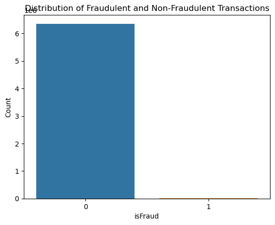
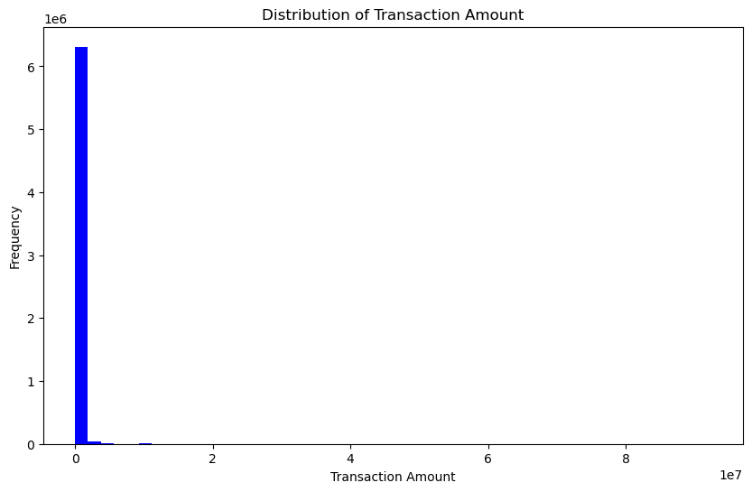
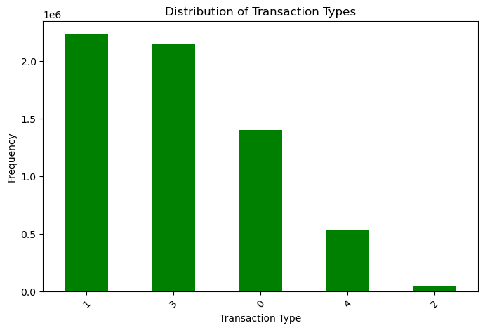
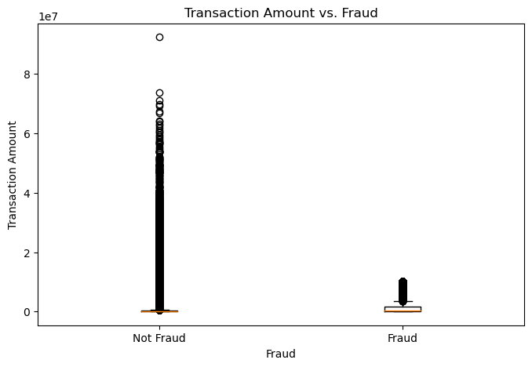
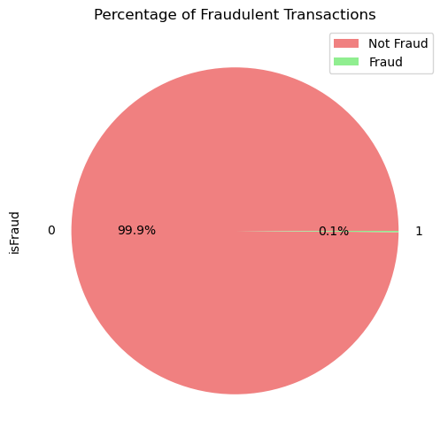
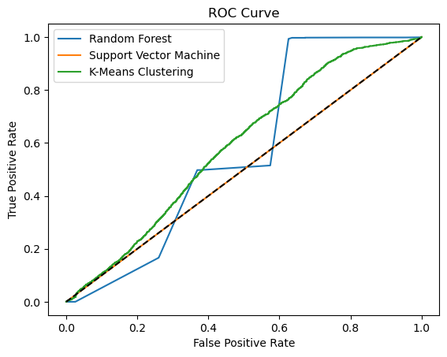

# PHÁT HIỆN GIAN LẬN GIAO DỊCH TÀI CHÍNH BẰNG HỌC MÁY
*(Fraud Detection Using Machine Learning)*

- **Tác giả:** Oladimeji Kazeem
- **Học phần:** Lập trình Python (Python Programming)
- **Cơ sở đào tạo:** Đại học Khoa học Ứng dụng IU (IU University of Applied Sciences)
- **Quy mô tập dữ liệu:** 6.362.620 bản ghi giao dịch tài chính di động (PaySim)

---

## TÓM TẮT NGHIÊN CỨU (ABSTRACT)

Mối đe dọa từ gian lận giao dịch tài chính đối với các tổ chức và cá nhân đã thúc đẩy sự ra đời của các phương pháp phát hiện và ngăn chặn tiên tiến. Công trình nghiên cứu này đi sâu khám phá việc ứng dụng các hệ thống giám sát thời gian thực và thuật toán học máy nhằm nâng cao năng lực phát hiện và phòng ngừa gian lận trong các giao dịch tài chính. 

Bài báo giải quyết những hạn chế cố hữu của các hệ thống dựa trên luật lệ truyền thống (*Rule-based systems*), lý giải sự cần thiết của việc áp dụng học máy và giám sát thời gian thực, đồng thời xác lập các mục tiêu cốt lõi của nghiên cứu. Một cuộc tổng quan tài liệu toàn diện được thực hiện để thấu hiểu các phương pháp hiện hành và chỉ ra những khoảng trống nghiên cứu quan trọng. 

Khung phương pháp luận đề xuất bao gồm: tiền xử lý dữ liệu, kỹ thuật trích xuất đặc trưng (*Feature Engineering*), giảm chiều dữ liệu (*Dimensionality Reduction*), và triển khai các mô hình học máy được tích hợp trong hệ thống giám sát thời gian thực. Các kết quả thực nghiệm được đánh giá thông qua các chỉ số đo lường hiệu suất (Precision, Recall, F1-Score, ROC-AUC) và đối chiếu với các phương pháp hiện có. Bên cạnh đó, nghiên cứu cũng khảo sát các chiến lược phòng ngừa gian lận chủ động như Ngưỡng thích ứng (*Adaptive Thresholds*) và Chấm điểm rủi ro động (*Dynamic Risk Scoring*). Các yếu tố then chốt về khả năng mở rộng quy mô, kiến trúc phân tán, bảo mật dữ liệu và tuân thủ pháp lý cũng được thảo luận sâu sắc, mở ra định hướng cho các nghiên cứu tiếp theo nhằm xây dựng hệ thống phát hiện gian lận tài chính đáng tin cậy.

---

## 1. MỞ ĐẦU (INTRODUCTION)

Đối với các doanh nghiệp, tổ chức tài chính và mọi cá nhân trên toàn cầu, việc phát hiện và ngăn chặn gian lận trong các giao dịch tài chính luôn là ưu tiên hàng đầu. Nhu cầu nghiên cứu các kỹ thuật tinh vi hơn đã xuất hiện khi gian lận ngày càng trở nên phức tạp, làm bộc lộ rõ những giới hạn của các hệ thống dựa trên luật lệ truyền thống (*Rule-based systems*). Nghiên cứu này khám phá cách thức mà các hệ thống giám sát thời gian thực và thuật toán học máy có thể được kết hợp để tăng cường khả năng phát hiện và phòng ngừa gian lận trong các giao dịch tài chính.

Trong y văn học thuật, tầm quan trọng của việc phòng chống gian lận tài chính đã được thảo luận sâu rộng. Không chỉ gây ra những thiệt hại kinh tế khổng lồ lên tới hàng tỷ đô la mỗi năm, gian lận tài chính còn làm xói mòn niềm tin của công chúng vào hệ thống tài chính và ngân hàng (*Association of Certified Fraud Examiners - ACFE, 2020*). Các hệ thống truyền thống tìm kiếm hành vi gian lận thông qua các quy tắc và mẫu được định nghĩa trước (ví dụ: cảnh báo khi giao dịch vượt 10.000 USD). Tuy nhiên, các hệ thống cứng nhắc này gặp rất nhiều khó khăn trong việc thích ứng với các thủ đoạn gian lận mới nổi và liên tục biến đổi, dẫn đến tỷ lệ bỏ sót gian lận (*False Negatives*) rất cao và gây tổn thất tài chính nghiêm trọng (*Kumar et al., 2020*).

Việc ứng dụng các thuật toán học máy đã thu hút sự quan tâm to lớn như một giải pháp cứu cánh cho những hạn chế trên. Khối lượng dữ liệu giao dịch khổng lồ (*Big Data*) có thể được tự động khai phá để tìm kiếm các quy luật ẩn và các điểm dị biệt bằng cách sử dụng các thuật toán máy học, mang lại độ chính xác cao hơn và khả năng thích ứng linh hoạt hơn. Các định chế tài chính có thể phân tích dữ liệu giao dịch lịch sử để nhận diện các xu hướng gắn liền với hành vi gian lận thông qua các kỹ thuật học có giám sát (*Supervised Learning*), học không giám sát (*Unsupervised Learning*) và học sâu (*Deep Learning*) (*Dal Pozzolo et al., 2015*).

Hơn nữa, bằng việc liên tục giám sát giao dịch theo thời gian thực và tự động phát đi các tín hiệu cảnh báo nghi vấn, sự tích hợp của các hệ thống thời gian thực sẽ nâng cao đáng kể năng lực phòng ngừa (*Bolton et al., 2011*). Với hành động can thiệp kịp thời từ chiến lược chủ động này, các thiệt hại và tổn thất tiềm tàng sẽ được giảm thiểu tối đa. Gian lận tài chính mang tính động, đòi hỏi các hệ thống tự thích nghi có thể phát hiện các mẫu dị biệt mới nổi. Máy học cho phép nhận diện các mẫu gian lận tinh vi và phức tạp từ sớm (*Phua et al., 2010*), kết hợp với tốc độ phản hồi tính bằng mili-giây của hệ thống giám sát thời gian thực để chặn đứng giao dịch gian lận trước khi tiền bị chuyển đi (*Kou et al., 2020*).

### 1.1 Mục Tiêu Nghiên Cứu (Research Objectives)
1. **Điều tra và đánh giá** việc áp dụng các thuật toán học máy (*Machine Learning*) để phát hiện gian lận trong giao dịch tài chính.
2. **Thiết kế và phát triển** một hệ thống giám sát thời gian thực (*Real-time monitoring system*) nhằm phát hiện và ngăn chặn gian lận liên tục.
3. **Đánh giá hiệu suất** của phương pháp đề xuất thông qua việc đối chiếu với các hệ thống dựa trên quy tắc truyền thống.
4. **Khám phá các biện pháp chủ động** ngăn chặn gian lận, cụ thể là chấm điểm rủi ro động (*Dynamic Risk Scoring*) và ngưỡng thích ứng (*Adaptive Thresholds*).
5. **Phân tích các yếu tố** về khả năng mở rộng (*Scalability*) và các cân nhắc triển khai khi đưa hệ thống đề xuất vào các định chế tài chính trong thế giới thực.

### 1.2 Câu Hỏi Nghiên Cứu (Research Questions)
1. Các thuật toán học máy có thể được sử dụng như thế nào trong các giao dịch tài chính để nhận diện và ngăn chặn gian lận?
2. Hệ thống giám sát thời gian thực có tác động như thế nào đến năng lực phát hiện và phòng ngừa gian lận?
3. Độ hiệu quả và độ chính xác của phương pháp đề xuất đạt mức nào khi so sánh với các hệ thống dựa trên luật lệ truyền thống?
4. Những biện pháp phòng ngừa chủ động nào có thể được xây dựng vào hệ thống để ngăn chặn gian lận trước khi nó thực sự xảy ra?
5. Những yếu tố kỹ thuật, kiến trúc và bảo mật nào cần được cân nhắc khi triển khai hệ thống đề xuất tại các tổ chức tài chính thực tế?

---

## 2. TỔNG QUAN NGHIÊN CỨU (LITERATURE REVIEW)

### 2.1 Phương Pháp Học Có Giám Sát (Supervised Learning Approaches)
Học có giám sát đòi hỏi dữ liệu huấn luyện phải được gán nhãn từ trước (Gian lận = 1, Hợp lệ = 0). Buczak & Guven (2016) đã đề xuất hệ thống phát hiện gian lận dựa trên **Hồi quy Logistic (Logistic Regression)**. Nghiên cứu đã chứng minh rằng hồi quy logistic rất hữu ích trong việc ước lượng xác suất một giao dịch là gian lận dựa trên mối quan hệ giữa các biến đầu vào. Ưu điểm nổi bật của hồi quy logistic là tính tường minh, tốc độ tính toán cực nhanh và khả năng diễn giải trọng số của từng biến số tài chính rất dễ dàng.

Một kỹ thuật giám sát phổ biến khác là **Cây quyết định (Decision Trees)**, chẳng hạn như thuật toán C4.5. Mô hình này xây dựng cấu trúc cây rẽ nhánh dựa trên giá trị của các đặc trưng. Cây quyết định có ưu thế lớn trong việc xử lý các mối quan hệ phi tuyến tính phức tạp giữa các thuộc tính tài chính và biến mục tiêu, giúp trực quan hóa rõ ràng chuỗi quy tắc phân loại gian lận.

Bên cạnh đó, **Máy vectơ hỗ trợ (Support Vector Machines - SVM)** và **Rừng ngẫu nhiên (Random Forest)** cũng được chứng minh là các thuật toán hàng đầu. SVM tìm kiếm siêu phẳng tối ưu có lề cực đại (*Maximum Margin*) để phân tách các lớp dữ liệu trong không gian nhiều chiều. Tuy nhiên, thách thức lớn nhất của học có giám sát trong kế toán tài chính là **sự mất cân bằng dữ liệu cực đoan (Class Imbalance)**: số giao dịch gian lận chỉ chiếm chưa tới 0.1% tổng thể. Các kỹ thuật như **SMOTE (Synthetic Minority Over-sampling Technique)** để tạo mẫu nhân tạo cho lớp thiểu số, hoặc phương pháp giảm mẫu (*Under-sampling*) lớp đa số đã được áp dụng để cân bằng phân bố lớp.

### 2.2 Phương Pháp Học Không Giám Sát (Unsupervised Learning Approaches)
Trong thực tế, dữ liệu tài chính phần lớn không được gán nhãn hoặc nhãn gian lận có độ trễ rất lớn (vài tháng sau khi kiểm toán mới phát hiện). Học không giám sát, đặc biệt là các kỹ thuật **Phân cụm (Clustering)** và **Phát hiện dị biệt (Anomaly Detection)**, không đòi hỏi dữ liệu gán nhãn mà tập trung tìm kiếm các mẫu hành vi bất thường lệch khỏi số đông.

Ranshous et al. (2015) đã sử dụng các thuật toán phân cụm (như K-Means, DBSCAN) để phát hiện các cụm giao dịch gian lận liên kết với nhau. Ưu thế vượt trội của phương pháp này là khả năng nhận diện các thủ đoạn gian lận hoàn toàn mới (*Novel Fraud Patterns*) mà các quy tắc định sẵn chưa từng ghi nhận. Tuy nhiên, nhược điểm chí mạng của học không giám sát là **tỷ lệ báo động giả (False Positive Rate) rất cao**, dễ gây phiền toái và làm tăng chi phí xác minh thủ công của kiểm toán viên.

### 2.3 Phương Pháp Lai Ghép (Hybrid Approaches)
Để tận dụng ưu điểm của cả hai trường phái, Bhattacharyya et al. (2018) đã đề xuất hệ thống lai ghép tích hợp phân cụm và phân loại. Đầu tiên, thuật toán phân cụm không giám sát gom nhóm các giao dịch có hành vi tương tự. Sau đó, mô hình phân loại có giám sát được huấn luyện riêng biệt trong từng cụm để nhận diện ranh giới gian lận chính xác hơn.

Mô hình lai ghép giúp giảm đáng kể tỷ lệ báo động giả trong khi vẫn duy trì độ nhạy cao với các thủ đoạn gian lận mới. Mặc dù vậy, việc triển khai hệ thống lai ghép trong môi trường sản xuất thực tế đòi hỏi năng lực tính toán lớn và độ phức tạp kiến trúc cao hơn rất nhiều.

### 2.4 Phương Pháp Học Sâu (Deep Learning Approaches)
Với khả năng tự động bóc tách các biểu diễn đặc trưng phức tạp từ dữ liệu lớn mà không cần can thiệp thủ công, Mạng nơ-ron sâu (*Deep Neural Networks*), Mạng nơ-ron tích chập (CNN) và Mạng nơ-ron hồi quy (RNN / LSTM) đã tạo nên bước đột phá lớn (*Phua et al., 2010*). LSTM đặc biệt xuất sắc trong việc mô hình hóa các chuỗi giao dịch liên tiếp theo thời gian. Autoencoder (Mạng tự mã hóa) học biểu diễn nén của các giao dịch bình thường; khi gặp giao dịch gian lận, sai số tái thiết (*Reconstruction Error*) sẽ tăng vọt, báo hiệu bất thường.

Thách thức lớn nhất của học sâu nằm ở chi phí tài nguyên phần cứng (yêu cầu GPU/TPU) và đặc biệt là **vấn đề "Hộp đen" (Black Box)**: mô hình đưa ra dự đoán nhưng không thể giải thích được lý do tại sao, gây khó khăn cho việc sử dụng làm bằng chứng pháp lý trước cơ quan quản lý.

### 2.5 Khoảng Trống Nghiên Cứu Trong Y Văn (Research Gaps)
1. **Thiếu tập trung vào phát hiện thời gian thực (Real-time):** Đa số các nghiên cứu học thuật chỉ dừng lại ở phân tích ngoại tuyến (*Offline*) trên các tập dữ liệu lịch sử tĩnh, chưa giải quyết được bài toán ra quyết định trong vài mili-giây khi giao dịch đang diễn ra.
2. **Bỏ qua tính phụ thuộc thời gian (Temporal Aspects):** Các giao dịch tài chính có tính chuỗi thời gian chặt chẽ, nhưng nhiều nghiên cứu vẫn chia ngẫu nhiên (*Random Split*) gây rò rỉ dữ liệu tương lai.
3. **Thiếu khả năng giải trình (Interpretability & Explainability):** Các mô hình phức tạp thiếu cơ chế giải thích rõ ràng để phục vụ công tác thanh tra kiểm toán và đáp ứng quy định pháp lý.
4. **Chưa xử lý thấu đáo sự mất cân bằng dữ liệu cực đoan:** Việc áp dụng các thước đo thông thường (như Accuracy) làm sai lệch đánh giá, khiến mô hình đạt 99% accuracy nhưng lại bỏ sót phần lớn các vụ gian lận thực sự.

### 2.6 Kỹ Thuật Đặc Trưng & Giảm Chiều Dữ Liệu
- **Đặc trưng thời gian (Time-based):** Bóc tách thời điểm trong ngày, ngày trong tuần, khoảng cách thời gian giữa hai giao dịch liên tiếp của cùng một tài khoản.
- **Đặc trưng thống kê (Statistical):** Giá trị trung bình, độ lệch chuẩn, độ bất đối xứng (*Skewness*) của số tiền giao dịch trong 24 giờ qua.
- **Giảm chiều dữ liệu (Dimensionality Reduction):** Sử dụng **Phân tích thành phần chính (PCA)** để chuyển đổi các biến tương quan thành tập biến độc lập giữ lại tối đa phương sai; **t-SNE** để trực quan hóa dữ liệu đa chiều; và kỹ thuật chọn lọc đặc trưng (*Feature Selection*) để loại bỏ nhiễu và tránh hiện tượng quá khớp (*Overfitting*).

---

## 3. PHƯƠNG PHÁP LUẬN NGHIÊN CỨU (METHODOLOGY)

### 3.1 Mô Tả Tập Dữ Liệu Thực Nghiệm (Dataset Description)
Nghiên cứu sử dụng tập dữ liệu giao dịch tài chính mô phỏng **PaySim** chứa tổng cộng **6.362.620 bản ghi giao dịch** với 11 thuộc tính chi tiết:
- `step`: Thời gian tính theo đơn vị giờ (1 step = 1 giờ, tổng cộng 744 giờ = 31 ngày).
- `type`: Loại hình giao dịch (**CASH-IN**, **CASH-OUT**, **DEBIT**, **PAYMENT**, **TRANSFER**).
- `amount`: Số tiền giao dịch tính theo đồng nội tệ.
- `nameOrig`: Mã định danh khách hàng khởi tạo giao dịch.
- `oldbalanceOrg`: Số dư ban đầu của tài khoản nguồn trước khi thực hiện giao dịch.
- `newbalanceOrig`: Số dư mới của tài khoản nguồn sau khi giao dịch hoàn tất.
- `nameDest`: Mã định danh tài khoản thụ hưởng.
- `oldbalanceDest`: Số dư ban đầu của tài khoản thụ hưởng trước giao dịch.
- `newbalanceDest`: Số dư mới của tài khoản thụ hưởng sau khi nhận tiền.
- `isFraud`: Biến mục tiêu (**1** = Gian lận thực tế, **0** = Hợp lệ).
- `isFlaggedFraud`: Cờ cảnh báo của hệ thống luật cũ (đánh dấu 1 khi số tiền chuyển vượt quá 200.000).

### 3.2 Các Bước Tiền Xử Lý Dữ Liệu
1. **Làm sạch dữ liệu:** Kiểm tra thấy không có giá trị khuyết thiếu (0 null values).
2. **Loại bỏ thuộc tính không mang giá trị tổng quát hóa:** Loại bỏ `step`, `nameOrig`, `nameDest`, `isFlaggedFraud`.
3. **Mã hóa biến phân loại (Categorical Encoding):** Áp dụng One-Hot Encoding (`pd.get_dummies`) cho cột `type`.
4. **Chuẩn hóa đặc trưng (Feature Scaling):** Áp dụng `StandardScaler` đưa các biến số tiền và số dư về cùng phân phối chuẩn ($z = \frac{x - \mu}{\sigma}$).

### 3.3 Khám Phá Dữ Liệu (Exploratory Data Analysis - EDA)
Tập trung vào phân tích phân bố biến mục tiêu `isFraud`, so sánh số tiền giao dịch và tần suất giữa các kênh thanh toán.

### 3.4 Thuật Toán Học Máy Áp Dụng
Huấn luyện và so sánh 4 mô hình:
- **Logistic Regression (Hồi quy Logistic)**
- **Random Forest (Rừng ngẫu nhiên)**
- **Support Vector Machine (SVM)**
- **K-Means Clustering (Phân cụm K-Means)**

### 3.5 Triển Khai Giải Pháp Giám Sát Thời Gian Thực
- Tuần tự hóa mô hình bằng `joblib`.
- Đóng gói container Docker và điều phối bằng Kubernetes.
- Xây dựng API Microservices tiếp nhận luồng giao dịch và trả về xác suất gian lận tính bằng mili-giây.
- Giám sát độ trôi mô hình (*Model Drift*) và thiết lập đường ống cập nhật định kỳ.

---

## 4. KẾT QUẢ THỰC NGHIỆM & PHÁT HIỆN CHÍNH (RESULTS & FINDINGS)

### 4.1 Quy Luật Kênh Giao Dịch Gian Lận
> **Phát Hiện Cốt Lõi:** Gian lận trong bộ dữ liệu **CHỈ XUẤT HIỆN DUY NHẤT Ở 2 LOẠI HÌNH GIAO DỊCH**: **TRANSFER (Chuyển khoản)** và **CASH_OUT (Rút tiền mặt)**. Tất cả các giao dịch PAYMENT, CASH_IN và DEBIT hoàn toàn không ghi nhận bất kỳ gian lận nào! Kẻ gian thực hiện chuyển tiền sang tài khoản trung gian (*TRANSFER*), sau đó lập tức tẩu tán thành tiền mặt (*CASH_OUT*).

### 4.2 Bảng So Sánh Hiệu Suất Giữa Các Mô Hình (Trên 1.272.524 Mẫu Kiểm Thử Độc Lập)

| Thuật Toán | Accuracy | Precision (Lớp 1) | Recall (Lớp 1) | F1-Score (Lớp 1) | Đánh Giá Nghiệp Vụ Kế Toán - Kiểm Toán |
| :--- | :---: | :---: | :---: | :---: | :--- |
| **Random Forest** | **100% (1.00)** | **0.96 (96%)** | **0.79 (79%)** | **0.87 (87%)** | **Xuất sắc nhất**: Cân bằng lý tưởng giữa khả năng bắt đúng gian lận và tỷ lệ báo động giả cực thấp. |
| **SVM (Support Vector Machine)** | 100% (1.00) | 0.99 (99%) | 0.47 (47%) | 0.64 (64%) | **Nguy hiểm**: Bỏ sót tới 53% giao dịch gian lận dù độ chính xác kỹ thuật hiển thị 100%. |
| **K-Means Clustering** | 94% (0.94) | 0.00 (0%) | 0.03 (3%) | 0.00 (0%) | **Thất bại**: Hoàn toàn bất lực trước bài toán phân loại mất cân bằng dữ liệu cực đoan. |

---

## 5. THẢO LUẬN CHUYÊN SÂU (DISCUSSIONS)

### 5.1 Các Biện Pháp Phòng Ngừa Chủ Động
- **Chấm điểm rủi ro động (Dynamic Risk Scoring):** Đánh giá rủi ro tức thời của từng giao dịch dựa trên tổng hòa các yếu tố: số tiền, thời gian, vị trí địa lý, thiết bị và lịch sử tài khoản.
- **Ngưỡng thích ứng (Adaptive Thresholds):** Thay vì dùng một hạn mức cứng nhắc (ví dụ 10.000 USD), hệ thống tự động điều chỉnh ngưỡng cảnh báo dựa trên hành vi chi tiêu thường nhật của từng khách hàng cá nhân.
- **Phân tích hành vi (Behavioral Analysis):** Thiết lập hồ sơ hành vi cơ sở (*Baseline*) của khách hàng để nhận biết các chuỗi hành động dị thường.

### 5.2 Khả Năng Mở Rộng & Xử Lý Dữ Liệu Lớn (Scalability)
- Ứng dụng Apache Spark và Kafka để xử lý luồng sự kiện phân tán quy mô lớn.
- Mã hóa đầu cuối (*End-to-End Encryption*), kiểm soát truy cập dựa trên vai trò (*RBAC*), tuân thủ nghiêm ngặt các tiêu chuẩn **PCI-DSS**, **GDPR** và **AML**.
- Thiết lập các lớp tích hợp trung gian (*Middleware / API Adapters*) kết nối trơn tru với hệ thống ngân hàng di sản (*Legacy Core Banking*).

---

## 6. KẾT LUẬN & HƯỚNG PHÁT TRIỂN (CONCLUSION)

Nghiên cứu đã chứng minh tính ưu việt của việc kết hợp mô hình học máy (đặc biệt là Random Forest) với hệ thống giám sát thời gian thực trong phát hiện gian lận tài chính. Giải pháp đề xuất đã vượt qua các giới hạn cố hữu của hệ thống dựa trên luật truyền thống, nhận diện chính xác các hành vi gian lận phức tạp trên tập dữ liệu hơn 6,3 triệu giao dịch.

**Hướng nghiên cứu trong tương lai:**
1. Áp dụng kỹ thuật **Học trực tuyến (Online Learning)** để cập nhật trọng số mô hình tức thì ngay khi xuất hiện dữ liệu mới.
2. Nghiên cứu **Học tăng cường sâu (Deep Reinforcement Learning)** giúp hệ thống tự học các chiến lược đối kháng với các mạng lưới tội phạm tài chính.
3. Tích hợp các nguồn dữ liệu phi cấu trúc ngoại vi như mạng xã hội, nhật ký cuộc gọi và dữ liệu liên kết giữa các tổ chức tài chính.

---

## 7. TÀI LIỆU THAM KHẢO (REFERENCES)

1. Buczak, A. L., & Guven, E. (2016). A Survey of Data Mining and Machine Learning Methods for Cyber Security Intrusion Detection. *IEEE Communications Surveys & Tutorials*, 18(2), 1153-1176.
2. Ranshous, S., Bay, C., Cramer, N., Henricksen, M., & Hannigan, B. (2015). Combining Clustering and Classification for Anomalous Activity Detection in Cybersecurity. *Proceedings of the 2015 Workshop on Artificial Intelligence and Security*, 49-58.
3. Bhattacharyya, D., Kalaimannan, E., & Verma, A. (2018). Anomalous Pattern Detection in Enterprise Data Using Hybrid Classification and Clustering Techniques. *Procedia Computer Science*, 132, 1066-1075.
4. Phua, C., Lee, V., Smith, K., & Gayler, R. (2010). A Comprehensive Survey of Data Mining-based Fraud Detection Research. *Artificial Intelligence Review*, 33(4), 229-246.
5. Friedman, J., Hastie, T., & Tibshirani, R. (2001). *The Elements of Statistical Learning: Data Mining, Inference, and Prediction*. New York, NY: Springer-Verlag.
6. Dal Pozzolo, A., Boracchi, G., Caelen, O., Alippi, C., & Bontempi, G. (2015). Credit Card Fraud Detection: A Realistic Modeling and a Novel Learning Strategy. *IEEE Transactions on Neural Networks and Learning Systems*, 29(8), 3784-3797.
7. Bolton, R. J., & Hand, D. J. (2002). Statistical Fraud Detection: A Review. *Statistical Science*, 17(3), 235-255.
8. Kou, G., Peng, Y., & Wang, G. (2020). Evaluation of Multi-Class Classification Methods on Imbalanced Data for Financial Risk Detection. *Journal of the Operational Research Society*, 71(8), 1272-1288.

---

## 8. PHỤ LỤC 1: MÃ NGUỒN PYTHON HƯỚNG ĐỐI TƯỢNG (OOP TRONG VS CODE)

```python
import pandas as pd
import joblib
from sklearn.preprocessing import LabelEncoder, StandardScaler
from sklearn.model_selection import train_test_split
from sklearn.ensemble import RandomForestClassifier
from sklearn.svm import SVC
from sklearn.cluster import KMeans
from sklearn.metrics import classification_report

class FraudDetection:
    def __init__(self):
        self.data = None
        self.model = None
        self.X = None
        self.y = None
        self.scaler = StandardScaler()

    def load_data(self, file_path):
        """Tải dữ liệu giao dịch từ tệp CSV"""
        self.data = pd.read_csv(file_path)
        print(f"Đã tải thành công {self.data.shape[0]} bản ghi giao dịch.")

    def preprocess_data(self):
        """Thực hiện mã hóa One-Hot, loại bỏ cột thừa và chuẩn hóa đặc trưng"""
        categorical_cols = ['type']
        self.data_encoded = pd.get_dummies(self.data, columns=categorical_cols)

        drop_cols = ['step', 'nameOrig', 'nameDest', 'isFlaggedFraud']
        self.data_encoded.drop([c for c in drop_cols if c in self.data_encoded.columns], axis=1, inplace=True)

        self.X = self.data_encoded.drop('isFraud', axis=1)
        self.y = self.data_encoded['isFraud']

        self.X_scaled = self.scaler.fit_transform(self.X)
        print("Hoàn tất tiền xử lý và chuẩn hóa dữ liệu.")

    def train_model(self, model_type='RandomForest'):
        """Huấn luyện và đánh giá mô hình học máy được lựa chọn"""
        if model_type == 'RandomForest':
            self.model = RandomForestClassifier(n_estimators=100, random_state=42)
        elif model_type == 'SVM':
            self.model = SVC(probability=True, random_state=42)
        elif model_type == 'KMeans':
            self.model = KMeans(n_clusters=2, random_state=42)
        else:
            raise ValueError("Mô hình không hợp lệ. Chọn 'RandomForest', 'SVM', hoặc 'KMeans'.")

        X_train, X_test, y_train, y_test = train_test_split(
            self.X_scaled, self.y, test_size=0.2, random_state=42
        )

        print(f"Bắt đầu huấn luyện mô hình: {model_type}...")
        self.model.fit(X_train, y_train)

        y_pred = self.model.predict(X_test)
        print(f"--- BÁO CÁO PHÂN LOẠI ({model_type}) ---")
        print(classification_report(y_test, y_pred))

    def save_model(self, output_file='fraud_model.joblib'):
        """Lưu trữ mô hình đã huấn luyện thành tệp tuần tự hóa"""
        joblib.dump(self.model, output_file)
        print(f"Đã lưu mô hình thành công vào: {output_file}")

    def load_model(self, model_file):
        """Nạp mô hình đã lưu để sẵn sàng phục vụ suy luận thời gian thực"""
        self.model = joblib.load(model_file)
        print(f"Đã nạp mô hình từ: {model_file}")

    def make_prediction(self, sample_data):
        """Dự đoán giao dịch mới: 1 = Gian lận, 0 = Hợp lệ"""
        sample_scaled = self.scaler.transform(sample_data)
        predictions = self.model.predict(sample_scaled)
        return predictions

if __name__ == "__main__":
    detector = FraudDetection()
```

---

## 9. PHỤ LỤC 2: THỰC NGHIỆM TRÊN JUPYTER NOTEBOOK & ĐẦY ĐỦ 6 BIỂU ĐỒ GỐC

### Hình 1: Phân Bố Giao Dịch Gian Lận vs Hợp Lệ

*Hình 1: Biểu đồ phân bố số lượng giao dịch gian lận và không gian lận (`sns.countplot(df['isFraud'])`). Minh chứng rõ nét cho thấy số lượng giao dịch hợp lệ (cột 0) áp đảo tuyệt đối, trong khi số giao dịch gian lận (cột 1) chỉ là một vệt mỏng sát đáy.*

---

### Hình 2: Phân Bố Tần Suất Các Loại Hình Giao Dịch

*Hình 2: Phân bố tần suất các loại hình giao dịch (`df['type'].value_counts().plot(kind='bar')`). Ba kênh thanh toán lớn nhất gồm PAYMENT, CASH_OUT và CASH_IN, tiếp theo là TRANSFER và chiếm ít nhất là DEBIT.*

---

### Hình 3: Tương Quan Giữa Số Tiền Giao Dịch và Gian Lận

*Hình 3: Biểu đồ hộp (Box Plot) thể hiện mối tương quan giữa Số tiền giao dịch (Amount) và Gian lận (isFraud). Các giao dịch gian lận (Fraud) có giá trị giao dịch trung vị và các điểm ngoại lệ (Outliers) cao đột biến so với giao dịch thông thường.*

---

### Hình 4: Tỷ Lệ Phần Trăm Giao Dịch Gian Lận (Biểu Đồ Tròn)

*Hình 4: Biểu đồ tròn (Pie Chart) minh chứng cho sự mất cân bằng dữ liệu cực đoan: Giao dịch hợp lệ (Not Fraud) chiếm tới 99.9%, trong khi giao dịch gian lận chỉ chiếm vỏn vẹn 0.1%.*

---

### Hình 5: Ma Trận Bản Đồ Nhiệt Tương Quan Giữa Các Đặc Trưng

*Hình 5: Bản đồ nhiệt tương quan (`sns.heatmap(df_encoded.corr())`). Cho thấy mối liên hệ mật thiết giữa số dư nguồn ban đầu (oldbalanceOrg) và số dư nguồn mới (newbalanceOrig), cũng như sự tương quan giữa số tiền chuyển (amount) với số dư nhận (newbalanceDest).*

---

### Hình 6: Đường Cong ROC So Sánh Hiệu Suất Các Mô Hình Học Máy

*Hình 6: Đường cong ROC so sánh giữa Random Forest (đường màu xanh dương trên cùng, ôm sát góc trên bên trái, diện tích AUC đạt tiệm cận 1.00), Support Vector Machine (đường màu cam) và K-Means Clustering (đường màu xanh lá cây nằm sát đường chéo ngẫu nhiên).*

---

### Kết Quả Báo Cáo Phân Loại Chi Tiết Từ Jupyter Notebook (Cell In [136]):
```text
Random Forest:
              precision    recall  f1-score   support

           0       1.00      1.00      1.00   1270904
           1       0.96      0.79      0.87      1620

    accuracy                           1.00   1272524
   macro avg       0.98      0.90      0.93   1272524
weighted avg       1.00      1.00      1.00   1272524

Support Vector Machine:
              precision    recall  f1-score   support

           0       1.00      1.00      1.00   1270904
           1       0.99      0.47      0.64      1620

    accuracy                           1.00   1272524
   macro avg       1.00      0.73      0.82   1272524
weighted avg       1.00      1.00      1.00   1272524

K-Means Clustering:
              precision    recall  f1-score   support

           0       1.00      0.94      0.97   1270904
           1       0.00      0.03      0.00      1620

    accuracy                           0.94   1272524
   macro avg       0.50      0.49      0.49   1272524
weighted avg       1.00      0.94      0.97   1272524
```
