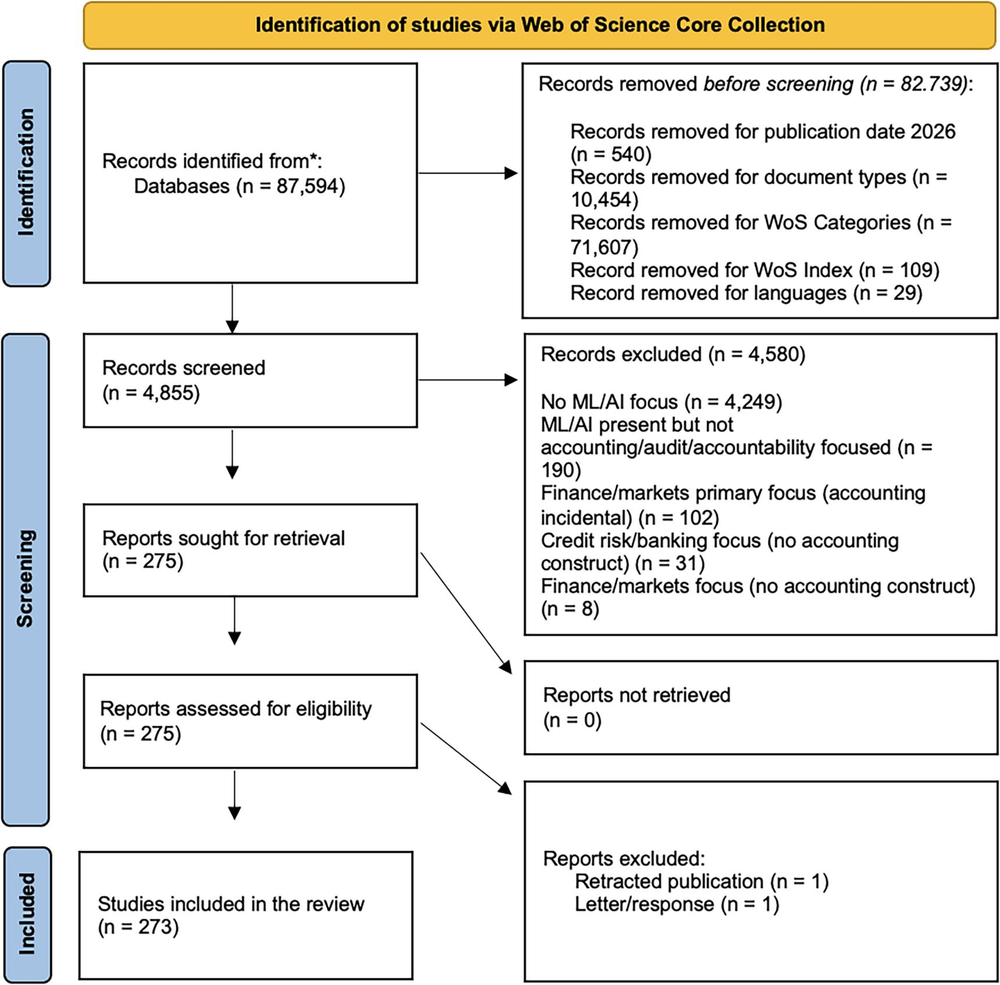
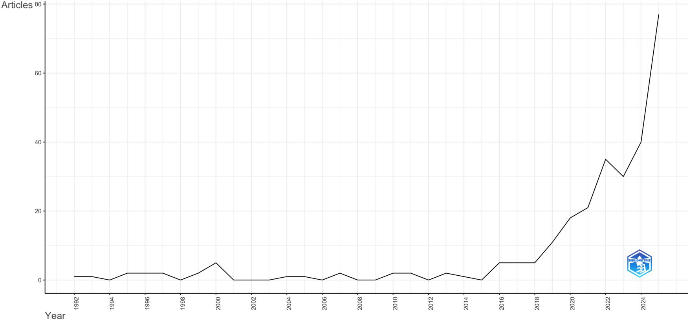
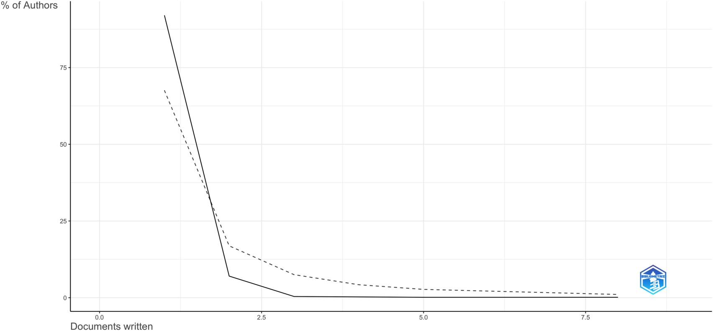
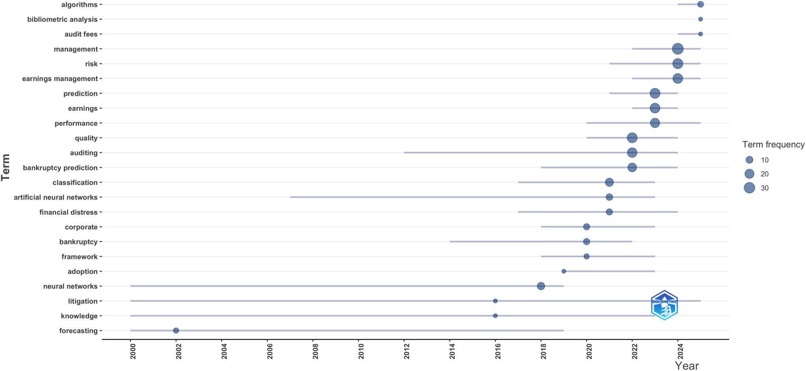
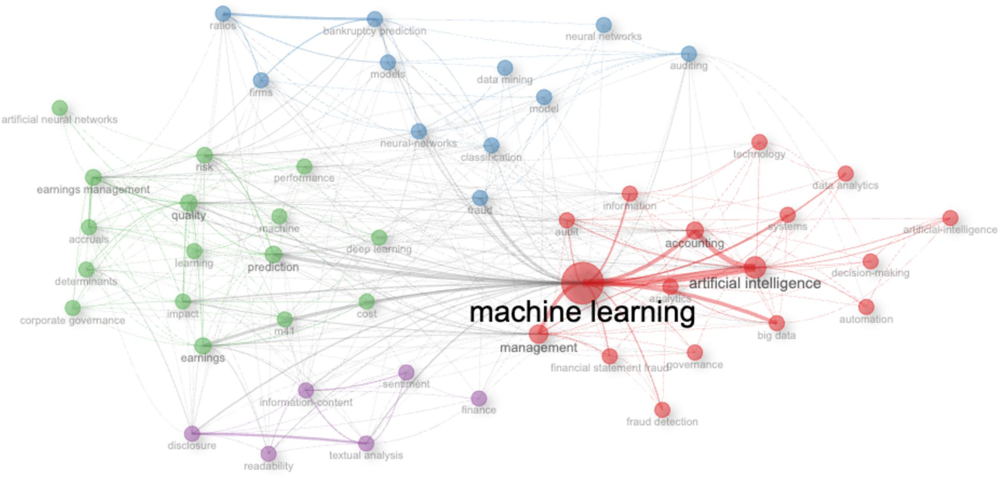
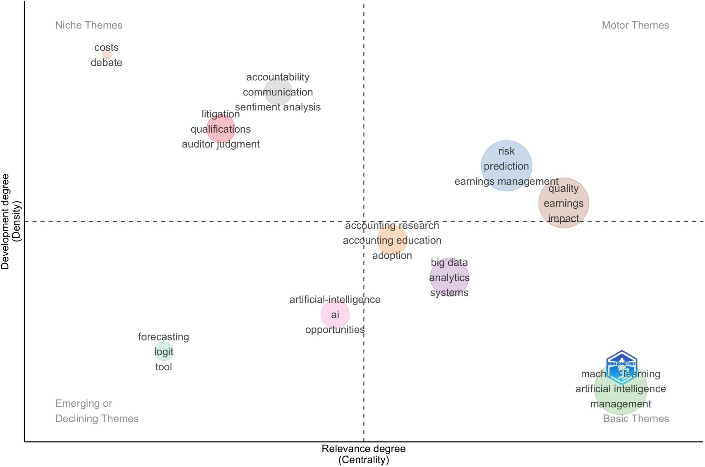
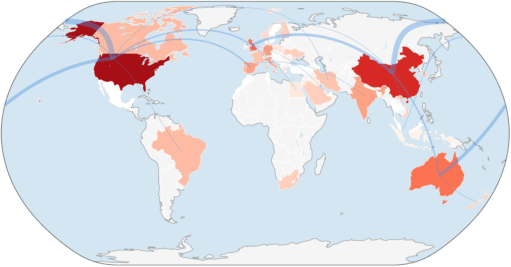

# ỨNG DỤNG HỌC MÁY TRONG KẾ TOÁN: XU HƯỚNG HIỆN TẠI VÀ TRIỂN VỌNG TƯƠNG LAI
*(Applications of Machine Learning in Accounting: Current Trends and Future Perspectives)*

- **Tác giả:** Federico Chmet (Đại học Piemonte Orientale), Davide Calandra & Silvana Secinaro (Đại học Torino), Ahmed A. Elamer (Đại học Alfaisal)
- **Tạp chí xuất bản:** *Journal of Information Systems* (JIS) — Hiệp hội Kế toán Hoa Kỳ (*American Accounting Association - AAA*), 2026
- **DOI:** [10.2308/ISYS-2025-064](https://doi.org/10.2308/ISYS-2025-064)
- **Quy mô mẫu nghiên cứu:** 273 bài báo bình duyệt Web of Science Core Collection (WoSCC) từ 1992 đến 2025 qua 125 tạp chí kế toán hàng đầu

---

## TÓM TẮT NGHIÊN CỨU (ABSTRACT)

Học máy (*Machine Learning - ML*) ngày càng được ứng dụng rộng rãi nhằm phát hiện gian lận, dự báo kiệt quệ tài chính, phân tích công bố thông tin và hỗ trợ công tác kiểm toán. Các nghiên cứu tổng quan trước đây thường lập bản đồ các ứng dụng hoặc phương pháp kỹ thuật đơn lẻ nhưng hiếm khi kết nối các bài toán nghiệp vụ kế toán với các quyết định thiết kế, kiểm chứng và quản trị mô hình ML. 

Chúng tôi đã thực hiện tổng quan hệ thống trên **273 bài báo bình duyệt** thuộc danh mục *Web of Science Core Collection* xuất bản từ năm 1992 đến năm 2025, kết hợp giữa bản đồ khoa học trắc lượng thư mục (*Bibliometric Science Mapping*) với khung tổng hợp Tiền đề - Quyết định - Kết quả (*Antecedents-Decisions-Outcomes - ADO*) được bồi đắp qua lăng kính Lý thuyết - Bối cảnh - Phương pháp (*Theory-Context-Method - TCM*).

Y văn tập trung thành các cụm xung quanh việc dự báo phá sản & kiệt quệ tài chính, chất lượng báo cáo và gian lận, được kết nối xuyên suốt thông qua phân tích dữ liệu kiểm toán và phân tích văn bản. Việc áp dụng ML được thúc đẩy chủ yếu bởi áp lực chứng thực (*Assurance Pressure*), thông tin phi cấu trúc và dữ liệu quy trình kỹ thuật số. Tuy nhiên, phần lớn các nghiên cứu hiện nay vẫn dựa dẫm quá mức vào các chỉ số thiên về độ chính xác thuần túy (*Accuracy-oriented metrics*), kiểm chứng phi thời gian (*Nontemporal validation*) và khả năng giải trình mang tính "báo cáo cho có" chứ chưa được kiểm thử trong thực tế. Chúng tôi chỉ ra cách thức các điều kiện kế toán cần phải rèn giũa quy trình đánh giá ML và đề xuất một chương trình nghị sự nghiên cứu hướng tới mô hình ML nhạy cảm với chi phí (*Cost-aware*), vững chắc theo thời gian (*Temporally robust*) và có thể quản trị, kiểm soát được trong kế toán.

**Từ khóa cốt lõi:** Machine learning; Accounting; Auditing; Bibliometric analysis; ADO-TCM framework; Cost-sensitive learning; Look-ahead bias; Explainable AI (XAI / SHAP).

---

## 1. MỞ ĐẦU (INTRODUCTION)

Học máy (ML) hiện nay đóng vai trò vô cùng quan trọng đối với ngành kế toán - kiểm toán, vừa là một công cụ thực tiễn mạnh mẽ để giải quyết các khối lượng bằng chứng khổng lồ và không đồng nhất, vừa là một đối tượng nghiên cứu học thuật sâu sắc nhằm thấu hiểu cách thức các mô hình điều khiển bằng dữ liệu tác động đến phán đoán nghề nghiệp, hoạt động chứng thực và chất lượng báo cáo tài chính. 

Trong nghiên cứu kế toán, các ứng dụng của ML đã mở rộng từ các mục đích dự báo ban đầu (như sàng lọc kiệt quệ tài chính và gian lận) sang một phổ ứng dụng phong phú hơn rất nhiều: phát hiện sai sót trọng yếu, phân tích dữ liệu kiểm toán chuyên sâu, và khai phá văn bản đối với các thuyết minh tài chính cùng các vấn đề kiểm toán quan trọng (*Key Audit Matters - KAMs*).

### Hai Giới Hạn Cốt Lõi Của Các Nghiên Cứu Tổng Quan Trước Đây:
1. **Chỉ mô tả nơi ứng dụng ML mà không đánh giá sự tương thích phương pháp:** Các bài tổng quan trước đây thường chỉ liệt kê các chủ đề hoặc phân loại theo thuật toán, nhưng bỏ ngỏ câu hỏi sống còn: *Liệu thiết kế mô hình và phương pháp kiểm chứng có tương thích với bản chất nghiệp vụ kế toán hay không?*
2. **Lý thuyết chỉ dùng để giới thiệu bối cảnh chứ chưa định hình thiết kế kỹ thuật:** Các lý thuyết kế toán thường chỉ được trích dẫn để mở đầu, chứ chưa bao giờ được dùng để điều chỉnh hàm mất mát nhạy cảm chi phí (*Cost-sensitive loss function*), cửa sổ thời gian kiểm chứng (*Validation windows*), hay ngưỡng cắt phán đoán kiểm toán.

### Hai Câu Hỏi Nghiên Cứu (Research Questions):
- **RQ1:** Cấu trúc tri thức, các lĩnh vực ứng dụng và các mẫu hình Lý thuyết - Bối cảnh - Phương pháp (TCM) nào đang định hình nghiên cứu học máy trong kế toán?
- **RQ2:** Các tiền đề kế toán định hình quyết định thiết kế và kiểm chứng ML như thế nào, và những quyết định này tạo ra các kết quả công bố cùng các khoảng trống nghiên cứu ra sao?

---

## 2. PHƯƠNG PHÁP LUẬN & QUY TRÌNH TUYỂN CHỌN PRISMA 2020

Nghiên cứu áp dụng quy trình tổng quan y văn có cấu trúc (*Structured Literature Review - SLR*) kết hợp chuẩn quốc tế **PRISMA 2020** trên cơ sở dữ liệu *Web of Science Core Collection (WoSCC)* (bao gồm cả SSCI và ESCI trong các lĩnh vực Business, Finance, Management).

### Hình 1: Quy Trình Lọc Tổng Quan Tuyển Chọn Nghiên Cứu (PRISMA 2020)

*Hình 1: Quy trình lọc tổng quan và tuyển chọn nghiên cứu (Review Workflow and Study Selection Process) từ 1.482 bản ghi ban đầu đến mẫu chính thức 273 bài báo bình duyệt đỉnh cao (1992–2025).*

| Chỉ Tiêu Dữ Liệu Thống Kê | Giá Trị Ghi Nhận | Ý Nghĩa Học Thuật |
| :--- | :--- | :--- |
| **Khung thời gian nghiên cứu** | **1992 – 2025** | 34 năm phát triển từ mạng nơ-ron sơ khai đến XAI và LLM hiện đại |
| **Tổng số bài báo bình duyệt** | **273 bài báo** | Bộ ngữ liệu chuẩn mực, chất lượng cao nhất |
| **Số lượng tạp chí xuất bản** | **125 tạp chí** | Hội tụ ở các tạp chí AIS hàng đầu (IJAIS, JIS, TAR, AH, CAR) |
| **Tốc độ tăng trưởng sản lượng** | **11.45% / năm** | Tăng trưởng theo hàm mũ sau năm 2018 |
| **Số lượng tác giả đóng góp** | **753 tác giả** | Trung bình 3.04 đồng tác giả/bài, 26.37% hợp tác quốc tế |
| **Số trích dẫn trung bình/bài** | **21.16 lần** | Tác động học thuật rất mạnh mẽ |

---

## 3. KẾT QUẢ BẢN ĐỒ TRẮC LƯỢNG THƯ MỤC (BIBLIOMETRICS)

### Hình 2: Sản Lượng Khoa Học Hàng Năm (1992 – 2025)

*Hình 2: Sản lượng bài báo khoa học hàng năm (Annual Scientific Production). Từ dưới 5 bài/năm trước năm 2015 lên tới hơn 40 bài/năm trong giai đoạn 2023 - 2025.*

### Hình 3: Năng Suất Tác Giả Theo Định Luật Lotka

*Hình 3: Phân bố năng suất tác giả theo Định luật Lotka (Author Productivity through Lotka's Law). Nhóm tác giả tiên phong nòng cốt dẫn đầu là GS. Miklos A. Vasarhelyi (Rutgers).*

### Hình 4: Tiến Hóa Các Chủ Đề Nghiên Cứu Nổi Bật (Trend Topics)

*Hình 4: Tiến hóa các chủ đề nghiên cứu nổi bật (Trend Topics). Sự lên ngôi của Textual Analysis, Audit Analytics, Deep Learning, Process Mining và Explainable AI.*

### Hình 5: Mạng Lưới Đồng Xuất Hiện Từ Khóa (Co-Occurrence Network)

*Hình 5: Mạng lưới đồng xuất hiện từ khóa (Co-Occurrence Network). Machine Learning đóng vai trò trung tâm (Hub), kết nối trực tiếp AI, Bankruptcy prediction, Fraud detection, Audit quality và Deep learning.*

### Hình 6: Bản Đồ Chủ Đề 4 Góc Phần Tư (Thematic Map)

*Hình 6: Bản đồ chủ đề (Thematic Map). Motor Themes: Đánh giá rủi ro dự báo và Báo cáo tài chính; Basic Themes: AI/ML, Big Data, Hệ thống phân tích.*

### Hình 7: Bản Đồ Hợp Tác Khoa Học Quốc Tế

*Hình 7: Bản đồ hợp tác nghiên cứu giữa các quốc gia (Countries' Collaboration World Map). Trục hợp tác chính giữa Hoa Kỳ - Trung Quốc - Vương quốc Anh - Canada - Tây Âu.*

---

## 4. TỔNG HỢP ADO-TCM: BÓC TRẦN 3 SAI LẦM PHƯƠNG PHÁP LUẬN CHÍ MẠNG

### 🚨 Sai Lầm 1: Bỏ Quên Chi Phí Sai Số Bất Đối Xứng (Asymmetric Error Costs)
- Trong kỹ thuật ML thuần túy, tác giả thường chỉ báo cáo **Accuracy** hoặc **AUC**, ngầm coi chi phí của False Positive ($C_{FP}$) và False Negative ($C_{FN}$) là ngang nhau.
- **Thực tế kiểm toán:** Báo động nhầm ($C_{FP}$) chỉ tốn vài phút kiểm tra lại, nhưng bỏ sót gian lận/phá sản ($C_{FN}$) gây thiệt hại hàng triệu USD, sụp đổ hãng kiểm toán và kiện tụng hình sự. Bắt buộc phải áp dụng **Cost-Sensitive Learning**.

### 🚨 Sai Lầm 2: Xác Thực Phi Thời Gian & Rủi Ro Nhìn Trước (Look-Ahead Bias)
- Việc dùng $K$-fold cross-validation hoặc chia mẫu ngẫu nhiên 80/20 đã vô tình dùng dữ liệu tương lai để dự đoán quá khứ, gây ra hiện tượng **Rò rỉ dữ liệu (Look-ahead bias)**.
- **Thực tế kiểm toán:** Dữ liệu kế toán mang tính thời gian chặt chẽ. Phải dùng phương pháp **Cửa sổ cuốn theo thời gian (Rolling/Expanding window temporal validation)**: chỉ dùng thông tin đến thời điểm $t-1$ để dự báo thời điểm $t$.

### 🚨 Sai Lầm 3: Khả Năng Giải Trình "Báo Cáo Cho Có" (Reported rather than Tested Explainability)
- Nhiều bài báo chỉ vẽ biểu đồ SHAP hoặc Feature Importance rồi tuyên bố mô hình đã giải trình được (XAI).
- **Thực tế kiểm toán:** Biểu đồ SHAP vô nghĩa nếu kiểm toán viên không thể hiểu và không thể dùng làm bằng chứng pháp lý trước cơ quan quản lý (PCAOB, SEC, Bộ Tài chính). Tính giải trình phải được **kiểm nghiệm thực tế trong môi trường có kiểm toán viên thao tác (Human-in-the-loop experiment)**.

---

## 5. BẢNG CHƯƠNG TRÌNH NGHỊ SỰ NGHIÊN CỨU TƯƠNG LAI (TABLE 7)

| Lĩnh Vực Trọng Tâm | Định Hướng Nghiên Cứu Cụ Thể | Khung Lý Thuyết Tiềm Năng | Chiến Lược Thực Nghiệm & Dữ Liệu |
| :--- | :--- | :--- | :--- |
| **1. Đánh giá nhạy cảm chi phí** | Tích hợp chi phí bất đối xứng $C_{FP}$ và $C_{FN}$ vào hàm mục tiêu; đo lường tổn thất kinh tế thực tế. | Lý thuyết đại diện (Agency theory), Lý thuyết quyết định thống kê. | Mô phỏng ma trận chi phí; dữ liệu SEC AAERs có trọng số thiệt hại. |
| **2. Kiểm chứng theo thời gian** | Kiểm chứng cửa sổ cuốn; nghiên cứu hiện tượng dịch chuyển khái niệm (*Concept drift*) qua các cuộc khủng hoảng kinh tế. | Lý thuyết thể chế (Institutional theory), Chu kỳ kinh doanh. | Chuỗi thời gian dài hạn Compustat/CRSP (1990–2025); stress-testing. |
| **3. Hợp tác Người - Máy** | Đo lường phản ứng của kiểm toán viên; khắc phục thiên lệch tự động hóa (*Automation bias*) hoặc ác cảm thuật toán (*Algorithm aversion*). | Lý thuyết tải nhận thức (*Cognitive load*), Lý thuyết hành vi ra quyết định. | Thí nghiệm trong phòng lab (*Lab experiments*) với kiểm toán viên thực thụ. |
| **4. Kiểm toán & Quản trị AI** | Xây dựng quy trình kiểm toán thuật toán AI; lưu vết siêu dữ liệu, tính thẩm tra và bảo mật theo chuẩn mực COSO/COBIT. | Lý thuyết trách nhiệm giải trình (*Accountability*), Đạo đức AI. | Nghiên cứu trường hợp điển hình tại Big 4; khung kiểm soát nội bộ cho AI. |

---

## 6. KẾT LUẬN & HÀM Ý THỰC TIỄN

Kỷ nguyên áp dụng học máy ngây thơ (*Naive ML adoption*) vào kế toán đã chính thức kết thúc. Để xây dựng hệ thống AI kế toán - kiểm toán có giá trị thực tiễn, nghiên cứu bắt buộc phải tích hợp sâu sắc:
1. **Bản chất nghiệp vụ kế toán:** Rủi ro sai sót trọng yếu và trách nhiệm pháp lý.
2. **Phương pháp luận khoa học dữ liệu chuẩn mực:** Học nhạy cảm chi phí và kiểm chứng theo thời gian nghiêm ngặt.
3. **Mô hình hợp tác Người - Máy:** Đặt kiểm toán viên vào vị trí trung tâm của quy trình ra quyết định.
