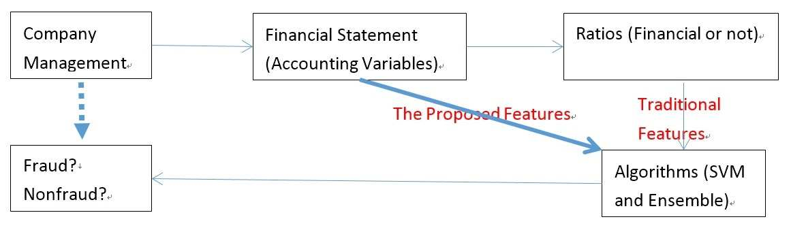

# PHÁT HIỆN GIAN LẬN KẾ TOÁN TẠI CÁC CÔNG TY ĐẠI CHÚNG HOA KỲ BẰNG TIẾP CẬN HỌC MÁY & DỮ LIỆU BCTC THÔ
*(Detecting Accounting Frauds in Publicly Traded U.S. Firms: A Machine Learning Approach)*

- **Tác giả:** Bin Li (ĐH Vũ Hán), Julia Yu (Nanyang Business School, NTU), Jie Zhang (NTU), Bin Ke (ĐH Quốc gia Singapore - NUS)
- **Tạp chí & Hội nghị:** ACML / JMLR Workshop and Conference Proceedings (Mở rộng tại Journal of Accounting Research - JAR)
- **Định danh học thuật:** JMLR W&CP 45:173-188 / SSRN 2849013
- **Cơ sở dữ liệu thực nghiệm:** Toàn bộ hồ sơ vi phạm AAERs từ Ủy ban Chứng khoán Hoa Kỳ (SEC) giai đoạn 1982–2010 (90.172 năm-công ty)

---

## TÓM TẮT NGHIÊN CỨU (ABSTRACT)

Nghiên cứu này khảo sát cách thức các kỹ thuật học máy (*Machine Learning*) có thể hỗ trợ hiệu quả việc phát hiện gian lận kế toán tại các công ty đại chúng giao dịch trên thị trường chứng khoán Hoa Kỳ. Các công trình nghiên cứu trước đây thường bắt chước chuyên gia con người thông qua việc sử dụng các tỷ số tài chính (*financial ratios*) hoặc tỷ số phi tài chính làm biến đặc trưng cho mô hình. Chúng tôi tạo ra bước đột phá khác biệt hoàn toàn bằng cách **sử dụng trực tiếp các biến số kế toán thô (*raw accounting variables*)**, vốn có sẵn ngay trên báo cáo tài chính của doanh nghiệp, từ đó cho phép áp dụng nhanh chóng cho các công ty mới với chi phí rất thấp.

Bên cạnh đó, chúng tôi thu thập bộ dữ liệu gian lận kế toán toàn diện nhất về các công ty niêm yết Hoa Kỳ và gán nhãn từng năm-công ty (*firm-years*). Một đặc tính cốt lõi của bài toán này là **dữ liệu mất cân bằng cực đoan (*extremely imbalanced data*)**, trong đó số năm-công ty có hành vi gian lận chiếm tỷ lệ chưa tới 1% (chính xác là 0,7%). Thay vì sử dụng kỹ thuật lấy lại mẫu (*re-sampling*) làm sai lệch phân phối thực tế, chúng tôi giải quyết vấn đề bằng các kỹ thuật học máy thích nghi với dữ liệu mất cân bằng:
1. Mô hình Máy véctơ hỗ trợ có trọng số phạt lệch (*Biased-Penalty Support Vector Machine - BP-SVM*) tuyến tính và phi tuyến tính (Polynomial, RBF).
2. Các phương pháp học kết hợp (*Ensemble Methods*) tiên tiến như **EasyEnsemble** và **BalancedCascade**.

Kết quả thực nghiệm trên diện rộng chứng minh rằng phương pháp đề xuất đạt độ chính xác cân bằng (*Balanced Accuracy - BAC*) lên tới **77,53%**, vượt trội hoàn toàn so với các mô hình kinh điển như Logistic Regression (BAC chỉ đạt 60,00%) hay SVM-FK (BAC 69,74%). Hơn thế nữa, thuật toán có tốc độ tính toán cực nhanh, sẵn sàng triển khai trên quy mô lớn tại các cơ quan quản lý và các hãng kiểm toán.

**Từ khóa:** Phát hiện gian lận kế toán; Học máy; Biến số kế toán thô; Dữ liệu mất cân bằng; Biased-Penalty SVM; Phương pháp kết hợp (Ensemble Methods); AAERs; SEC.

---

## 1. GIỚI THIỆU & ĐỘNG LỰC NGHIÊN CỨU (INTRODUCTION)

Học máy đã và đang được ứng dụng mạnh mẽ trong lĩnh vực tài chính tính toán (*computational finance*). Trong đó, một trong những bài toán thách thức và có giá trị kinh tế lớn nhất là **phát hiện gian lận kế toán (*accounting fraud*)** tại các công ty niêm yết. Gian lận kế toán do những người nội bộ (các nhà quản lý cấp cao và cổ đông kiểm soát) thực hiện là vấn đề nhức nhối mang tính toàn cầu.

Nếu không được phát hiện và ngăn chặn kịp thời, gian lận sẽ gây ra những thảm họa kinh tế khổng lồ cho các bên liên quan trực tiếp (như các vụ bê bối lịch sử Enron, WorldCom). Gian lận cũng tác động tiêu cực gián tiếp tới các doanh nghiệp làm ăn liêm chính, vì các doanh nghiệp trung thực buộc phải cạnh tranh bất bình đẳng với các công ty gian dối để thu hút nguồn vốn khan hiếm của nhà đầu tư. Hơn thế nữa, do sự bất cân xứng thông tin (*information asymmetry*) giữa người nội bộ và thị trường, gian lận làm xói mòn nghiêm trọng niềm tin của công chúng vào hệ thống tài chính.

### Điểm Nghẽn Của Các Phương Pháp Truyền Thống:
Trong lịch sử nghiên cứu kế toán, giới học thuật và thực hành thường tin rằng: Để phát hiện gian lận, mô hình phải bắt chước hành vi của kiểm toán viên con người bằng cách tính toán các **tỷ số tài chính (*financial ratios*)**, chẳng hạn như:
- Mô hình M-Score của Beneish (1999) gồm 8 tỷ số tài chính.
- Mô hình F-Score của Dechow et al. (2011) gồm 11 tỷ số tài chính và biến dồn tích.

Tuy nhiên, việc phụ thuộc vào tỷ số tài chính bộc lộ 3 điểm yếu chí mạng:
1. **Thiên lệch chủ quan của con người (*Human Domain Bias*):** Tỷ số tài chính do con người tự nghĩ ra có thể bỏ sót những mối tương tác phi tuyến tính ngầm giữa các khoản mục số liệu thô.
2. **Chi phí tính toán và mất mát thông tin:** Khi doanh nghiệp không có đủ dữ liệu lịch sử hoặc có cấu trúc vốn đặc thù, việc tính tỷ số sẽ gặp lỗi chia cho 0 hoặc làm mất mát độ lớn thực tế (*magnitude*) của các giao dịch.
3. **Kẻ gian dễ dàng đối phó:** Những kẻ gian lận sành sỏi hoàn toàn hiểu rõ các tỷ số như ROA, Biên lợi nhuận gộp, hay Tỷ số thanh toán hiện hành, và họ sẽ chủ động dàn xếp các con số để "làm đẹp" đúng các chỉ số mà kiểm toán viên thường soi xét!

---

## 2. Ý TƯỞNG CỐT LÕI: SỬ DỤNG TRỰC TIẾP BIẾN KẾ TOÁN THÔ (RAW ACCOUNTING VARIABLES)

Thay vì chuyển đổi dữ liệu thành các tỷ số tài chính, nhóm nghiên cứu đề xuất **đưa trực tiếp 24 khoản mục kế toán thô** từ Bảng cân đối kế toán và Báo cáo kết quả hoạt động kinh doanh vào các thuật toán học máy hiện đại.

*Hình 1: Sơ đồ đối chiếu giữa tiếp cận truyền thống dựa trên tỷ số tài chính (phía trên) và tiếp cận đề xuất của nghiên cứu dựa trên dữ liệu kế toán thô kết hợp học thích nghi mất cân bằng (phía dưới).*

### Danh mục 24 biến kế toán thô trên BCTC:
1. `act`: Tài sản ngắn hạn (Current Assets - Total)
2. `ap`: Phải trả người bán (Accounts Payable - Trade)
3. `at`: Tổng tài sản (Assets - Total)
4. `ceq`: Vốn chủ sở hữu phổ thông (Common/Ordinary Equity - Total)
5. `che`: Tiền và tương đương tiền (Cash and Short-Term Investments)
6. `cogs`: Giá vốn hàng bán (Cost of Goods Sold)
7. `csho`: Khối lượng cổ phiếu lưu hành (Common Shares Outstanding)
8. `dlc`: Nợ ngắn hạn (Debt in Current Liabilities)
9. `dltt`: Nợ dài hạn (Long-Term Debt - Total)
10. `dp`: Khấu hao và hao mòn lũy kế (Depreciation and Amortization)
11. `ebit`: Lợi nhuận trước lãi vay và thuế (EBIT)
12. `invt`: Hàng tồn kho (Inventories - Total)
13. `ivao`: Đầu tư và tạm ứng dài hạn khác (Investment and Advances - Other)
14. `ivst`: Đầu tư ngắn hạn (Short-Term Investments - Total)
15. `lct`: Nợ ngắn hạn tổng cộng (Current Liabilities - Total)
16. `lt`: Tổng nợ phải trả (Liabilities - Total)
17. `ni`: Lợi nhuận ròng (Net Income/Loss)
18. `ppegt`: Nguyên giá tài sản cố định (Property, Plant and Equipment - Gross)
19. `ppent`: Giá trị còn lại TSCĐ (Property, Plant and Equipment - Net)
20. `pstk`: Cổ phiếu ưu đãi (Preferred/Preference Stock)
21. `re`: Lợi nhuận giữ lại chưa phân phối (Retained Earnings)
22. `rect`: Khoản phải thu khách hàng (Receivables - Total)
23. `sale`: Doanh thu thuần (Sales/Turnover - Net)
24. `xsga`: Chi phí bán hàng và quản lý doanh nghiệp (SG&A Expense)

---

## 3. CƠ SỞ DỮ LIỆU THỰC NGHIỆM AAERs (1982–2010)

Mẫu gian lận kế toán được trích xuất từ **Thông cáo Thực thi Kế toán và Kiểm toán (AAERs - Accounting and Auditing Enforcement Releases)** do SEC ban hành từ 17/05/1982 đến 01/09/2010.

| Tên Tập Dữ Liệu | Giai Đoạn | Tổng Số Năm-Công Ty | Số Năm Gian Lận (Tỷ lệ %) | Số Năm Không Gian Lận (%) | Số Lượng Biến Đặc Trưng |
| :--- | :--- | :--- | :--- | :--- | :--- |
| **USRaw 0paired (Toàn bộ)** | 1991–2005 | 90.172 (100%) | 632 (0,70%) | 89.540 (99,30%) | 24 biến thô năm $t$ |
| - Mẫu huấn luyện (Train) | 1991–2002 | 72.456 (100%) | 514 (0,71%) | 71.942 (99,29%) | 24 biến thô |
| - Mẫu kiểm thử ngoài mẫu (Test) | 2003–2005 | 17.716 (100%) | 118 (0,67%) | 17.598 (99,33%) | 24 biến thô |
| **USRaw 1paired (Cặp 2 năm)** | 1991–2005 | 77.605 (100%) | 548 (0,62%) | 77.057 (99,38%) | 48 biến (năm $t$ và $t-1$) |
| - Mẫu huấn luyện (Train) | 1991–2002 | 61.662 (100%) | 438 (0,71%) | 61.224 (99,29%) | 48 biến |
| - Mẫu kiểm thử (Test) | 2003–2005 | 15.943 (100%) | 110 (0,67%) | 15.833 (99,33%) | 48 biến |
| **USRatio (Tỷ số tài chính)** | 1991–2005 | 88.875 (100%) | 693 (0,78%) | 88.182 (99,22%) | 11 tỷ số (Dechow 2011) |
| - Mẫu huấn luyện (Train) | 1991–2002 | 70.879 (100%) | 568 (0,80%) | 70.311 (99,20%) | 11 tỷ số |
| - Mẫu kiểm thử (Test) | 2003–2005 | 17.996 (100%) | 125 (0,69%) | 17.871 (99,31%) | 11 tỷ số |

> [!WARNING]
> **Thách thức mất cân bằng lớp cực đoan:** Số vụ gian lận chỉ chiếm **0,7%** tổng mẫu (tỷ lệ 1 vụ gian lận trên 140 công ty bình thường). Nếu một mô hình ngây thơ luôn dự đoán "Không gian lận", độ chính xác thuần túy (*Raw Accuracy*) vẫn đạt tới 99,3%, nhưng mô hình đó hoàn toàn vô giá trị vì bỏ sót 100% các công ty gian lận! Do đó, bắt buộc phải sử dụng **Balanced Accuracy (BAC)**:
> $$ \text{Balanced Accuracy (BAC)} = \frac{\text{Sensitivity} + \text{Specificity}}{2} $$

---

## 4. CÁC THUẬT TOÁN HỌC MÁY THÍCH NGHI MẤT CÂN BẰNG

### 4.1 Biased-Penalty Support Vector Machine (BP-SVM)
Để giải bài toán bất đối xứng chi phí, BP-SVM gán trọng số phạt $p$ lớn hơn nhiều cho các trường hợp phân loại nhầm lớp thiểu số (gian lận):
$$ \min_{\mathbf{w}, b, \boldsymbol{\xi}} \frac{1}{2} \|\mathbf{w}\|^2 + C \left( p \sum_{i \in \text{Frauds}} \xi_i + \sum_{i \in \text{Non-frauds}} \xi_i \right) $$
Trong thực nghiệm, tham số phạt tối ưu được tính bằng tỷ lệ mất cân bằng mẫu:
$$ p = \frac{N_{\text{non-fraud}}}{N_{\text{fraud}}} = \frac{71.942}{514} \approx 139,96 $$

Các dạng nhân (kernel) được kiểm định:
- Tuyến tính (*Linear Kernel*): $\kappa(\mathbf{x}_i, \mathbf{x}_j) = \mathbf{x}_i^T \mathbf{x}_j$
- Đa thức bậc 2 (*Polynomial Kernel degree 2*): $\kappa(\mathbf{x}_i, \mathbf{x}_j) = (\mathbf{x}_i^T \mathbf{x}_j + 1)^2$
- Đa thức bậc 3 (*Polynomial Kernel degree 3*): $\kappa(\mathbf{x}_i, \mathbf{x}_j) = (\mathbf{x}_i^T \mathbf{x}_j + 1)^3$
- Hàm bán kính cơ sở (*RBF Kernel*): $\kappa(\mathbf{x}_i, \mathbf{x}_j) = \exp(-\gamma \|\mathbf{x}_i - \mathbf{x}_j\|^2)$

### 4.2 Phương Pháp Học Kết Hợp (Ensemble Learning: EasyEnsemble & BalancedCascade)
Thay vì chỉ huấn luyện một bộ phân loại duy nhất, EasyEnsemble và BalancedCascade khai thác sức mạnh của tập hợp $m_1$ bộ phân loại AdaBoost, mỗi bộ AdaBoost chứa $m_2$ cây quyết định (*Decision Trees*):
1. **EasyEnsemble:** Trích xuất ngẫu nhiên $m_1$ tập mẫu con cân bằng độc lập, huấn luyện $m_1$ bộ phân loại yếu và tổng hợp kết quả biểu quyết.
2. **BalancedCascade:** Học có giám sát theo tầng thác lũ. Sau mỗi vòng, loại bỏ các mẫu không gian lận đã được phân loại đúng với độ tin cậy cực cao, dồn toàn bộ năng lực học máy vào việc phân biệt các mẫu mập mờ, khó phân loại nhất.

---

## 5. KẾT QUẢ THỰC NGHIỆM ĐỊNH LƯỢNG (EMPIRICAL RESULTS)

Bảng dưới đây tổng hợp kết quả kiểm thử ngoài mẫu (*out-of-sample test*) giai đoạn 2003–2005 trên 17.716 năm-công ty:

| Bộ Dữ Liệu | Phương Pháp Thuật Toán | Sensitivity (%) (Bắt trúng gian lận) | Specificity (%) (Nhận diện công ty sạch) | Balanced Accuracy (BAC %) |
| :--- | :--- | :--- | :--- | :--- |
| **USRatio (11 tỷ số tài chính)** | Mô hình Logit (Dechow et al. 2011) | 64,00% | 55,99% | **60,00%** |
| **USRaw 1paired (48 biến)** | SVM-FK (Cecchini et al. 2010) | 65,45% | 74,03% | **69,74%** |
| **USRaw 0paired (24 biến thô)** | BP-SVM Tuyến tính (Linear) | 70,34% | 68,96% | **69,65%** |
| USRaw 0paired (24 biến thô) | BP-SVM Đa thức bậc 2 (Poly-2) | 71,19% | 72,28% | **71,73%** |
| USRaw 0paired (24 biến thô) | **BP-SVM Đa thức bậc 3 (Poly-3)** | **73,73%** | **72,83%** | **73,28%** |
| USRaw 0paired (24 biến thô) | BP-SVM Bán kính RBF | 71,19% | 74,22% | **72,70%** |
| **USRaw 0paired (24 biến thô)** | **EasyEnsemble (AdaBoost + Trees)** | **75,76%** | **77,10%** | **76,43%** |
| **USRaw 0paired (24 biến thô)** | **BalancedCascade (Cascade Ensemble)** | **72,54%** | **82,52%** | **77,53%** |

### 🔍 Những Phát Hiện Khoa Học Mang Tính Cách Mạng:
1. **Biến số kế toán thô vượt trội hơn tỷ số tài chính:** Khi cùng áp dụng mô hình máy học, việc dùng 24 biến thô mang lại BAC 69,65% – 77,53%, cao hơn vượt bậc so với việc dùng 11 tỷ số tài chính chọn lọc thủ công (chỉ đạt BAC 60,00%).
2. **Phi tuyến tính nắm giữ chìa khóa gian lận:** Kernel đa thức bậc 3 (Poly-3) đạt BAC 73,28%, cao hơn đáng kể so với kernel tuyến tính (69,65%). Điều này chứng minh hành vi che giấu gian lận tạo ra các mối tương tác phi tuyến tính phức tạp giữa các khoản mục tài sản, nợ và chi phí mà mô hình tuyến tính không thể nào phát hiện.
3. **Kỹ thuật Ensemble đạt đỉnh cao hiệu năng:** BalancedCascade đạt Balanced Accuracy cao nhất lịch sử nghiên cứu trên tập dữ liệu này: **77,53%**, đồng thời đẩy độ đặc hiệu Specificity lên tới **82,52%** (giảm thiểu tối đa tình trạng báo động giả cho kiểm toán viên).

---

## 6. ĐÚC KẾT CHO NGHỀ NGHIỆP KẾ TOÁN & KIỂM TOÁN

> [!TIP]
> **Bài học nghiệp vụ cho Kiểm toán viên:**
> - **Đừng chỉ nhìn vào các tỷ số quen thuộc:** Kẻ gian luôn chủ đích điều chỉnh số liệu để các chỉ số như ROE, Current Ratio, Gross Margin nằm trong "vùng an toàn". Khi kiểm toán, hãy đưa toàn bộ số liệu sổ sách thô vào thuật toán học máy phi tuyến tính để nhận diện các bất thường cấu trúc ngầm.
> - **Tối ưu hóa thời gian kiểm toán:** Với Specificity đạt 82,52%, mô hình BalancedCascade giúp loại bỏ hơn 80% các doanh nghiệp thực sự liêm chính, giúp hãng kiểm toán tập trung nguồn lực nhân sự cấp cao vào 20% các hồ sơ rủi ro cao nhất.

---

## 7. TÀI LIỆU THAM KHẢO CHÍNH (REFERENCES)

1. **Beneish, M. D. (1999).** The detection of earnings manipulation. *Financial Analysts Journal*, 55(5), 24–36.
2. **Dechow, P. M., Ge, W., Larson, C. R., & Sloan, R. G. (2011).** Predicting material accounting misstatements. *Contemporary Accounting Research*, 28(1), 17–82.
3. **Cecchini, M., Aytug, H., Koehler, G. J., & Pathak, P. (2010).** Making words work: Using financial text as a predictor of financial events. *Decision Support Systems*, 50(1), 164–175.
4. **Bao, Y., Ke, B., Li, B., Yu, Y. J., & Zhang, J. (2020).** Detecting accounting fraud in publicly traded U.S. firms using a machine learning approach. *Journal of Accounting Research*, 58(1), 199–235.
5. **Liu, X.-Y., & Zhou, Z.-H. (2013).** Ensemble methods for class imbalance learning. *Imbalanced Learning: Foundations, Algorithms, and Applications*, Wiley, 61–82.
