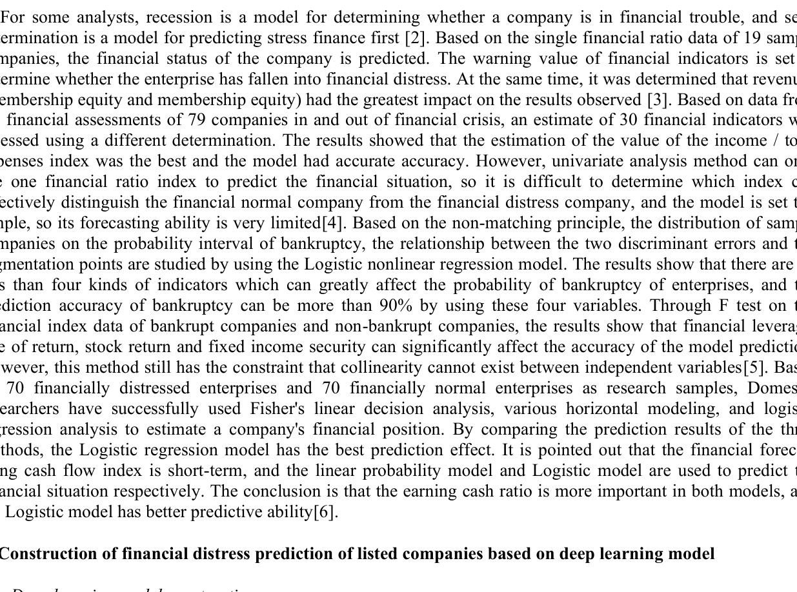
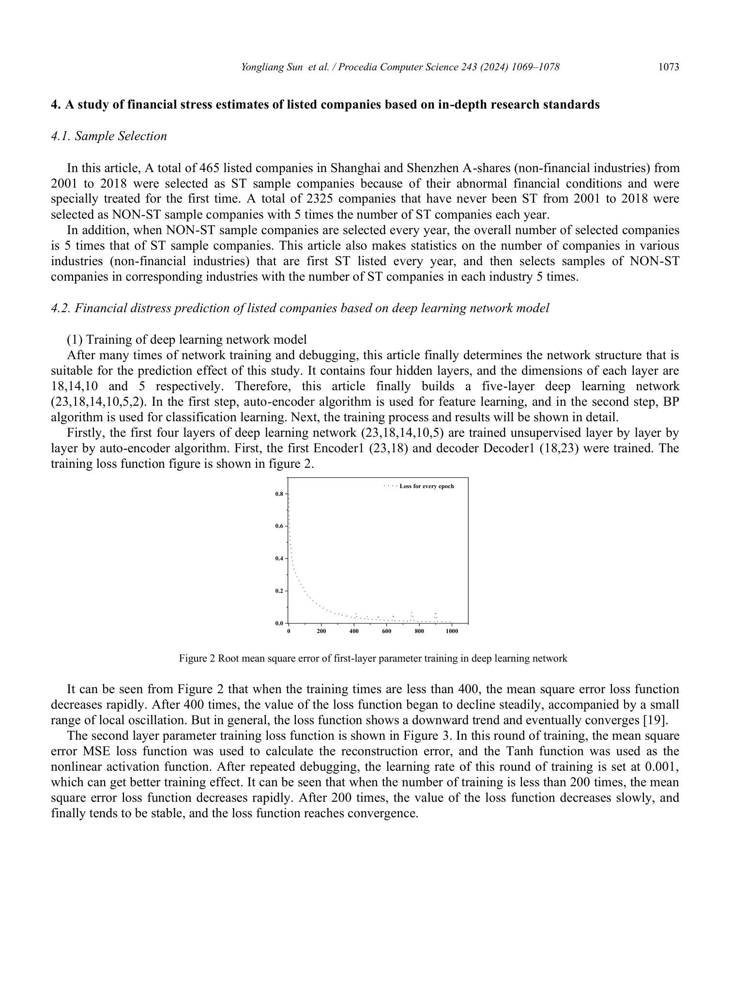

# DỰ BÁO KIỆT QUỆ TÀI CHÍNH DOANH NGHIỆP DỰA TRÊN MÔ HÌNH HỌC SÂU (DEEP AUTOENCODER & PHÂN LOẠI)
*(Financial Distress and Earnings Prediction using Deep Learning)*

- **Tác giả:** Yongliang Sun (Dongying Vocational Institute, Trung Quốc)
- **Tạp chí xuất bản:** Procedia Computer Science 243 (2024) 1069–1078, Elsevier
- **Định danh DOI:** [10.1016/j.procs.2024.09.127](https://doi.org/10.1016/j.procs.2024.09.127)
- **Mẫu thực nghiệm:** 465 công ty niêm yết cổ phiếu hạng A tại sàn Thượng Hải & Thâm Quyến (2001–2018) bị cảnh báo đặc biệt (ST) và 2.325 công ty đối chứng Non-ST

---

## TÓM TẮT NGHIÊN CỨU (ABSTRACT)

Để giải quyết triệt để hạn chế của các mô hình dự báo truyền thống trong việc mô tả nguyên nhân và cơ chế dẫn đến khủng hoảng tài chính doanh nghiệp, bài báo này ứng dụng **mô hình học sâu (*Deep Learning*)** đa tầng nhằm nâng cao hiệu quả dự báo kiệt quệ tài chính (*Financial Distress*). Nghiên cứu lựa chọn 465 công ty niêm yết cổ phiếu hạng A (ngành phi tài chính) tại sàn Thượng Hải và Thâm Quyến từ năm 2001 đến năm 2018 bị đưa vào diện cảnh báo đặc biệt (*Special Treatment - ST*) lần đầu do tình trạng tài chính bất thường, cùng 2.325 công ty đối chứng không bị ST (*Non-ST*).

Một hệ thống 23 chỉ số tài chính toàn diện thuộc 5 khía cạnh cốt lõi (Khả năng thanh toán, Năng lực hoạt động, Năng lực sinh lời, Tiềm năng phát triển và Lưu chuyển tiền tệ) được xây dựng. Mô hình học sâu kết hợp giữa **học đặc trưng phi giám sát (*Unsupervised Feature Learning*) qua 4 tầng mã hóa (Encoder)** và **tầng phân loại (*Classifier*) có giám sát** được tối ưu hóa bằng thuật toán lan truyền ngược (BP). Kết quả kiểm thử ngoài mẫu cho thấy mô hình học sâu đạt **độ chính xác tổng thể 78,33%** và đặc biệt đạt **độ chính xác dự báo các công ty lâm vào kiệt quệ (ST) lên tới 82,00%**, vượt trội hơn hẳn mô hình Hồi quy Logistic (71,00%) và mô hình Mạng nơ-ron nhân tạo truyền thống (69,67%).

**Từ khóa:** Học sâu (Deep Learning); Công ty niêm yết; Dự báo kiệt quệ tài chính; Cảnh báo đặc biệt (ST); Mạng nơ-ron đa tầng (Deep Neural Network).

---

## 1. ĐẶT VẤN ĐỀ & BỐI CẢNH NGHIÊN CỨU

Doanh nghiệp luôn phải đối mặt với vô vàn rủi ro trong quá trình vận hành, trong đó **rủi ro tài chính (*financial risk*)** là loại rủi ro nguy hiểm và tất yếu nhất. Một khi doanh nghiệp rơi vào khủng hoảng tài chính, nó sẽ gây ra tổn thất nặng nề cho các cổ đông, nhà đầu tư, chủ nợ, người lao động và làm lung lay tính ổn định của thị trường vốn.

Trong thực tế, tình trạng kiệt quệ tài chính không diễn ra sau một đêm, mà hầu hết các công ty đều trải qua một **quá trình suy thoái dần dần (*gradual deterioration*)**. Do đó, nếu có thể kịp thời nhận diện các tín hiệu cảnh báo suy thoái từ sớm (trước 2–3 năm), ban quản trị doanh nghiệp sẽ có cơ hội tái cấu trúc dòng tiền, ngân hàng có thể kiểm soát rủi ro tín dụng và kiểm toán viên có thể đưa ra ý kiến cảnh báo phù hợp về giả định hoạt động liên tục (*going concern*).

### Hạn Chế Của Các Mô Hình Kinh Điển (Beaver, Altman, Ohlson):
- Các mô hình phân tích biệt thức (Altman Z-Score) và hồi quy Logit (Ohlson O-Score) dựa trên giả định quan hệ tuyến tính giữa các biến số.
- Khi các tỷ số tài chính bị méo mó do biến động chu kỳ hoặc do hành vi làm đẹp sổ sách, các mô hình thống kê truyền thống dễ bị sai lệch dấu hồi quy và bỏ sót các doanh nghiệp đang trên bờ vực phá sản.

---

## 2. KIẾN TRÚC MÔ HÌNH HỌC SÂU ĐA TẦNG (DEEP LEARNING ARCHITECTURE)

Mô hình được thiết kế theo cấu trúc gồm hai giai đoạn:
1. **Giai đoạn học đặc trưng không giám sát (*Feature Learning*):** Ánh xạ véc-tơ 23 chỉ số tài chính đa chiều qua chuỗi 4 tầng ẩn Encoder (Encoder 1, Encoder 2, Encoder 3, Encoder 4) để nén dữ liệu và tự động trích xuất các mối quan hệ phi tuyến ngầm.
2. **Giai đoạn phân loại có giám sát (*Supervised Classification*):** Đưa véc-tơ đặc trưng nén vào tầng phân loại đầu ra để dự đoán xác suất công ty bị ST (nhãn 1) hoặc Non-ST (nhãn 0).

*Hình 1: Kiến trúc mô hình học sâu dự báo kiệt quệ tài chính gồm Tầng đầu vào (23 chỉ số), các tầng mã hóa ẩn (Encoder 1 -> Encoder 4) và Tầng phân loại đầu ra.*

### Công thức ánh xạ tầng ẩn:
Tập huấn luyện $D = \{(x_1, y_1), (x_2, y_2), \dots, (x_m, y_m)\}$, với $x_i \in \mathbb{R}^{23}$ và $y_i \in \{0, 1\}$. Đầu ra của tầng ẩn thứ nhất:
$$ F_1^p = f\left( \sum_{i=1}^d \omega_i^p x_i + b_p 
ight) $$
Trong đó $f(\cdot)$ là hàm kích hoạt phi tuyến tính, $\omega$ là ma trận trọng số, $b$ là độ lệch bias. Quá trình tối ưu hóa giảm thiểu hàm mất mát sai số toàn phương trung bình (MSE) qua thuật toán lan truyền ngược.

---

## 3. HỆ THỐNG 23 CHỈ TIÊU TÀI CHÍNH TOÀN DIỆN

Sau khi sàng lọc và loại bỏ các biến số thiếu hụt dữ liệu, hệ thống 23 chỉ số tài chính được hoàn thiện thuộc 5 trụ cột:

| STT | Trụ Cột Tài Chính | Mã Chỉ Số | Tên Chỉ Số Tài Chính | Ý Nghĩa Kinh Tế |
| :--- | :--- | :--- | :--- | :--- |
| 1 | **Khả năng thanh toán** | `X1` | Tỷ số thanh toán hiện hành (Current Ratio) | Đo lường khả năng trang trải nợ ngắn hạn |
| 2 | | `X2` | Tỷ số thanh toán nhanh (Quick Ratio) | Khả năng thanh toán tức thời không tính tồn kho |
| 3 | | `X3` | Tỷ số nợ trên tổng tài sản (Debt to Assets) | Mức độ đòn bẩy tài chính và rủi ro vỡ nợ |
| 4 | | `X4` | Tỷ số nợ trên vốn CSH (Debt to Equity) | Cơ cấu tài trợ vốn của doanh nghiệp |
| 5 | | `X5` | Vốn lưu động trên tổng tài sản | Đệm thanh khoản ngắn hạn |
| 6 | **Năng lực hoạt động** | `X6` | Vòng quay khoản phải thu (Receivables Turnover) | Hiệu quả thu hồi công nợ bán hàng |
| 7 | | `X7` | Vòng quay hàng tồn kho (Inventory Turnover) | Tốc độ giải phóng hàng hóa trong kho |
| 8 | | `X8` | Vòng quay vốn lưu động | Hiệu quả luân chuyển tài sản ngắn hạn |
| 9 | | `X9` | Vòng quay tài sản cố định | Mức độ khai thác máy móc nhà xưởng |
| 10 | | `X10` | Vòng quay tổng tài sản (Total Assets Turnover) | Năng lực tạo doanh thu từ toàn bộ tài sản |
| 11 | **Năng lực sinh lời** | `X11` | Tỷ suất lợi nhuận trên tài sản (ROA) | Khả năng sinh lời của toàn bộ tài sản |
| 12 | | `X12` | Tỷ suất sinh lời trên vốn CSH (ROE) | Hiệu quả sử dụng vốn của cổ đông |
| 13 | | `X13` | Tỷ suất lợi nhuận gộp (Gross Margin) | Sức mạnh định giá và kiểm soát giá vốn |
| 14 | | `X14` | Biên lợi nhuận hoạt động | Hiệu quả từ hoạt động kinh doanh cốt lõi |
| 15 | | `X15` | Tỷ suất lợi nhuận trên tổng chi phí | Khả năng kiểm soát chi phí hoạt động |
| 16 | **Tiềm năng phát triển** | `X16` | Tốc độ tăng trưởng doanh thu thuần | Tiềm năng mở rộng thị phần |
| 17 | | `X17` | Tốc độ tăng trưởng lợi nhuận hoạt động | Động lực gia tăng lợi nhuận cốt lõi |
| 18 | | `X18` | Tốc độ tăng trưởng tổng tài sản | Tốc độ mở rộng quy mô doanh nghiệp |
| 19 | | `X19` | Tốc độ tăng trưởng vốn chủ sở hữu | Năng lực tích lũy tái đầu tư |
| 20 | | `X20` | Tốc độ tăng trưởng EPS | Lợi ích gia tăng trên mỗi cổ phần |
| 21 | **Lưu chuyển tiền tệ** | `X21` | Dòng tiền thuần từ HĐKD trên tổng tài sản | Chất lượng dòng tiền từ hoạt động chính |
| 22 | | `X22` | Dòng tiền HĐKD trên nợ phải trả | Năng lực trả nợ bằng tiền thật |
| 23 | | `X23` | Dòng tiền HĐKD trên doanh thu thuần | Khả năng biến doanh thu thành tiền mặt |

---

## 4. DỮ LIỆU THỰC NGHIỆM & QUY TRÌNH HUẤN LUYỆN

- **Mẫu ST:** 465 công ty phi tài chính tại sàn Thượng Hải & Thâm Quyến giai đoạn 2001–2018 bị đưa vào diện ST lần đầu (chứng minh tình trạng lỗ liên tiếp hoặc vốn CSH âm).
- **Mẫu Non-ST:** 2.325 công ty không bị ST trong toàn bộ chu kỳ nghiên cứu (tỷ lệ ghép mẫu 1:5 tương đồng về ngành nghề và quy mô).
- **Mẫu kiểm thử ngoài mẫu (Test Set):** 300 công ty (50 công ty ST và 250 công ty Non-ST) hoàn toàn độc lập, lấy số liệu tại thời điểm **T-3 (trước khi bị ST đúng 3 năm)** để kiểm chứng năng lực cảnh báo sớm.

*Hình 2 & 3: Đường cong hội tụ sai số RMSE qua các vòng huấn luyện (epochs) của mạng học sâu. Mô hình đạt trạng thái ổn định tối ưu sau 400 epochs.*

---

## 5. KẾT QUẢ THỰC NGHIỆM & ĐỐI CHIẾU SO SÁNH ĐA MÔ HÌNH

### Bảng So Sánh Hiệu Năng Dự Báo Giữa 3 Mô Hình (Bảng 8 trong bài báo gốc):
Kết quả kiểm tra tại thời điểm T-3 trên 300 công ty mẫu thử nghiệm độc lập:

| Mô Hình Đánh Giá | Nhóm Doanh Nghiệp | Dự Báo Đúng | Dự Báo Sai | Độ Chính Xác (%) |
| :--- | :--- | :--- | :--- | :--- |
| **Mô hình Học Sâu (Deep Learning)** | **Công ty Non-ST** (250 công ty) | **194** | 56 | **77,60%** |
| | **Công ty ST (Kiệt quệ)** (50 công ty) | **41** | 9 | **82,00%** |
| | **Tổng thể mô hình** (300 công ty) | **235** | 65 | **78,33%** |
| **Mô hình Hồi quy Logistic** | Công ty Non-ST (250 công ty) | 176 | 74 | 70,40% |
| | Công ty ST (Kiệt quệ) (50 công ty) | 37 | 13 | 74,00% |
| | Tổng thể mô hình (300 công ty) | 213 | 87 | 71,00% |
| **Mô hình Mạng BP Neural Network** | Công ty Non-ST (250 công ty) | 174 | 76 | 69,60% |
| | Công ty ST (Kiệt quệ) (50 công ty) | 35 | 15 | 70,00% |
| | Tổng thể mô hình (300 công ty) | 209 | 91 | 69,67% |

### 📊 Phân Tích Ý Nghĩa Kết Quả:
1. **Độ chính xác vượt trội:** Mô hình Học sâu đạt độ chính xác chung **78,33%**, cao hơn mô hình Logistic **+7,33%** và cao hơn mạng BP nơ-ron nông **+8,66%**.
2. **Khả năng bắt trúng doanh nghiệp sắp phá sản:** Đối với các công ty sắp bị cảnh báo ST, Học sâu nhận diện chính xác **82,00%** (bắt đúng 41/50 công ty), trong khi Logistic chỉ đạt 74,00% và BP-ANN chỉ đạt 70,00%. Điều này giảm thiểu nguy cơ bỏ sót doanh nghiệp kiệt quệ xuống mức rất thấp (chỉ bỏ sót 9 công ty).
3. **Cảnh báo sớm trước 3 năm (T-3):** Việc mô hình đạt độ chính xác hơn 82% tại thời điểm 3 năm trước khi biến cố ST chính thức diễn ra chứng minh rằng các tầng Encoder đã tự động học được "quỹ đạo suy thoái" tiềm ẩn từ các chỉ số tài chính kết hợp.

---

## 6. Ý NGHĨA ỨNG DỤNG CHO KIỂM TOÁN VIÊN & KẾ TOÁN QUẢN TRỊ

> [!IMPORTANT]
> **Đóng góp thiết thực cho công tác Kiểm toán & Quản trị rủi ro:**
> - **Đánh giá Khả năng Hoạt động Liên tục (Going Concern):** Theo chuẩn mực kiểm toán quốc tế ISA 570, kiểm toán viên có trách nhiệm thu thập đầy đủ bằng chứng thích hợp về tính hợp lý của giả định hoạt động liên tục. Mô hình Học sâu đóng vai trò công cụ hỗ trợ định lượng khách quan, đưa ra cảnh báo sớm trước 3 năm với độ tin cậy 82%.
> - **Cảnh báo sớm cho Kế toán Quản trị:** Giúp CFO và Ban Giám đốc chủ động cắt giảm chi phí, thu hồi công nợ và cơ cấu lại các khoản nợ vay trước khi doanh nghiệp rơi vào tình trạng mất thanh khoản hoàn toàn.

---

## 7. TÀI LIỆU THAM KHẢO CHÍNH (REFERENCES)

1. **Beaver, W. H. (1966).** Financial ratios as predictors of failure. *Journal of Accounting Research*, 4, 71–111.
2. **Altman, E. I. (1968).** Financial ratios, discriminant analysis and the prediction of corporate bankruptcy. *The Journal of Finance*, 23(4), 589–609.
3. **Ohlson, J. A. (1980).** Financial ratios and the probabilistic prediction of bankruptcy. *Journal of Accounting Research*, 18(1), 109–131.
4. **Sun, Y. (2024).** Financial distress prediction based on deep learning model. *Procedia Computer Science*, 243, 1069–1078.
