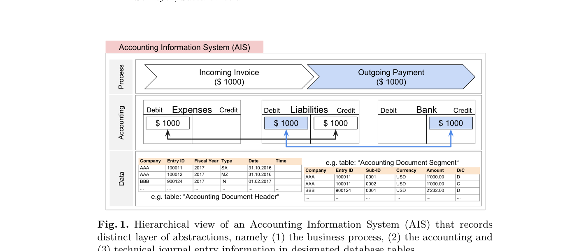
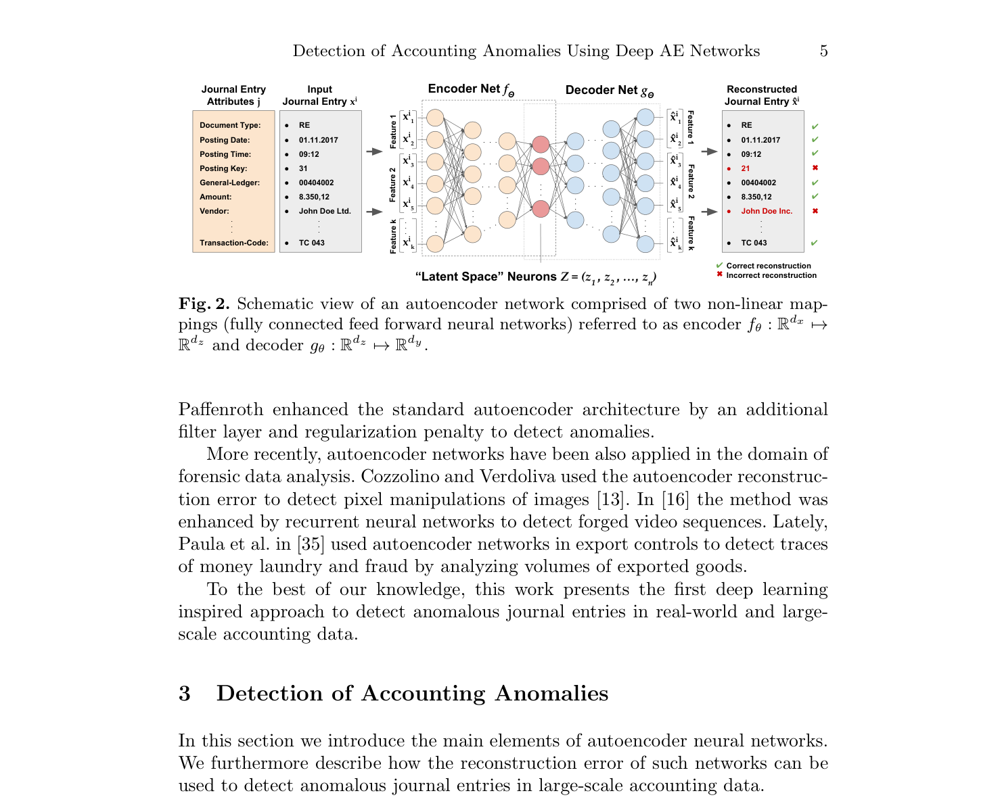

# PHÁT HIỆN BẤT THƯỜNG TRONG DỮ LIỆU KẾ TOÁN QUY MÔ LỚN BẰNG MẠNG DEEP AUTOENCODER
*(Detection of Anomalies in Large Scale Accounting Data using Deep Autoencoder Networks)*

- **Tác giả:** Marco Schreyer (DFKI), Timur Sattarov (PwC), Damian Borth (DFKI), Andreas Dengel (DFKI), Bernd Reimer (PwC)
- **Đơn vị nghiên cứu:** Trung tâm Nghiên cứu Trí tuệ Nhân tạo Đức (DFKI) & Hãng Kiểm toán PricewaterhouseCoopers (PwC GmbH)
- **Định danh học thuật:** [arXiv:1709.05254](https://arxiv.org/abs/1709.05254)
- **Cơ sở dữ liệu thực nghiệm:** Hàng triệu dòng bút toán kế toán thực tế trích xuất từ hệ thống hoạch định tài nguyên doanh nghiệp (SAP ERP) của 2 tập đoàn đa quốc gia

---

## TÓM TẮT NGHIÊN CỨU (ABSTRACT)

Học cách phát hiện gian lận trong dữ liệu kế toán quy mô lớn là một trong những thách thức lâu đời nhất trong công tác kiểm toán báo cáo tài chính và điều tra gian lận nội bộ. Hiện nay, phần lớn các kỹ thuật áp dụng trong thực tế vẫn phụ thuộc vào **các quy tắc thủ công (*handcrafted IF-ELSE rules*)** được rút ra từ các kịch bản gian lận đã biết trong quá khứ. Mặc dù đem lại thành công nhất định, các quy tắc này bộc lộ nhược điểm nghiêm trọng: Chúng hoàn toàn bất lực trong việc tổng quát hóa ra ngoài các kịch bản đã biết và những kẻ gian lận sẽ nhanh chóng tìm ra cách lách luật.

Để khắc phục nhược điểm này, lấy cảm hứng từ thành công của học sâu, chúng tôi đề xuất ứng dụng **Mạng nơ-ron Tự mã hóa Sâu (*Deep Autoencoder Neural Networks*)** để tự động phát hiện các bút toán sổ cái bất thường (*anomalous journal entries*). Chúng tôi chứng minh rằng **sai số tái tạo (*reconstruction error*)** thu được từ mạng nơ-ron sau huấn luyện, khi được điều chuẩn bởi xác suất xuất hiện của từng thuộc tính riêng lẻ, có thể được diễn giải như một thang đo đánh giá bất thường có tính thích nghi rất cao.

Thực nghiệm trên hai bộ dữ liệu bút toán nhật ký chung thực tế quy mô lớn của hai tập đoàn đa quốc gia chứng minh tính hiệu quả vượt bậc của phương pháp, đạt điểm F1-score lên tới **32,93%** (Dataset A) và **16,95%** (Dataset B), đồng thời **giảm thiểu 97,5% số lượng cảnh báo giả (*false positive alerts*)** so với các phương pháp nơ-ron nông. Phản hồi thực tế từ các kiểm toán viên công chứng (*Chartered Accountants*) và các chuyên gia điều tra gian lận (*Fraud Examiners*) tại PwC đã khẳng định chất lượng xuất sắc của mô hình trong việc bắt trúng các bất thường kế toán trọng yếu trong thực tế.

**Từ khóa:** Hệ thống thông tin kế toán (AIS); Kỹ thuật kiểm toán có máy tính trợ giúp (CAATs); Kiểm tra bút toán (Journal Entry Testing); Kế toán điều tra (Forensic Accounting); Phát hiện gian lận; Phân tích dữ liệu điều tra; Học sâu (Deep Learning); Autoencoder.

---

## 1. ĐỘNG LỰC & THÁCH THỨC TRONG KIỂM TOÁN SỔ CÁI (GENERAL LEDGER)

Theo Báo cáo Gian lận Toàn cầu của Hiệp hội các Nhà điều tra Gian lận Công chứng (ACFE), một tổ chức điển hình **bị thất thoát trung bình 5% tổng doanh thu hàng năm** do các hành vi gian lận và lạm dụng chức vụ. Trong các vụ bê bối tài chính, ban giám đốc và các kế toán viên thoái hóa thường sử dụng các bút toán điều chỉnh nhật ký chung (*journal entries*) để "xào nấu" lợi nhuận hoặc che giấu các khoản rút ruột tài sản.

Theo Chuẩn mực Kiểm toán Quốc tế **ISA 240** và chuẩn mực Hoa Kỳ **SAS 99**, kiểm toán viên bắt buộc phải thực hiện thủ tục **Kiểm tra bút toán nhật ký (*Journal Entry Testing - JET*)** để đánh giá rủi ro ban quản lý ghi đè kiểm soát nội bộ.

### Điểm Nghẽn Của Phương Pháp Kiểm Toán Truyền Thống:
Trong các hệ thống ERP hiện đại như **SAP R/3 hay SAP S/4HANA**, một doanh nghiệp lớn có thể phát sinh hàng triệu dòng bút toán mỗi năm. Kiểm toán viên thường dùng các câu lệnh truy vấn lọc dữ liệu (SQL, ACL, IDEA) dựa trên quy tắc cố định, ví dụ:
- Lọc các bút toán hạch toán vào ban đêm hoặc ngày cuối tuần.
- Lọc các bút toán có số tiền làm tròn (ví dụ: 10.000.000 VNĐ).
- Lọc các bút toán chứa từ khóa nhạy cảm ("điều chỉnh", "sửa lỗi").

**Hậu quả:** Các quy tắc này sinh ra hàng chục nghìn cảnh báo giả (*False Positives*), khiến kiểm toán viên kiệt sức vì phải kiểm tra thủ công các bút toán hoàn toàn bình thường, trong khi kẻ gian chỉ cần hạch toán vào lúc 10h sáng thứ Ba với số tiền lẻ là hoàn toàn "tàng hình" trước hệ thống kiểm toán!

---

## 2. BẢN CHẤT DỮ LIỆU BÚT TOÁN KẾ TOÁN TRONG HỆ THỐNG ERP

Mỗi giao dịch kinh tế trong hệ thống SAP ERP được ghi nhận theo nguyên tắc ghi kép (*dual-entry principle*), bao gồm ít nhất hai dòng bút toán (Nợ và Có) và được tổ chức thành hai tầng bảng cơ sở dữ liệu:
1. **Tầng Tiêu đề chứng từ (Document Header - Bảng `BKPF`):** Chứa thông tin chung về chứng từ: Số chứng từ, Loại chứng từ (Document Type, ví dụ: `RE` - Hóa đơn mua hàng, `KZ` - Thanh toán người bán), Ngày hạch toán (Posting Date), Giờ hạch toán, Mã người tạo (User ID), Mã giao dịch (T-Code).
2. **Tầng Dòng bút toán (Line Items - Bảng `BSEG`):** Chứa chi tiết từng dòng: Khóa định khoản (Posting Key, ví dụ: `31` - Ghi Có nhà cung cấp, `40` - Ghi Nợ tài khoản chi phí), Mã tài khoản Sổ cái (General Ledger Account), Số tiền hạch toán (Amount), Mã nhà cung cấp / khách hàng.

*Hình 1: Quy trình ghi nhận dòng tiền và hạch toán chứng từ kép trong hệ thống ERP: Nhận hóa đơn đầu vào ($1.000) -> Thanh toán qua ngân hàng ($1.000).*

### Tiền xử lý dữ liệu:
Do các thuộc tính kế toán phần lớn là biến định danh phân loại (*categorical attributes*), nghiên cứu áp dụng kỹ thuật mã hóa **One-Hot Encoding** để chuyển đổi từng bút toán thành một véc-tơ nhị phân thưa đa chiều:
- **Tập dữ liệu A:** Gồm 401 chiều sau khi mã hóa.
- **Tập dữ liệu B:** Gồm 576 chiều sau khi mã hóa.

---

## 3. PHÂN LOẠI 2 DẠNG BẤT THƯỜNG KẾ TOÁN: GLOBAL VS. LOCAL ANOMALIES

Để thiết kế hệ thống phát hiện gian lận hiệu quả, nhóm tác giả phân định rõ hai hình thái bất thường:
1. **Bất thường toàn cục (*Global Anomalies*):** Các bút toán có thuộc tính hiếm gặp hoặc số tiền vượt ngưỡng cực đoan (ví dụ: Bút toán chuyển tiền hàng triệu USD phát sinh từ một loại chứng từ chưa từng dùng bao giờ).
2. **Bất thường cục bộ / ngữ cảnh (*Local/Contextual Anomalies*):** Các bút toán nhìn bề ngoài **hoàn toàn bình thường** nếu xem xét từng thuộc tính riêng lẻ (số tiền nhỏ, tài khoản thông dụng, hạch toán giờ hành chính), nhưng **sự kết hợp giữa các thuộc tính lại vô lý và trái quy luật** (ví dụ: Nhân viên phòng Mua hàng lại hạch toán tài khoản Chi phí Quản trị Doanh nghiệp đối ứng với Tài khoản Ngân hàng lạ).

---

## 4. KIẾN TRÚC MẠNG NƠ-RON DEEP AUTOENCODER ĐỀ XUẤT

Mạng Autoencoder là một kiến trúc học sâu không giám sát gồm hai mạng nơ-ron truyền thẳng ghép nối tiếp:
1. **Mạng Mã hóa (Encoder Net $f_	heta$):** Nén véc-tơ đầu vào $x_i \in \mathbb{R}^{d_x}$ qua nhiều tầng ẩn xuống một không gian tiềm ẩn (*Latent Space*) có số chiều cực nhỏ $Z \in \mathbb{R}^{d_z}$ (với $d_z = 3$).
2. **Mạng Giải mã (Decoder Net $g_	heta$):** Giải nén từ không gian tiềm ẩn để tái tạo lại véc-tơ ban đầu $\hat{x}_i \in \mathbb{R}^{d_y}$.

*Hình 2: Kiến trúc Deep Autoencoder phát hiện bất thường: Bút toán hợp lệ được tái tạo hoàn hảo (sai số thấp); Bút toán gian lận có cấu trúc dị thường không thể tái tạo đúng (sai số vọt cao) -> Gắn cờ cảnh báo.*

### Cơ Chế Phát Hiện Gian Lận Qua Sai Số Tái Tạo:
Mạng Autoencoder được huấn luyện trên hàng triệu bút toán bình thường hàng ngày của doanh nghiệp. Do đó, mạng học được "quy luật hạch toán chuẩn mực" của tổ chức.
- **Bút toán liêm chính (99,9%):** Autoencoder dễ dàng tái tạo lại với sai số cực nhỏ $\mathcal{L}(x_i, \hat{x}_i) pprox 0$.
- **Bút toán gian lận (bất thường):** Chứa đựng các tương tác kỳ dị chưa từng thấy trong tập huấn luyện. Autoencoder không thể tái tạo chính xác $
ightarrow$ **Sai số tái tạo vọt lên cực cao!**

$$ \mathcal{L}(x_i, \hat{x}_i) = rac{1}{k} \sum_{j=1}^k \left( x_i^j - \hat{x}_i^j 
ight)^2 $$

### Thang Đo Điểm Bất Thường Kết Hợp (Hybrid Anomaly Score):
Để bắt được cả Global Anomalies và Local Anomalies, tác giả kết hợp:
1. Điểm xác suất thuộc tính $AP(x_i)$: Bắt các giá trị hiếm gặp (Global).
2. Điểm sai số tái tạo Autoencoder $\mathcal{L}(x_i, \hat{x}_i)$: Bắt tương tác bất hợp lý (Local).

$$ AS(x_i) = lpha \cdot rac{AP(x_i) - AP_{\min}}{AP_{\max} - AP_{\min}} + (1 - lpha) \cdot rac{\mathcal{L}(x_i, \hat{x}_i) - \mathcal{L}_{\min}}{\mathcal{L}_{\max} - \mathcal{L}_{\min}} $$

---

## 5. THỰC NGHIỆM ĐỊNH LƯỢNG TRÊN DỮ LIỆU ERP THỰC TẾ

Tác giả đánh giá 9 cấu hình mạng Autoencoder từ nông (AE 1: 1 tầng ẩn) đến sâu (AE 9: 9 tầng ẩn với hàng nghìn nơ-ron):

| Cấu Hình | Kiến Trúc Các Tầng Ẩn (Số Nơ-ron) | Chiều Latent Space | Dataset A: Precision | Dataset A: F1-Score | Số Cảnh Báo Phải Xem Xét |
| :--- | :--- | :--- | :--- | :--- | :--- |
| **AE 1 (Nông)** | [401] - 3 - [401] | 3 | 0,0049 | 0,0098 | 19.233 bút toán |
| AE 2 | [401] - 4-3-4 - [401] | 3 | 0,0063 | 0,0126 | 14.966 bút toán |
| AE 3 | [401] - 8-4-3-4-8 - [401] | 3 | 0,0098 | 0,0194 | 9.719 bút toán |
| AE 4 | [401] - 16-8-4-3-4-8-16 - [401] | 3 | 0,0290 | 0,0564 | 3.275 bút toán |
| AE 5 | [401] - 32-16-8-4-3-4-8-16-32 - [401] | 3 | 0,0641 | 0,1204 | 1.483 bút toán |
| AE 6 | [401] - 64-32-16-8-4-3-4-8-16-64 - [401] | 3 | 0,0752 | 0,1398 | 1.264 bút toán |
| AE 7 | [401] - 128-64-32-16-8-4-3-4-8-16-64-128 - [401] | 3 | 0,0796 | 0,1474 | 1.194 bút toán |
| AE 8 | [401] - 256-128-64-32-16-8-4-3-4-8-16-64-128-256 - [401] | 3 | 0,1201 | 0,2144 | 791 bút toán |
| **AE 9 (Sâu nhất)** | **[401] - 512-256-128-64-32-16-8-4-3-...-512 - [401]** | **3** | **0,1971** | **0,3293** | **Chỉ còn 482 bút toán!** |

### 🚀 Sức Mạnh Tuyệt Đối Của Kiến Trúc Mạng Sâu:
Mạng nông AE 1 bắt kiểm toán viên phải kiểm tra tới **19.233 bút toán** để tìm ra gian lận. Trong khi đó, mạng học sâu **AE 9 thu hẹp danh sách nghi vấn xuống chỉ còn 482 bút toán (giảm tới 97,5% khối lượng công việc!)** trong khi vẫn duy trì tỷ lệ bao phủ gian lận (Recall) đạt 100%!

### Bảng Đối Chuẩn So Sánh Với Các Thuật Toán Học Không Giám Sát Khác (Bảng 3 bài báo):

| Thuật Toán Đối Chuẩn | Dataset | ROC-AUC | Precision (%) | F1-Score | Số Lượng Bút Toán Cần Kiểm Tra |
| :--- | :--- | :--- | :--- | :--- | :--- |
| **Deep Autoencoder (AE 9)** | **A** | **0,9999** | **56,88%** | **0,7251** | **Chỉ 167 bút toán** |
| One-Class SVM (OC-SVM) | A | 0,9999 | 27,69% | 0,4338 | 343 bút toán |
| Local Outlier Factor (LOF) | A | 0,9979 | 4,99% | 0,0952 | 1.901 bút toán |
| HDBSCAN (Phân cụm mật độ) | A | 0,9787 | 2,56% | 0,0499 | 3.714 bút toán |
| PCA (Phân tích thành phần chính) | A | 0,9608 | 0,55% | 0,0110 | 17.162 bút toán |
| **Deep Autoencoder (AE 9)** | **B** | **0,9997** | **16,16%** | **0,2782** | **Chỉ 619 bút toán** |
| One-Class SVM | B | 0,9997 | 13,97% | 0,2451 | 716 bút toán |
| LOF | B | 0,9984 | 5,18% | 0,0986 | 1.929 bút toán |
| HDBSCAN | B | 0,9744 | 3,83% | 0,0720 | 2.680 bút toán |
| PCA | B | 0,9978 | 3,31% | 0,0640 | 3.025 bút toán |

---

## 6. ĐÁNH GIÁ CHẤT LƯỢNG THỰC TẾ TỪ CÁC CHUYÊN GIA KIỂM TOÁN PwC

Các kiểm toán viên công chứng và chuyên gia điều tra gian lận tại PwC đã trực tiếp rà soát các bút toán bất thường trong thực tế do mô hình AE 9 phát hiện:
1. **Phát hiện gian lận phân tách thanh toán (*Invoice Splitting*):** Bắt sống các bút toán cố ý chia nhỏ số tiền thành nhiều hóa đơn dưới 5.000 EUR để lách thẩm quyền phê duyệt của Giám đốc tài chính.
2. **Bút toán điều chỉnh ngoài giờ (*Off-Hour Postings*):** Phát hiện các bút toán điều chỉnh doanh thu vào lúc 23h đêm Chủ nhật được thực hiện bởi tài khoản người dùng của phòng kỹ thuật IT thay vì phòng kế toán.
3. **Cặp tài khoản đối ứng bất thường:** Nhận diện các bút toán Nợ TK Chi phí quản lý đối ứng trực tiếp với Có TK Phải thu khách hàng mà không qua hóa đơn điều chỉnh.

---

## 7. ĐÚC KẾT CHO NGHỀ NGHIỆP KIỂM TOÁN HIỆN ĐẠI

> [!TIP]
> **Chuyển dịch từ Kiểm toán lấy mẫu sang Kiểm toán toàn diện 100%:**
> - Deep Autoencoder cho phép quét 100% hàng triệu bút toán nhật ký chung trong vài phút, loại bỏ hoàn toàn rủi ro chọn mẫu (*Sampling Risk*).
> - Giúp các hãng kiểm toán Big 4 chuyển đổi mạnh mẽ sang mô hình **Kiểm toán liên tục (*Continuous Auditing*)**, phát hiện gian lận theo thời gian thực thay vì đợi đến đợt kiểm toán cuối năm.

---

## 8. TÀI LIỆU THAM KHẢO CHÍNH (REFERENCES)

1. **Schreyer, M., Sattarov, T., Borth, D., Dengel, A., & Reimer, B. (2017).** Detection of anomalies in large scale accounting data using deep autoencoder networks. *arXiv preprint arXiv:1709.05254*.
2. **ACFE (2016).** Report to the Nations on Occupational Fraud and Abuse. *Association of Certified Fraud Examiners*.
3. **PwC (2016).** Global Economic Crime Survey 2016: An inside look at the true costs of crime. *PricewaterhouseCoopers*.
4. **Schreyer, M., et al. (2020).** Multi-view anomaly detection in large-scale accounting data. *International Conference on Information Systems (ICIS)*.
