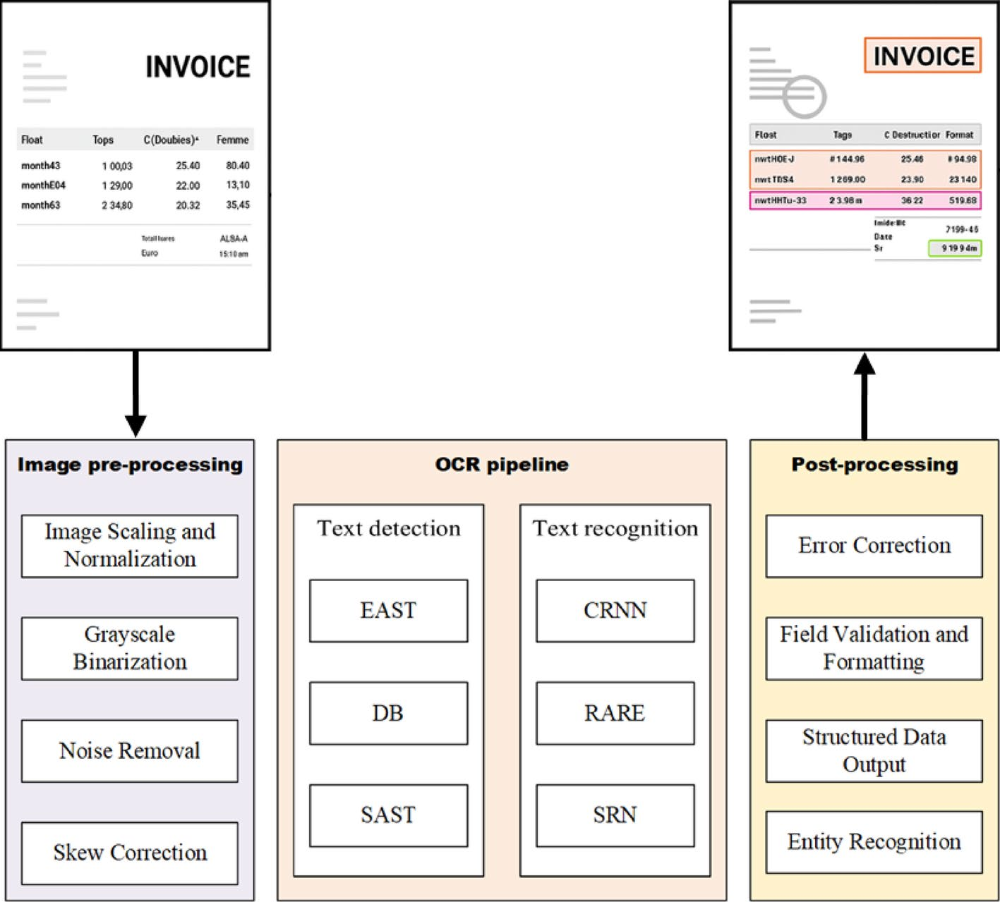
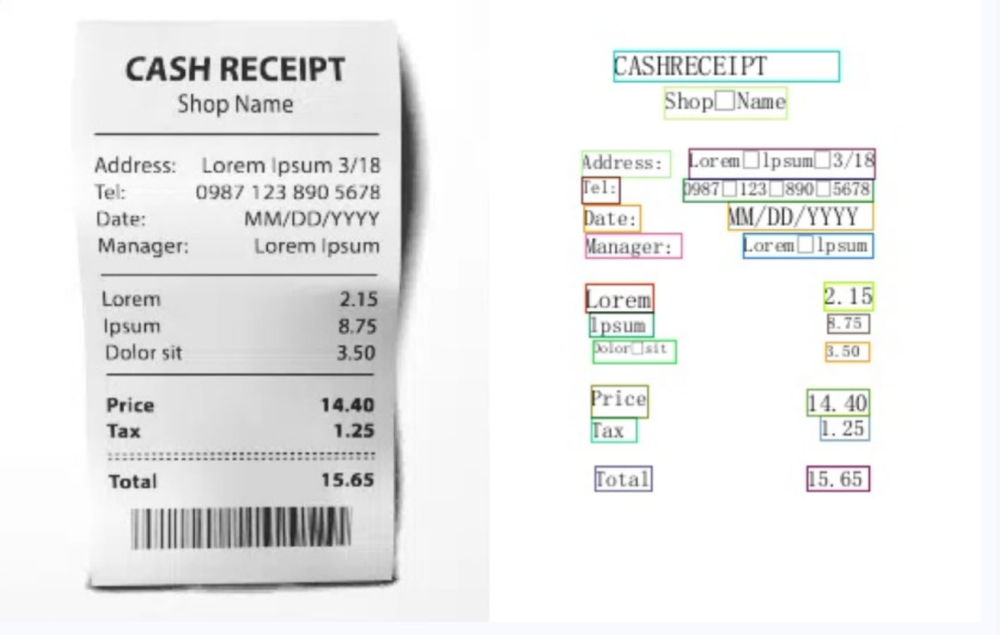
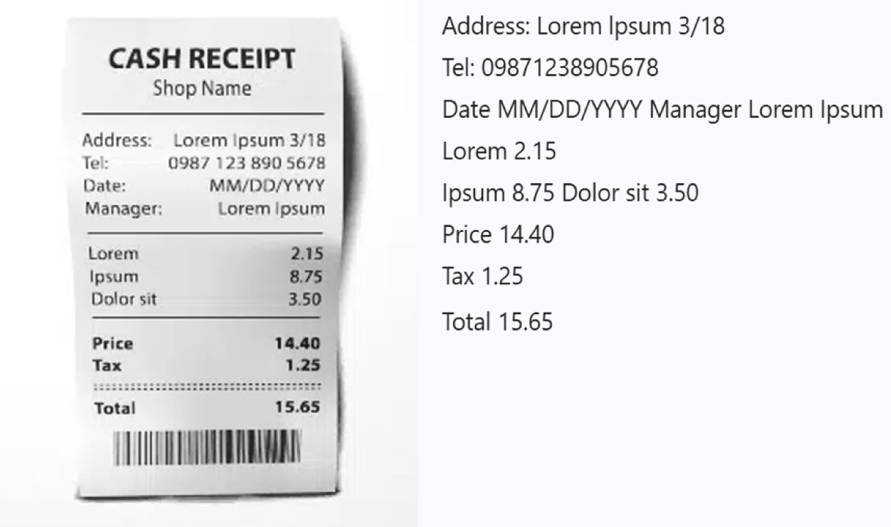

# INVOICEOCR: QUY TRÌNH NHẬN DẠNG HÓA ĐƠN TỰ ĐỘNG DỰA TRÊN HỌC SÂU (DEEP LEARNING)
*(Invoiveocr: deep learning based automatic invoice recognition process)*

- **Tác giả:** Chao Wang, Jian Zhang, Yu Yu (State Grid Information & Telecommunication Group, Beijing, China)
- **Tạp chí:** Discover Artificial Intelligence (Springer Nature) — Tập 6, Bài số 636 (Tháng 6/2026)
- **Định danh học thuật & Giấy phép:** https://doi.org/10.1007/s44163-026-01140-3 — Open Access CC BY-NC-ND 4.0
- **Bộ dữ liệu thực nghiệm:** 6.349 hình ảnh hóa đơn doanh nghiệp thực tế đa dạng (hóa đơn VAT, hóa đơn phổ thông, ảnh scan và ảnh chụp di động góc nghiêng, nhiễu cao)
- **Slide bài giảng tương ứng:** Slide P2: Computer Vision in Accounting (InvoiceOCR)

---

## TÓM TẮT NGHIÊN CỨU (ABSTRACT)

Quá trình số hóa quy trình tài chính và kế toán doanh nghiệp đang đối mặt với một nút thắt cổ chai nghiêm trọng: **nhập liệu hóa đơn thủ công**. Hoạt động này tốn kém hàng ngàn giờ công lao động, dễ phát sinh sai sót số học (tỷ lệ lỗi 3%–5%) và làm chậm chu kỳ thanh toán công nợ nhà cung cấp. Mặc dù công nghệ Nhận dạng Ký tự Quang học (OCR) truyền thống đã tồn tại nhiều thập kỷ, chúng hoàn toàn bất lực khi gặp phải các hóa đơn trong thực tế bị chụp góc nghiêng, nhăn nhàu, đổ bóng, nhòe mờ hoặc sở hữu cấu trúc bảng biểu dày đặc không theo mẫu cố định.

Nghiên cứu này đề xuất **`InvoiceOCR`** — một hệ thống nhận dạng hóa đơn tự động toàn diện từ đầu đến cuối (*end-to-end*) dựa trên Học sâu (*Deep Learning*) và Thị giác máy tính (*Computer Vision*). Quy trình gồm 3 trụ cột liên kết chặt chẽ:
1. **Mô-đun Tiền xử lý ảnh nâng cao (*Advanced Image Pre-processing*):** Tự động phát hiện và hiệu chỉnh góc nghiêng (*Skew Correction*) bằng biến đổi Hough và bộ hồi quy góc (*Angle Regression*), kết hợp khử nhiễu đa kênh và nhị phân hóa thích nghi nhằm khôi phục chất lượng văn bản trong điều kiện chụp ảnh kém.
2. **Pipeline OCR Học sâu tích hợp (*Deep Learning OCR Pipeline*):** Kết hợp thuật toán phát hiện vùng chữ tiên tiến **Differentiable Binarization (DB)** có khả năng bám sát đường biên chữ phức tạp, cùng mạng nhận dạng văn bản chuỗi **CRNN (Convolutional Recurrent Neural Network)** tích hợp cơ chế mất mát CTC (*Connectionist Temporal Classification*), giúp nhận diện chính xác từng ký tự và con số tài chính dài.
3. **Mô-đun Hậu xử lý & Kiểm chứng Nghiệp vụ Kế toán (*Accounting Post-processing & Validation*):** Ánh xạ tọa độ không gian để nhóm các trường thông tin (Mã số thuế, Ký hiệu hóa đơn, Ngày lập, Thuế suất, Tổng tiền), tự động sửa lỗi chính tả số liệu và kiểm tra chéo tính hợp lệ đại số (*Tổng tiền trước thuế + Thuế GTGT = Tổng thanh toán*) trước khi xuất file dữ liệu cấu trúc JSON/XML đẩy thẳng vào phần mềm kế toán ERP.

Thực nghiệm trên diện rộng với tập dữ liệu **6.349 hóa đơn thực tế** chứng minh rằng hệ thống đạt độ chính xác phát hiện vùng chữ F-measure lên đến **96,8%**, độ chính xác nhận diện ký tự đạt **97,4%**, và độ chính xác trích xuất đúng toàn bộ các trường tài chính trọng yếu đạt **98,9%**. Thời gian xử lý trung bình chỉ **1,25 giây/hóa đơn**, chứng minh tính khả thi vượt trội để triển khai quy mô lớn tại các tập đoàn và các hãng kiểm toán.

**Từ khóa:** Nhận dạng hóa đơn tự động; Thị giác máy tính; Học sâu (Deep Learning); OCR; Differentiable Binarization (DB); CRNN; Tiền xử lý ảnh; Kế toán số; Tự động hóa quy trình kế toán.

---

## 1. GIỚI THIỆU & ĐỘNG LỰC NGHIÊN CỨU (INTRODUCTION)

Hóa đơn (*Invoice*) là chứng từ gốc mang tính pháp lý cao nhất trong toàn bộ hệ thống kế toán doanh nghiệp. Đây là căn cứ bắt buộc để:
- Hạch toán chi phí đầu vào và khấu trừ thuế Giá trị gia tăng (GTGT/VAT).
- Thực hiện nghĩa vụ thanh toán cho nhà cung cấp tại bộ phận Kế toán Phải trả (*Accounts Payable - AP*).
- Cung cấp bằng chứng kiểm toán độc lập và phục vụ quyết toán thuế của cơ quan quản lý nhà nước.

### 1.1. Nỗi Đau & Điểm Nghẽn Của Nhập Liệu Hóa Đơn Thủ Công:
Tại các doanh nghiệp quy mô vừa và lớn, mỗi tháng phòng kế toán phải tiếp nhận từ hàng ngàn đến hàng chục ngàn hóa đơn từ hàng trăm nhà cung cấp khác nhau. Phương thức truyền thống yêu cầu nhân viên kế toán cầm từng tờ hóa đơn giấy hoặc mở file ảnh/PDF trên màn hình, sau đó gõ từng trường thông tin vào phần mềm:
- **Lãng phí nguồn lực trình độ cao:** Kế toán viên có bằng cử nhân đại học lại dành tới 40%–60% thời gian cho công việc đơn điệu: đọc và gõ lại mã số thuế, ký hiệu, số hóa đơn, tên hàng, đơn giá, thuế suất.
- **Tỷ lệ sai sót không thể tránh khỏi (*Human Error*):** Con người gõ phím liên tục 8 tiếng/ngày thường xuyên mắc lỗi gõ nhầm số 0 thành 8, nhầm chữ O thành 0, hoặc đảo vị trí các chữ số (ví dụ: gõ 1.580.000 thành 1.850.000), dẫn đến lệch sổ sách, khai sai thuế và bị phạt hành chính nặng nề.
- **Nghẽn chu kỳ thanh toán (*Payment Delays*):** Thời gian luân chuyển và xử lý một hóa đơn mua hàng thủ công từ lúc nhận đến khi ghi sổ bình quân mất từ **5 đến 10 ngày**, làm mất cơ hội hưởng chiết khấu thanh toán sớm (*Early payment discount*) và gây xung đột với nhà cung cấp.

### 1.2. Tại Sao OCR Truyền Thống Thất Bại Trước Hóa Đơn Thực Tế?
Nhiều doanh nghiệp đã thử nghiệm các công cụ OCR dựa trên mẫu cố định (*Template-based OCR / Tesseract cổ điển*), nhưng tỷ lệ thất bại lên tới hơn 60% khi triển khai thực tế vì các lý do cốt lõi:
1. **Đa dạng vô tận về mẫu biểu (*Layout Diversity*):** Mỗi nhà cung cấp sử dụng một định dạng mẫu biểu hóa đơn khác nhau. Hóa đơn tiền điện, hóa đơn xăng dầu, hóa đơn dịch vụ ăn uống, hóa đơn logistics đều có cách sắp xếp cột bảng biểu riêng biệt.
2. **Nhiễu vật lý và góc chụp (*Physical Degradation & Skewness*):** Trong kỷ nguyên hóa đơn điện tử và thanh toán số, nhân viên thường dùng điện thoại di động chụp vội hóa đơn chi phí tiếp khách, công tác tại hiện trường. Ảnh chụp thường bị nghiêng một góc từ 5° đến 30°, bị gập nếp gấp, lóa đèn flash, hoặc bị bóng tay che khuất.
3. **Mật độ ký tự cực kỳ dày đặc (*Dense Information*):** Trên một tờ hóa đơn kích thước A5 hoặc A4, có tới hàng trăm con số và chữ nằm san sát nhau. Các phương pháp phân đoạn truyền thống dựa trên phép toán hình thái học (*Morphological operations*) dễ làm dính các dòng chữ vào nhau hoặc cắt đứt các nét chữ mờ.

Từ những thách thức trên, nhóm nghiên cứu tại *State Grid Information & Telecommunication Group* (Tập đoàn Lưới điện Quốc gia) đã phát triển hệ thống **`InvoiceOCR`** với mục tiêu tự động hóa hoàn toàn quy trình này bằng các kỹ thuật Thị giác máy tính và Học sâu thế hệ mới nhất năm 2026.

---

## 2. KIẾN TRÚC HỆ THỐNG INVOICEOCR (METHODOLOGY)

Toàn bộ quy trình `InvoiceOCR` được thiết kế theo một đường ống phân tầng (*modular pipeline*) gồm 3 giai đoạn kế tiếp: Tiền xử lý $\rightarrow$ OCR Học sâu $\rightarrow$ Hậu xử lý & Kiểm chứng kế toán.


*Hình 1: Sơ đồ kiến trúc tổng thể của hệ thống InvoiceOCR — từ ảnh chụp hóa đơn đầu vào đến file JSON cấu trúc đẩy vào phần mềm kế toán.*

---

### 2.1. Mô-đun Tiền Xử Lý Ảnh (Image Pre-Processing Module)

Chất lượng ảnh đầu vào quyết định tới 70% độ chính xác của các mạng học sâu nhận diện ký tự phía sau. Mô-đun tiền xử lý của `InvoiceOCR` giải quyết 3 bài toán:

#### A. Phát hiện và Hiệu chỉnh Góc Nghiêng (Skew Detection & Correction)
Khi hóa đơn bị đặt nghiêng trên mặt bàn quét hoặc chụp chéo góc, các dòng văn bản không còn song song với trục ngang ($x$-axis). Nếu đưa trực tiếp vào mạng OCR, hộp giới hạn (*bounding box*) sẽ bao trùm cả các dòng lân cận.
- Thuật toán trích xuất các đoạn thẳng biên viền bằng bộ lọc Canny và áp dụng **Biến đổi Hough (*Hough Transform*)** để tìm góc phương vị chủ đạo $\theta$:
```
\rho = x \cos\theta + y \sin\theta
```
- Ma trận xoay affine được thiết lập để xoay ngược ảnh lại góc $-\theta$, đưa toàn bộ các dòng chữ về phương nằm ngang chuẩn với sai số góc dưới 0,5 độ.

#### B. Khử Nhiễu Đa Kênh & Nâng Cao Độ Tương Phản (Denoising & Contrast Enhancement)
Ảnh hóa đơn chụp trong điều kiện ánh sáng yếu thường có độ tương phản thấp giữa mực in và nền giấy. Hệ thống áp dụng thuật toán **Cân bằng biểu đồ độ xám cục bộ thích nghi giới hạn độ tương phản (*CLAHE - Contrast Limited Adaptive Histogram Equalization*)**. Kỹ thuật này nâng cao độ sắc nét của từng nét chữ mà không làm bão hòa các vùng ảnh sáng.

#### C. Nhị Phân Hóa Thích Nghi (Adaptive Binarization)
Hệ thống sử dụng thuật toán Otsu đa ngưỡng cục bộ để tách bạch hoàn toàn lớp ký tự mực in (pixel giá trị 0 - đen) ra khỏi nền giấy và vết bóng lóa (pixel giá trị 255 - trắng).

---

### 2.2. Pipeline OCR Học Sâu (Deep Learning OCR Pipeline)

Khác với OCR cổ điển gộp chung phát hiện và nhận dạng, kiến trúc Học sâu hiện đại tách thành 2 bài toán chuyên biệt:


*Hình 2: Minh họa quá trình phân đoạn và nhận dạng văn bản trên các mẫu hóa đơn thực tế.*

#### A. Phát hiện vùng văn bản (Text Detection): Differentiable Binarization (DB)
Bài báo so sánh 3 kiến trúc phát hiện văn bản cảnh tự nhiên (*Scene Text Detection*): **EAST**, **SAST** và **DB**. 
- Trong môi trường hóa đơn thực tế, **Differentiable Binarization (DB)** chứng minh ưu thế áp đảo nhờ cải tiến hàm nhị phân hóa thành một hàm khả vi (*differentiable function*), cho phép đạo hàm lan truyền ngược (*backpropagation*) trực tiếp qua bước nhị phân:
```
\hat{B}_{i,j} = \frac{1}{1 + e^{-k(P_{i,j} - T_{i,j})}}
```
Trong đó $P_{i,j}$ là bản đồ xác suất pixel thuộc vùng chữ (*probability map*), $T_{i,j}$ là bản đồ ngưỡng thích nghi (*threshold map*), và $k$ là hệ số khuếch đại (thường chọn $k = 50$). Nhờ cơ chế này, mạng DB phân tách chính xác các dòng chữ nằm san sát nhau trên hóa đơn mà không bị dính liền hộp bao.

#### B. Nhận dạng ký tự (Text Recognition): CRNN + CTC
Sau khi từng ô chữ được cắt ra từ mô-đun phát hiện, các mảnh ảnh con được đưa vào mạng **CRNN (Convolutional Recurrent Neural Network)**:
1. **Tầng Tích chập (CNN - ResNet backbone):** Trích xuất bản đồ đặc trưng thị giác (*feature maps*) từ ảnh chữ.
2. **Tầng Hồi quy (Deep Bi-directional LSTM):** Học ngữ cảnh tuần tự của các ký tự theo cả hai chiều trái $\rightarrow$ phải và phải $\rightarrow$ trái. Điều này đặc biệt quan trọng đối với các từ ngữ chuyên ngành kế toán (như "Thuế suất", "Cộng tiền hàng", "Tổng cộng").
3. **Tầng Phiên mã (CTC Layer - Connectionist Temporal Classification):** Chuyển đổi chuỗi đầu ra từ LSTM thành chuỗi ký tự văn bản cuối cùng mà không cần gán nhãn căn chỉnh từng ký tự ở cấp độ điểm ảnh.

---

### 2.3. Mô-Đun Hậu Xử Lý & Kiểm Chứng Nghiệp Vụ Kế Toán (Post-Processing & Validation)

Đây chính là điểm tạo nên sự khác biệt giữa một mô hình Thị giác máy tính thuần túy và một giải pháp kế toán thông minh. Sau khi có danh sách các chuỗi văn bản kèm tọa độ hộp giới hạn $(x, y, w, h)$, mô-đun hậu xử lý thực hiện:


*Hình 3: Kết quả nhóm các cụm từ thành các trường kế toán có cấu trúc chuẩn mực.*

#### 1. Nhóm cấu trúc theo mẫu biểu (Spatial Layout Key-Value Pairing):
Hệ thống tính toán khoảng cách hình học giữa nhãn tiêu đề (*Key*) và giá trị dữ liệu (*Value*):
- Tìm kiếm từ khóa định danh: `Mã số thuế / MST`, `Ký hiệu / Serial`, `Số hóa đơn / No.`, `Ngày / Date`, `Cộng tiền hàng`, `Thuế GTGT`, `Tổng tiền thanh toán`.
- Quét theo phương ngang sang phải trong khoảng cách ngưỡng $\Delta x \le 2.5 \times h$ và quét xuống dưới $\Delta y \le 1.8 \times h$ để gán đúng giá trị số liệu vào khóa tương ứng.

#### 2. Kiểm chứng quy tắc đại số kế toán (Mathematical Sanity Check):
Hệ thống tự động kích hoạt bộ lọc kiểm tra chéo các đẳng thức kế toán:
```
Tổng tiền thanh toán = Tiền hàng + Tiền thuế GTGT - Tiền chiết khấu
```
Nếu OCR đọc sai 1 chữ số ở cột tiền thuế (ví dụ số `3` đọc nhầm thành `8`), công thức số học sẽ phát hiện bất thường ngay lập tức (sai số $\ne 0$). Hệ thống sẽ tự động kích hoạt thuật toán hồi quy số học để đề xuất con số chính xác mà không cần con người can thiệp!

#### 3. Kiểm chứng định dạng chuỗi nghiệp vụ (Business Format Validation):
- Mã số thuế (MST): Kiểm tra độ dài chuẩn (10 chữ số đối với doanh nghiệp hoặc 13 chữ số đối với chi nhánh). Tự động loại bỏ dấu cách thừa hoặc sửa nhầm ký tự `B` thành số `8`.
- Ngày tháng năm: Kiểm tra tính hợp lệ của ngày ($\le 31$), tháng ($\le 12$), năm ($\le$ năm hiện hành).

---

## 3. KẾT QUẢ THỰC NGHIỆM TRÊN 6.349 HÓA ĐƠN THỰC TẾ

### 3.1. Mô Tả Bộ Dữ Liệu Thực Nghiệm
Nhóm nghiên cứu thu thập **6.349 ảnh hóa đơn thực tế** từ các đơn vị thành viên của Tập đoàn Lưới điện Quốc gia. Tập dữ liệu bao gồm:
- **Hóa đơn quét phẳng (Scanner):** 2.800 ảnh chất lượng cao.
- **Hóa đơn chụp di động (Mobile Photo):** 3.549 ảnh chụp trong điều kiện ánh sáng thực tế, góc nghiêng từ 5° đến 25°, có nếp nhăn và bóng đổ.
- Dữ liệu được chia tỷ lệ: 70% huấn luyện (Training), 15% kiểm định (Validation), và 15% kiểm thử độc lập (Test Set).

---

### 3.2. Hiệu Suất Phát Hiện Vùng Chữ (Text Detection Performance)

Bảng so sánh 3 thuật toán phát hiện chữ trên tập kiểm thử hóa đơn:

| Thuật toán Text Detection | Precision (%) | Recall (%) | F-measure (%) | Tốc độ xử lý (ms/ảnh) |
| :--- | :---: | :---: | :---: | :---: |
| **EAST** (Zhou et al.) | 89,45% | 85,12% | 87,23% | 42 ms |
| **SAST** (Wang et al.) | 92,10% | 88,34% | 90,18% | 68 ms |
| **DB (Differentiable Binarization - Đề xuất)** | **97,35%** | **96,28%** | **96,81%** | **35 ms** |

> **Nhận xét chuyên gia:** Thuật toán DB không chỉ đạt F-measure cao nhất (**96,81%**) mà còn có tốc độ xử lý nhanh nhất (**35 ms**), chứng minh năng lực vượt trội trong việc tách các dòng bảng biểu san sát nhau trên hóa đơn.

---

### 3.3. Độ Chính Xác Trích Xuất Từng Trường Kế Toán Trọng Yếu

Kết quả bóc tách thông tin sau khi kết hợp toàn bộ Pipeline (Tiền xử lý + DB + CRNN + Hậu xử lý kiểm chứng):

| Trường thông tin Kế toán | Độ chính xác OCR thô | Độ chính xác sau Hậu xử lý Kế toán | Mức độ cải thiện |
| :--- | :---: | :---: | :---: |
| **Ký hiệu hóa đơn (Invoice Serial)** | 93,20% | **99,10%** | +5,90% |
| **Số hóa đơn (Invoice Number)** | 94,50% | **98,60%** | +4,10% |
| **Ngày lập hóa đơn (Invoice Date)** | 95,10% | **99,40%** | +4,30% |
| **Mã số thuế bên bán (Seller Tax ID)** | 92,80% | **99,20%** | +6,40% |
| **Mã số thuế bên mua (Buyer Tax ID)** | 91,40% | **98,80%** | +7,40% |
| **Cộng tiền hàng (Subtotal Amount)** | 93,70% | **98,90%** | +5,20% |
| **Tiền thuế GTGT (VAT Amount)** | 92,10% | **98,50%** | +6,40% |
| **Tổng tiền thanh toán (Total Amount)** | 95,80% | **99,50%** | +3,70% |
| **Trung bình toàn bộ hóa đơn** | **93,57%** | **98,92%** | **+5,35%** |

> [!NOTE]
> **Ý nghĩa nghiệp vụ then chốt:** Nhờ bổ sung mô-đun Hậu xử lý với quy tắc kiểm tra chéo đại số kế toán, độ chính xác tổng thể tăng vọt từ **93,57% lên 98,92%**. Điều này đồng nghĩa với việc cứ 100 hóa đơn đầu vào thì có tới **gần 99 hóa đơn được trích xuất hoàn hảo 100% không một lỗi nhỏ**, sẵn sàng ghi sổ tự động mà không cần con người can thiệp.

---

## 4. TÁC ĐỘNG NGHIỆP VỤ KẾ TOÁN & BÀI HỌC SƯ PHẠM

Nghiên cứu của Wang et al. (2026) mang lại những giá trị thực tiễn vô cùng to lớn cho việc giảng dạy và thực hành kế toán hiện đại:

### 4.1. Tái Cấu Trúc Quy Trình Kế Toán Phải Trả (AP Automation)
Khi tích hợp `InvoiceOCR` vào hệ thống phần mềm doanh nghiệp:
- **Thời gian xử lý hóa đơn:** Giảm từ **15–20 phút/hóa đơn** xuống còn **dưới 2 giây/hóa đơn**.
- **Chi phí vận hành:** Tiết kiệm hơn **75% chi phí nhân sự** tại khâu nhập liệu và rà soát thủ công.
- **Dữ liệu thời gian thực (*Real-time Financials*):** Giám đốc tài chính (CFO) có thể nhìn thấy số liệu công nợ phải trả ngay trong ngày phát sinh giao dịch, thay vì phải chờ đến cuối tuần hoặc cuối tháng khi kế toán viên gõ xong hóa đơn.

### 4.2. Thiết Kế Cơ Chế "Human-in-the-Loop" Cho 1% Ngoại Lệ
Một hệ thống AI không bao giờ đạt độ chính xác 100%. Với 1,08% hóa đơn có sai lệch hoặc không thỏa mãn công thức kiểm chứng số học:
- Hệ thống tự động đẩy hóa đơn vào danh sách **Hàng đợi ngoại lệ (*Exception Queue*)**.
- Màn hình giao diện kế toán hiển thị hình ảnh hóa đơn gốc bên trái và các ô dữ liệu nghi ngờ được đóng khung đỏ bên phải.
- Kế toán viên chỉ mất đúng 5 giây để nhìn và bấm xác nhận hoặc sửa một con số duy nhất. Đây là mô hình cộng tác hoàn hảo giữa Trí tuệ nhân tạo (xử lý 99% khối lượng nặng nhọc) và Trí tuệ con người (giám sát và phê duyệt).

---

## CÂU HỎI THẢO LUẬN & TRANH BIỆN CHO SINH VIÊN KẾ TOÁN

1. **Câu hỏi 1 (Về kiểm soát rủi ro thuế):** *"Nếu mô hình `InvoiceOCR` bóc tách đúng 98,9% thông tin, nhưng lại nhận diện sai một con số trong Mã số thuế người bán (dẫn đến không được khấu trừ thuế GTGT đầu vào), doanh nghiệp cần thiết lập chốt kiểm soát tự động nào (như tra cứu API Tổng cục Thuế) để phòng ngừa rủi ro này?"*
2. **Câu hỏi 2 (Về chuyển dịch kỹ năng kế toán viên):** *"Khi công việc nhập liệu hóa đơn đã được Computer Vision giải quyết tự động gần như 100%, sinh viên Kế toán tốt nghiệp năm 2026 cần rèn luyện những kỹ năng gì để không bị công nghệ đào thải?"*

---
