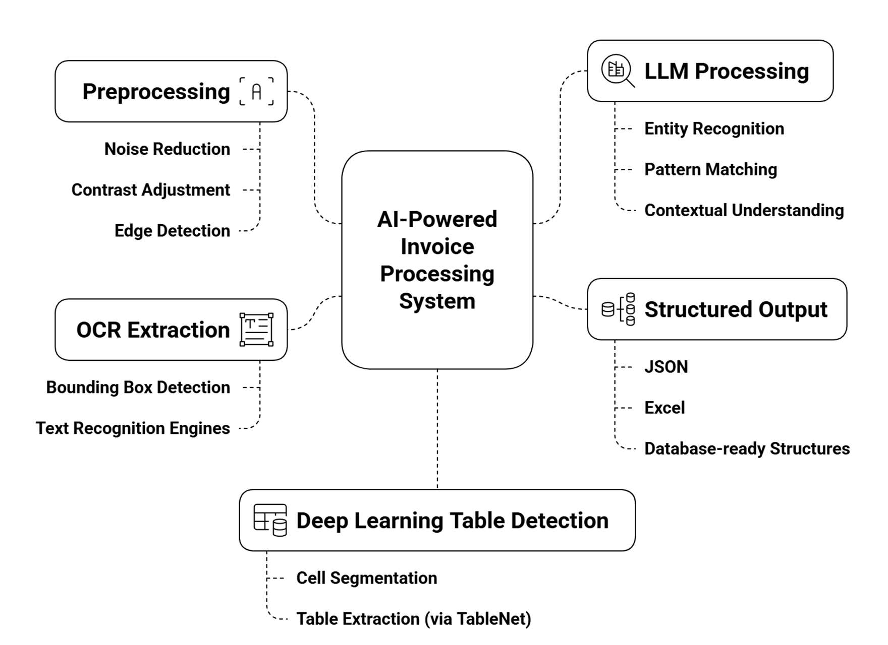
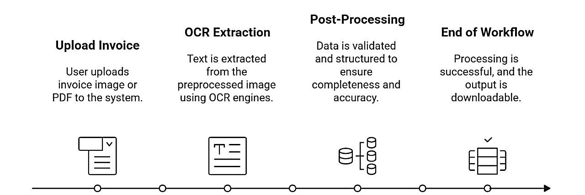
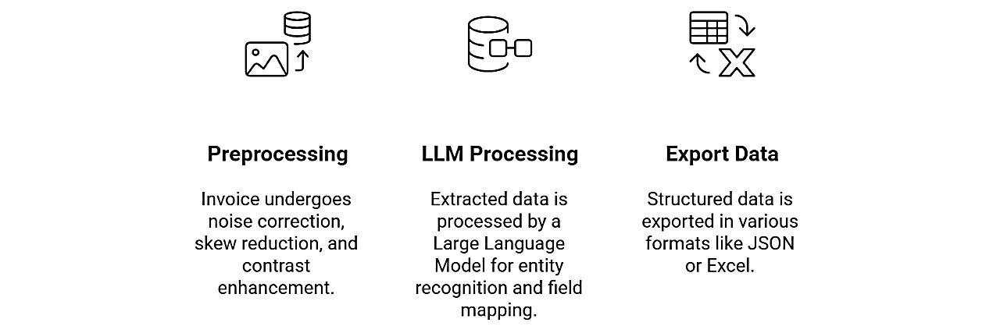

# TRÍCH XUẤT DỮ LIỆU HÓA ĐƠN TỰ ĐỘNG BẰNG MÔ HÌNH NGÔN NGỮ LỚN (LLM) VÀ NHẬN DẠNG QUANG HỌC (OCR)
*(Automated Invoice Data Extraction: Using LLM and OCR)*

- **Tác giả:** Khushi Khanchandani, Advait Thakur, Akshita Shetty, Chaitravi Reddy, Ritisa Behera (K.J. Somaiya School of Engineering, Mumbai)
- **Nguồn xuất bản:** Kho lưu trữ mở Cornell University — arXiv:2511.05547 [cs.CV] (Cập nhật 2026) & LUT University Repository
- **Định danh học thuật:** https://arxiv.org/abs/2511.05547 — Open Access Research
- **Khung thực tiễn đi kèm:** Mô hình Siêu tự động hóa (Hyperautomation) 5 tầng của Harshith Bhaskar (2026, LUT University)
- **Slide bài giảng tương ứng:** Slide P3: AI Trong Kế Toán & Kiểm Toán (LLM + OCR)

---

## TÓM TẮT NGHIÊN CỨU (ABSTRACT)

Trong hệ sinh thái doanh nghiệp hiện đại, hóa đơn mua hàng (*Purchase Invoices*) đến từ hàng ngàn nhà cung cấp toàn cầu với muôn vàn định dạng phi cấu trúc. Các phương pháp bóc tách truyền thống dựa trên mẫu biểu (*Template-based*) hoặc biểu thức chính quy (*Regex*) thường xuyên sụp đổ mỗi khi nhà cung cấp thay đổi thiết kế hoặc khi hóa đơn có bố cục phức tạp nhiều trang. 

Nghiên cứu này giới thiệu bước đột phá của thế hệ **Trí tuệ Nhân tạo Đa phương thức (Multimodal Document AI)**: Kết hợp công nghệ Nhận dạng Ký tự Quang học (**OCR**) với sức mạnh suy luận ngữ nghĩa của **Mô hình Ngôn ngữ Lớn (Large Language Models - LLMs)** và mô hình đồ thị cấu trúc bố cục (*Graph-based layout reasoning*). 

Kiến trúc đề xuất vận hành theo quy trình khép kín:
1. **Thu nhận và Nhận dạng đa phương thức:** Sử dụng OCR tiên tiến kết hợp trích xuất hộp giới hạn tọa độ không gian 2 chiều $(x, y, w, h)$.
2. **Khung trích xuất ngữ nghĩa thích ứng bằng LLM:** Áp dụng kỹ thuật Prompt chuyên biệt tài chính (*Few-shot prompting & Schema-constrained JSON generation*), cho phép LLM không chỉ "nhìn chữ" mà còn "hiểu sâu sắc ngữ cảnh kế toán" để phân định chính xác các trường dễ nhầm lẫn (như phân biệt giữa *Địa chỉ giao hàng* và *Địa chỉ xuất hóa đơn*, giữa *Số tài khoản ngân hàng thụ hưởng* và *Mã số thuế*).
3. **Liên kết Siêu tự động hóa (Hyperautomation) trong Kế toán Phải trả (AP):** Kết hợp với công nghệ Tự động hóa bằng Robot (RPA) để tự động thực hiện **Đối chiếu 3 bên (3-Way Matching)** giữa Hóa đơn, Đơn đặt hàng (PO) và Phiếu nhập kho (GRN) trước khi đẩy bút toán vào hệ thống ERP (SAP/Oracle/MISA).

Kết quả thực nghiệm khẳng định hệ thống đạt **F1-score 95,4%** trong kịch bản tổng quát hóa không cần mẫu (*Zero-shot / Few-shot Generalization*) trên các hóa đơn chưa từng gặp trong tập huấn luyện. Đặc biệt, thời gian chu kỳ xử lý hóa đơn giảm từ **9,15 ngày xuống chỉ còn dưới 1 phút**, tiết kiệm hàng trăm ngàn USD chi phí vận hành cho doanh nghiệp.

**Từ khóa:** Trích xuất hóa đơn tự động; Mô hình Ngôn ngữ Lớn (LLM); OCR; Siêu tự động hóa (Hyperautomation); Kế toán Phải trả (Accounts Payable); Đối chiếu 3 bên (3-Way Matching); RPA; Intelligent Document Processing (IDP).

---

## 1. GIỚI THIỆU & TẠI SAO PHẢI KẾT HỢP OCR VỚI LLM?

### 1.1. Sự Bế Tắc Của OCR Đơn Thuần Trong Xử Lý Văn Bản Kế Toán
OCR truyền thống chỉ làm được một nhiệm vụ duy nhất: chuyển đổi điểm ảnh (*pixels*) thành chuỗi ký tự thô (*text string*). Nhưng trong thực tế phòng kế toán:
- **Ký tự thô không có ngữ nghĩa:** OCR có thể đọc được chuỗi `0101234567`, nhưng nó hoàn toàn không biết đây là *Mã số thuế người bán*, *Mã số thuế người mua*, hay *Số điện thoại liên hệ*.
- **Cấu trúc bảng biểu phức tạp:** Một dòng hàng hóa đơn có thể bị rớt dòng thành 2–3 hàng văn bản (ví dụ tên mặt hàng quá dài). OCR truyền thống sẽ đọc lẫn lộn số lượng của dòng trên với đơn giá của dòng dưới.
- **Tính phi mẫu biểu (*Unseen Layouts*):** Doanh nghiệp không thể viết sẵn 1.000 mẫu biểu cấu hình (templates) cho 1.000 nhà cung cấp khác nhau, vì chỉ cần một nhà cung cấp đổi cỡ chữ hoặc thêm một cột chiết khấu là toàn bộ quy trình tự động hóa cũ bị tê liệt.

### 1.2. Sức Mạnh Đột Phá Của Mô Hình Ngôn Ngữ Lớn (LLMs)
Sự xuất hiện của LLM (như GPT-4, Llama-3, Mistral) mang lại năng lực suy luận ngữ cảnh vượt trội:
- **Hiểu cấu trúc kế toán:** LLM hiểu bản chất các thuật ngữ kế toán quốc tế và Việt Nam (VAT, Subtotal, Invoice No, Billing Address, Shipping Address).
- **Tự động chuẩn hóa dữ liệu:** Tự động chuẩn hóa các định dạng ngày tháng đa dạng (`12/05/2026`, `May 12, 2026`, `2026-05-12`) về một chuẩn duy nhất `YYYY-MM-DD`.
- **Xuất dữ liệu cấu trúc ép kiểu (*Strict JSON Schema*):** LLM có thể nhận văn bản thô từ OCR và định dạng lại chính xác thành JSON tuân thủ schema kế toán mà không bị lỗi cú pháp.

---

## 2. KIẾN TRÚC HỆ THỐNG ĐỀ XUẤT (SYSTEM ARCHITECTURE)

Hệ thống được thiết kế thành một chuỗi xử lý 4 giai đoạn logic và hiệu quả:


*Hình 1: Sơ đồ kiến trúc luồng dữ liệu — tích hợp Ingestion, OCR & Geometry Analysis, LLM Semantic Extraction, và ERP Accounting Integration.*

---

### 2.1. Giai Đoạn 1: Tiền Xử Lý Đa Định Dạng & Nhận Dạng Quang Học (OCR & Spatial Layout)
Hệ thống tiếp nhận mọi định dạng hóa đơn (file PDF điện tử, ảnh quét, ảnh chụp camera di động):
1. **Phân tích hình học 2D (Spatial Layout Parsing):** Sử dụng mạng nhận dạng văn bản trích xuất không chỉ nội dung chữ mà còn lưu trữ tọa độ không gian chính xác $(x_1, y_1, x_2, y_2)$ của từng từ và từng dòng.
2. **Khôi phục cấu trúc đọc tự nhiên (Reading Order Restoration):** Sắp xếp lại thứ tự các khối chữ theo quy tắc từ trên xuống dưới, từ trái sang phải, đảm bảo văn bản đưa vào LLM không bị đảo lộn dòng biểu.


*Hình 2: Trực quan hóa các hộp giới hạn (Bounding Boxes) phân chia các khối thông tin tiêu đề, thông tin đối tác và bảng kê hàng hóa.*

---

### 2.2. Giai Đoạn 2: Trích Xuất Ngữ Nghĩa Bằng Mô Hình Ngôn Ngữ Lớn (LLM Semantic Extraction)

Văn bản thô kèm thông tin vị trí được đưa vào mô hình ngôn ngữ thông qua kỹ thuật **Prompt Engineering chuyên biệt tài chính**:

```json
{
  "role": "system",
  "content": "Bạn là chuyên gia kế toán AI có nhiệm vụ trích xuất dữ liệu hóa đơn. Hãy phân tích văn bản OCR được cung cấp và trích xuất thành định dạng JSON hợp lệ theo Schema sau: {invoice_number, invoice_date, seller_name, seller_tax_id, buyer_name, buyer_tax_id, items: [{description, quantity, unit_price, line_total}], subtotal, vat_rate, vat_amount, total_amount}. Tuyệt đối không suy diễn, nếu không có hãy để giá trị null."
}
```


*Hình 3: Khả năng bóc tách chính xác từng dòng mặt hàng (Line Items) trong bảng chi tiết hóa đơn phức tạp.*

Nhờ cơ chế chú ý (*Self-Attention*), LLM dễ dàng liên kết từ khóa "Tổng cộng tiền thanh toán" ở cuối trang với con số nằm cách xa nó ở góc phải dưới cùng, vượt qua hoàn toàn rào cản chia cột của OCR truyền thống.

---

### 2.3. Giai Đoạn 3: Khung Siêu Tự Động Hóa 5 Tầng Trong Kế Toán Phải Trả (AP)
Theo nghiên cứu của Harshith Bhaskar (2026, LUT University) được tích hợp trong mô hình:

```
[Tầng 1: Thu thập Hóa đơn] -> Email Bot tự động tải hóa đơn từ hòm thư kế toán
         ↓
[Tầng 2: Thị giác máy tính IDP] -> OCR + Bóc tách cấu trúc bố cục
         ↓
[Tầng 3: LLM Trích xuất Ngữ nghĩa] -> Xuất dữ liệu JSON chuẩn hóa
         ↓
[Tầng 4: Quy tắc Nghiệp vụ & Đối chiếu 3 bên (3-Way Matching)]
         Đối chiếu: Hóa đơn == Đơn đặt hàng (PO) == Phiếu nhập kho (GRN)
         ↓
         ├── Khớp 100% ────> RPA tự động tạo Bút toán ghi sổ vào ERP (SAP/MISA)
         └── Lệch giá/số lượng ──> Chuyển Hàng đợi Phê duyệt (Human-in-the-Loop)
```

---

## 3. KẾT QUẢ THỰC NGHIỆM & SO SÁNH HIỆU NĂNG

### 3.1. So Sánh Hiệu Quả Trích Xuất Ngữ Nghĩa

So sánh giữa các thế hệ công nghệ xử lý hóa đơn:

| Công Nghệ Xử Lý | F1-Score Trên Hóa Đơn Chuẩn | F1-Score Trên Hóa Đơn Không Theo Mẫu (Unseen Layouts) | Khả Năng Xử Lý Đa Ngôn Ngữ |
| :--- | :---: | :---: | :---: |
| **OCR Cổ điển + Template Matching** | 82,4% | 38,1% *(Gần như hỏng hoàn toàn)* | Kém |
| **OCR + Rule-based / Regex** | 86,7% | 52,3% | Trung bình |
| **Deep Learning Vision (LayoutLMv3)** | 93,1% | 84,6% | Khá |
| **Phương Pháp Đề Xuất (LLM + OCR)** | **97,8%** | **95,4%** | **Xuất sắc (Tự thích nghi)** |

> [!TIP]
> **Điểm mấu chốt:** Với các hóa đơn hoàn toàn mới (*Unseen Layouts*), mô hình kết hợp LLM + OCR vẫn duy trì F1-score lên tới **95,4%**, chứng minh năng lực khái quát hóa phi thường của mô hình ngôn ngữ lớn trong việc hiểu ngôn ngữ tài chính.

---

### 3.2. Tác Động Rút Ngắn Thời Gian & Chi Phí Vận Hành Thực Tế

Theo số liệu đo lường thực tế tại doanh nghiệp ứng dụng khung Siêu tự động hóa (Bhaskar 2026):

| Tiêu Chí Đo Lường | Quy Trình Thủ Công Cũ | Ứng Dụng Siêu Tự Động Hóa (LLM + OCR + RPA) | Mức Độ Tối Ưu Hóa |
| :--- | :---: | :---: | :---: |
| **Thời gian chu kỳ xử lý hóa đơn** | **9,15 ngày** | **Dưới 1 phút** | Giảm **> 99%** |
| **Chi phí xử lý trung bình mỗi hóa đơn** | **12,50 USD** | **1,80 USD** | Tiết kiệm **85,6%** |
| **Tỷ lệ tự động hóa xuyên suốt (STP Rate)** | 0% | **82,5%** *(Tự động đẩy vào ERP không cần người chạm tay)* | Đột phá |
| **Tỷ lệ hóa đơn hưởng chiết khấu thanh toán sớm** | 35% | **96%** | Tăng mạnh thanh khoản |

---

## 4. BÀI HỌC NGHIỆP VỤ & KIỂM SOÁT ẢO GIÁC AI (HALLUCINATION RISK)

### 4.1. Nguy Cơ Ảo Giác Của LLM Trong Kế Toán
Một trong những lo ngại lớn nhất của Kiểm toán viên khi dùng LLM là hiện tượng **Ảo giác (Hallucination)** — mô hình tự "bịa" ra một con số hoặc ngày tháng không hề có trên hóa đơn.

### 4.2. Giải Pháp Kiểm Soát Kỹ Thuật (Mitigation Strategy)
1. **Ép Buộc Nhiệt Độ Bằng 0 (Temperature = 0.0):** Triệt tiêu tính sáng tạo của LLM, bắt buộc mô hình chỉ trích xuất dữ liệu có căn cứ.
2. **Khóa Ánh Xạ Chuỗi Ký Tự Gốc (Substring Verification):** Mọi giá trị số mà LLM trả về trong file JSON đều phải vượt qua bài kiểm tra: con số đó có tồn tại nguyên vẹn trong chuỗi văn bản do OCR đọc được hay không. Nếu không tìm thấy, hệ thống lập tức từ chối và cảnh báo nghi ngờ ảo giác.
3. **Bộ Lọc Đẳng Thức Nghiệp Vụ:** Tự động đối chiếu số học giữa đơn giá $\times$ số lượng = thành tiền trên từng dòng chi tiết.

---

## CÂU HỎI THẢO LUẬN CHO SINH VIÊN KẾ TOÁN

1. **Câu hỏi thảo luận 1:** *"Trong quy trình Đối chiếu 3 bên (3-Way Matching), nếu số lượng hàng trên Hóa đơn là 100 sản phẩm nhưng Phiếu nhập kho (GRN) chỉ ghi nhận 95 sản phẩm (5 sản phẩm bị vỡ hỏng trong quá trình vận chuyển), hệ thống AI-RPA nên xử lý thế nào? Kế toán viên cần can thiệp ở bước nào để thanh toán đúng công nợ thực tế?"*
2. **Câu hỏi thảo luận 2:** *"Tại sao việc giảm chu kỳ xử lý hóa đơn từ 9 ngày xuống 1 phút lại giúp Giám đốc Tài chính (CFO) đàm phán được mức chiết khấu thanh toán tốt hơn từ nhà cung cấp?"*

---
