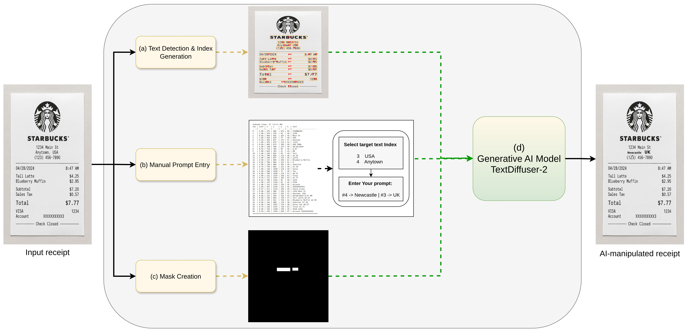
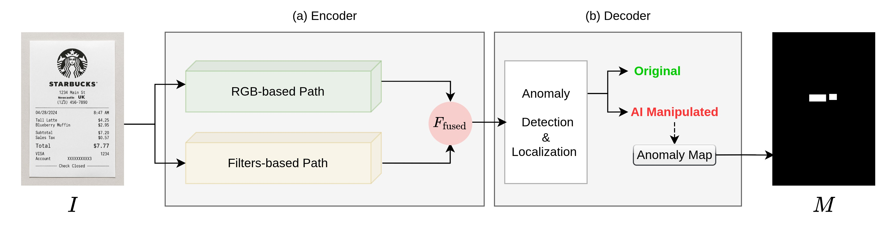
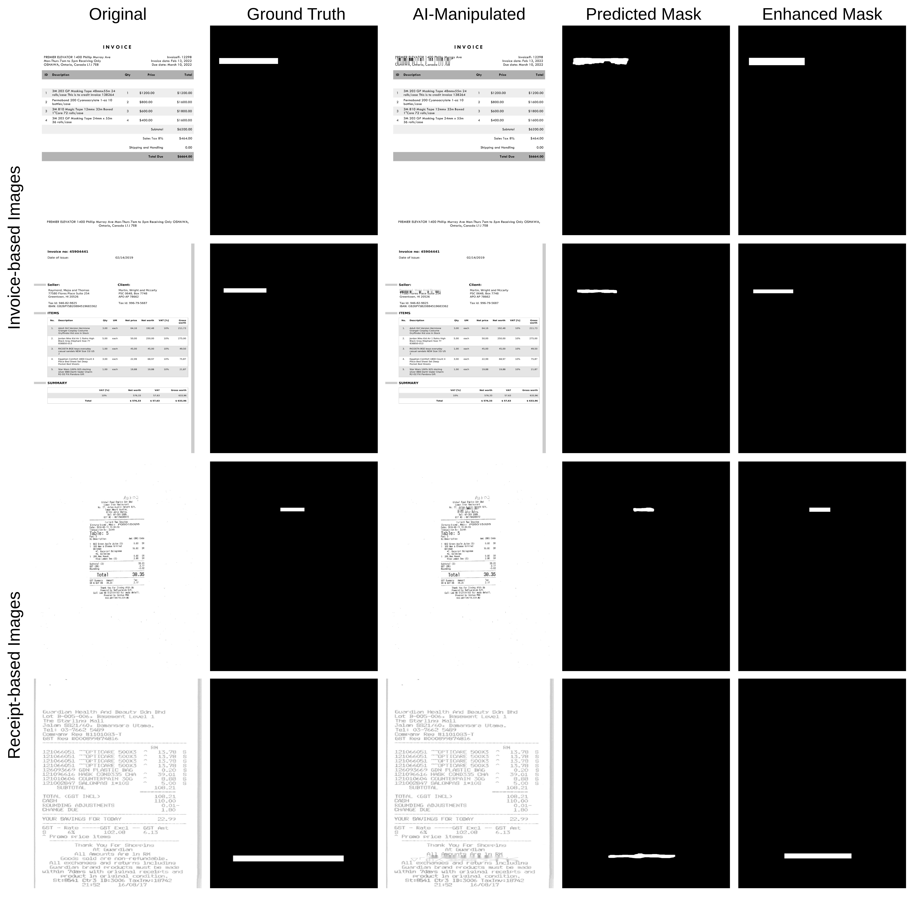

# HÓA ĐƠN VÀ BIÊN LAI GIẢ MẠO TRONG KẾ TOÁN: TÁC ĐỘNG NGHIỆP VỤ VÀ GIẢI PHÁP KHẮC PHỤC BẰNG THỊ GIÁC MÁY TÍNH TRONG KỶ NGUYÊN AI TẠO SINH (GEN-AI)
*(Fake Invoices and Receipts in Accounting: Impacts and Mitigation in the Age of gen-AI)*

- **Tác giả:** Philip Thornton, Lamyaa Aljuaid, Matthew W Chapman, Deepayan Bhowmik (Newcastle University & Sage PLC, UK)
- **Đơn vị nghiên cứu:** Khoa Máy tính & Kỹ thuật — Đại học Newcastle và Tập đoàn Phần mềm Kế toán Sage PLC (Vương quốc Anh)
- **Hội thảo & Nguồn:** British Machine Vision Conference (BMVC 2025 Workshops - MAAAI / SRBS) & Newcastle University Repository
- **Định danh học thuật:** https://doi.org/10.57711/kgxg-9653 — BMVA Open Access
- **Slide bài giảng tương ứng:** Slide P4: AI in Accounting & Auditing (Fake Invoices Gen-AI)

---

## TÓM TẮT NGHIÊN CỨU (ABSTRACT)

Sự bùng nổ vũ bão của Trí tuệ Nhân tạo Tạo sinh (**Generative AI - Gen-AI**), bao gồm các mô hình khuếch tán hình ảnh (*Diffusion Models*), Mạng đối nghịch tạo sinh (*GANs*) và các công cụ chỉnh sửa ảnh thông minh, đang tạo ra một mối đe dọa mang tính sinh tử đối với tính toàn vẹn của hệ thống kế toán và kiểm toán toàn cầu. Kẻ gian, nhân viên nội bộ bất lương hoặc các đường dây tội phạm có tổ chức giờ đây có thể tạo ra những hóa đơn, biên lai thanh toán giả mạo hoàn hảo — từ hóa đơn mua sắm tiếp khách, vé máy bay điện tử đến hóa đơn mua nguyên vật liệu trị giá hàng tỷ đồng — với độ chân thực về vết nhàu, bóng sáng, phông chữ và logo đến mức **mắt thường của kiểm toán viên con người hoàn toàn không thể nhận biết**.

Công trình nghiên cứu tiên phong này của Đại học Newcastle phối hợp với tập đoàn phần mềm kế toán quốc tế **Sage PLC**:
1. **Phân tích toàn diện tác động kinh tế và pháp lý:** Đánh giá các hình thức gian lận thanh toán khống chi phí công tác (*Expense Reimbursement Fraud*), gian lận hóa đơn bất hợp pháp để trốn thuế thu nhập doanh nghiệp, và gian lận quay vòng hoàn thuế GTGT (*VAT Carousel Fraud*).
2. **Giải phẫu cơ chế tạo giả của Gen-AI:** Làm rõ cách thức tội phạm sử dụng kỹ thuật cấy ghép ảnh (*Splicing*), xóa sửa số tiền (*Inpainting*), và sinh ảnh tổng hợp hoàn toàn (*Synthetic Generation*) để vượt qua các chốt kiểm soát nội bộ truyền thống.
3. **Đề xuất khung giải pháp Pháp y Hình ảnh số (Digital Image Forensics) dựa trên Thị giác Máy tính:**
   - **Phân tích mức độ lỗi nén (Error Level Analysis - ELA):** Phát hiện sự không đồng nhất trong tỷ lệ nén JPEG tại các vùng con số bị chỉnh sửa.
   - **Phân tích miền tần số (Frequency Domain & Wavelet Analysis):** Nhận diện các dấu vết can thiệp vi mô ở tần số cao mà mắt người không nhìn thấy.
   - **Kiểm định siêu dữ liệu (Metadata / EXIF Forensics):** Bóc tách lịch sử phần mềm chỉnh sửa và thiết bị tạo ảnh.
   - **Mạng Học sâu chuyên biệt (Deep Forgery Detection CNNs):** Huấn luyện mô hình nhận diện các dấu vết nhân tạo do AI tạo sinh để lại trên từng điểm ảnh (*pixel artifacts*).

Nghiên cứu cung cấp một lộ trình thực chiến để các nhà phát triển phần mềm kế toán (như Sage, SAP, MISA) và các hãng kiểm toán Big 4 tích hợp bộ lọc "Kính hiển vi số" vào quy trình kiểm soát nội bộ, bảo vệ doanh nghiệp trước làn sóng gian lận tài chính tinh vi thời đại AI.

**Từ khóa:** Hóa đơn giả mạo; Biên lai giả; AI tạo sinh (Gen-AI); Pháp y hình ảnh số (Image Forensics); Error Level Analysis (ELA); Kiểm toán gian lận; Kiểm soát nội bộ; Thị giác máy tính.

---

## 1. BỐI CẢNH: KHI MẮT THƯỜNG KIỂM TOÁN VIÊN BỊ "VÔ HIỆU HÓA"

Trong hơn một thế kỷ qua, nguyên tắc cơ bản của kiểm toán là **kiểm tra chứng từ gốc (Vouching)**: Kiểm toán viên xem xét hóa đơn, biên lai giấy hoặc bản chụp quét để đối chiếu với sổ sách kế toán. Nếu chứng từ có đầy đủ con dấu, chữ ký, ngày tháng hợp lý và hóa đơn nhìn "thật", giao dịch sẽ được chấp thuận.

Tuy nhiên, sự xuất hiện của AI tạo sinh đã làm sụp đổ hoàn toàn giả định này:
- **Thời kỳ tiền AI (Pre-AI):** Kẻ gian phải dùng kéo cắt dán số tiền, dùng bút xóa rồi photocopy lại. Những hóa đơn giả mạo này thường để lại dấu vết lem mực, phông chữ lệch hàng, hoặc đường viền cắt dán thô thiển mà một kế toán viên kinh nghiệm có thể phát hiện bằng mắt thường.
- **Thời kỳ Photoshop:** Kẻ gian dùng phần mềm chỉnh sửa ảnh để đổi con số. Mặc dù khó phát hiện hơn, nhưng nếu phóng to ảnh, kiểm toán viên vẫn có thể thấy pixel bị vỡ hoặc phông chữ bị méo.
- **Thời kỳ Gen-AI hiện nay (2025–2026):** Chỉ cần một câu lệnh prompt ngắn (ví dụ: *"Tạo một biên lai ăn tối nhà hàng 5 sao tại Hà Nội trị giá 15.800.000 VNĐ ngày 20/10/2025, có vết gấp giấy nhẹ và bóng đèn vàng"*), các mô hình AI tạo ra một bức ảnh hóa đơn hoàn hảo 100%. Phông chữ khớp hoàn toàn với ánh sáng môi trường, có độ nghiêng tự nhiên và vết bẩn giả như thật.

---

## 2. PHÂN TÍCH TÁC ĐỘNG NGHIỆP VỤ KẾ TOÁN & THUẾ (IMPACT ANALYSIS)

Bài báo phân loại 3 cấp độ thiệt hại nghiêm trọng của hóa đơn giả trong doanh nghiệp:

### 2.1. Cấp Độ Doanh Nghiệp: Gian Lận Chi Phí Thanh Toán Công Tác (T&E Expense Fraud)
Theo thống kê của Hiệp hội các Nhà Kiểm toán Gian lận Quốc tế (ACFE), gian lận chi phí chiếm tới **15% tổng số các vụ gian lận nội bộ doanh nghiệp**, với thời gian trung bình để phát hiện lên tới **18 tháng**. 
- Nhân viên công tác đi taxi hết 200.000 VNĐ nhưng dùng AI sửa ảnh biên lai thành 1.200.000 VNĐ để thanh toán khống.
- Tạo giả vé máy bay, hóa đơn khách sạn 5 sao dù thực tế ở nhà người quen.
- Doanh nghiệp mất mát hàng tỷ đồng quỹ tiền mặt mỗi năm mà không hề hay biết.

### 2.2. Cấp Độ Cơ Quan Thuế: Gian Lận Thuế TNDN & Hoàn Thuế GTGT
- Mua bán hóa đơn đầu vào giả để nâng khống giá vốn hàng bán (COGS), làm giảm lợi nhuận trước thuế nhằm trốn thuế TNDN.
- Gian lận hoàn thuế GTGT quay vòng (*VAT Carousel Fraud*): Sử dụng hóa đơn do AI tạo ra để hợp thức hóa hàng hóa ảo xuất khẩu, chiếm đoạt tiền hoàn thuế từ ngân sách nhà nước.

### 2.3. Cấp Độ Hãng Kiểm Toán Độc Lập: Rủi Ro Pháp Lý Khôn Lường
Nếu kiểm toán viên ký báo cáo kiểm toán chấp nhận toàn phần nhưng sau đó cơ quan công an phát hiện doanh nghiệp sử dụng hàng trăm tỷ hóa đơn đầu vào giả mạo:
- Hãng kiểm toán đối mặt với nguy cơ bị đình chỉ hoạt động, kiện tụng đòi bồi thường thiệt hại hàng triệu USD và đánh mất uy tín thương hiệu vĩnh viễn.

---

## 3. KHUNG GIẢI PHÁP THỊ GIÁC MÁY TÍNH & PHÁP Y HÌNH ẢNH (MITIGATION STRATEGIES)

Để chống lại AI tạo sinh, giải pháp duy nhất là **sử dụng chính Trí tuệ Nhân tạo và Thị giác máy tính như một chiếc "Kính hiển vi pháp y"**:


*Hình 1: Trực quan hóa kết quả phân tích mức độ lỗi nén (ELA) và miền tần số trên hóa đơn bị chỉnh sửa số tiền.*

---

### 3.1. Kỹ Thuật 1: Phân Tích Mức Độ Sai Số Nén (Error Level Analysis - ELA)
Khi một bức ảnh được lưu dưới định dạng JPEG, toàn bộ ảnh được nén với một tỷ lệ suy hao (*lossy compression*) đồng nhất.
- Khi kẻ gian mở ảnh ra bằng Photoshop hoặc AI, chỉnh sửa con số `5` thành số `8`, rồi lưu lại: **Vùng con số mới được nén ít lần hơn so với phần còn lại của bức ảnh**.
- Thuật toán ELA cố tình nén lại bức ảnh ở chất lượng 95% và tính toán ma trận sai số pixel giữa hai phiên bản:
```
\Delta I(x, y) = |I_{original}(x, y) - I_{recompressed}(x, y)| \times S
```
(Trong đó $S$ là hệ số khuếch đại hiển thị, thường chọn $S = 20$).
- Kết quả: Vùng văn bản nguyên bản hiển thị màu xám tối đồng nhất, trong khi **con số bị sửa đổi sẽ phát sáng rực rỡ** trên màn hình phân tích ELA, vạch trần hành vi gian lận ngay lập tức!

---

### 3.2. Kỹ Thuật 2: Phân Tích Miền Tần Số Cao & Biến Đổi Wavelet


*Hình 2: Dấu vết bất thường trong phổ tần số Fourier và nhiễu vi mô (PRNU) giữa hóa đơn do máy ảnh chụp thật và hóa đơn do AI tạo sinh.*

- Ảnh chụp từ máy ảnh/điện thoại thật luôn chứa mẫu nhiễu cảm biến quang học đặc thù (**PRNU - Photo-Response Non-Uniformity**), phân bố đều khắp bức ảnh như một "dấu vân tay phần cứng".
- Các hóa đơn do mô hình khuếch tán (Diffusion Models) tạo ra hoàn toàn không có nhiễu cảm biến thực này, hoặc có sự gián đoạn tần số cao tại đường biên chữ. Thuật toán biến đổi Wavelet 2D bóc tách các dải tần số cao $(HH, LH, HL)$ để phát hiện sự mất cân đối năng lượng điểm ảnh.

---

### 3.3. Kỹ Thuật 3: Mạng Học Sâu Phát Hiện Giả Mạo (Deep Learning Forgery Classifier)


*Hình 3: Kiến trúc mạng nơ-ron tích hợp (ResNet/Vision Transformer) phân loại hóa đơn Thật vs. Giả mạo và ma trận kết quả thực nghiệm.*

Hệ thống kết hợp mạng tích chập sâu và Vision Transformer:
- Đầu vào: Ảnh hóa đơn RGB kết hợp bản đồ ELA và bản đồ phổ tần số.
- Đầu ra: Điểm số rủi ro gian lận (**Fraud Risk Score: 0% – 100%**) và khoanh vùng chính xác tọa độ các ô bị can thiệp.

---

## 4. KHUNG QUY TRÌNH KIỂM SOÁT NỘI BỘ THỜI KỶ NGUYÊN GEN-AI

Nghiên cứu của Đại học Newcastle & Sage đề xuất quy trình kiểm soát 4 bước tự động hóa:

```
[Nhân viên gửi ảnh Hóa đơn thanh toán]
                ↓
[Cổng Pháp y Thị giác máy tính (AI Forensics Gateway)]
  ├── Bước 1: Kiểm tra Siêu dữ liệu (EXIF / C2PA Metadata)
  ├── Bước 2: Chạy bộ lọc ELA & Phân tích tần số Wavelet
  └── Bước 3: Chấm điểm rủi ro bằng Deep Learning Model
                ↓
    ┌───────────┴───────────┐
    ↓                       ↓
Điểm rủi ro < 15%     Điểm rủi ro ≥ 15% (Nghi ngờ giả mạo)
    ↓                       ↓
Tự động chuyển duyệt  Khóa thanh toán tạm thời + Gửi Cảnh báo
chi tiền theo hạn mức  đến Trưởng phòng Kiểm soát Nội bộ kèm
                      ảnh nhiệt khoanh vùng số tiền bị sửa!
```

---

## CÂU HỎI THẢO LUẬN & TRANH BIỆN TRÊN LỚP (SEMINAR)

1. **Câu hỏi thảo luận 1 (Về kiểm soát nội bộ & Đạo đức nghề nghiệp):** *"Nếu nhân viên dùng AI tạo ra một hóa đơn tiếp khách giả trị giá 5.000.000 VNĐ cực kỳ giống thật để bù đắp cho những chi phí không tên không thể lấy hóa đơn, quy trình kiểm soát nội bộ truyền thống có phát hiện được không? Bạn đánh giá hành vi này dưới góc độ Chuẩn mực đạo đức nghề nghiệp kế toán như thế nào?"*
2. **Câu hỏi thảo luận 2 (Cuộc đua công nghệ):** *"Kẻ gian có thể dùng AI để 'lừa' lại bộ lọc ELA bằng cách thêm nhiễu giả vào ảnh không? Phía các công ty kiểm toán và cơ quan thuế cần làm gì để luôn đi trước tội phạm công nghệ một bước?"*

---
