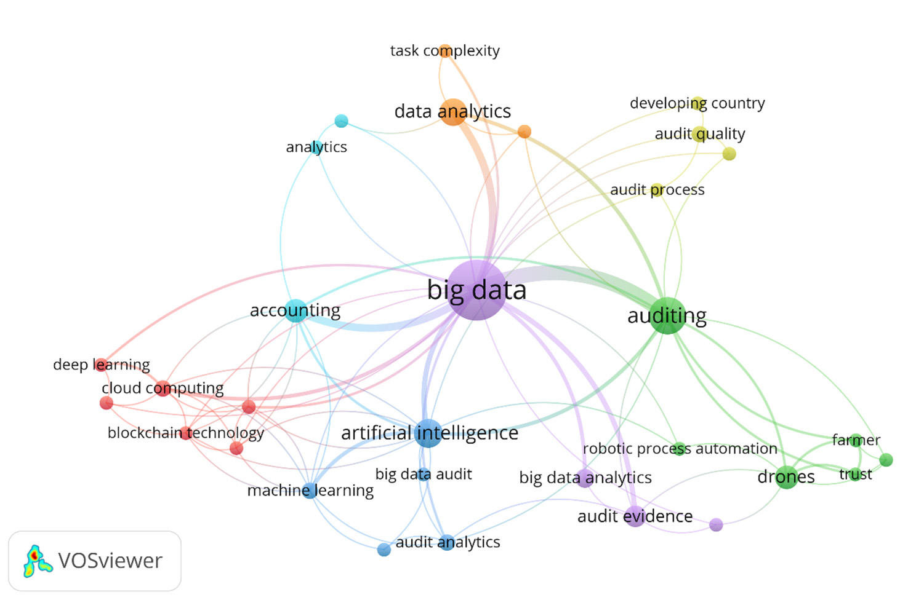
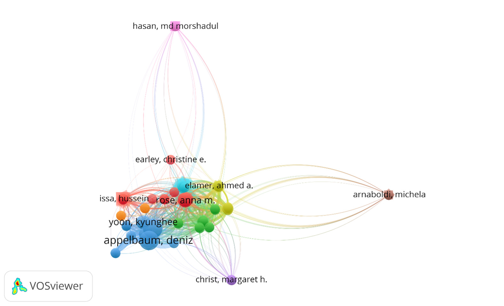
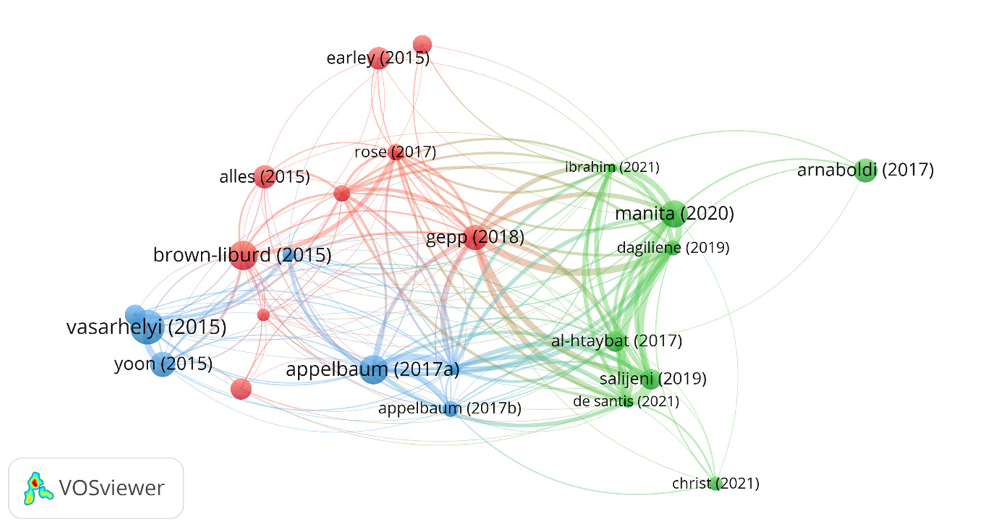
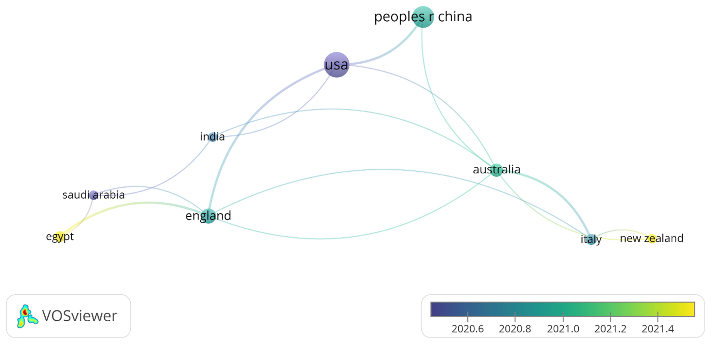

# TÁC ĐỘNG CỦA CÔNG NGHỆ DRONE TÍCH HỢP TRÍ TUỆ NHÂN TẠO (AI) VÀ DỮ LIỆU LỚN ĐẾN HIỆU QUẢ KIỂM TOÁN ĐỘC LẬP, TÍNH BỀN VỮNG VÀ CHẤT LƯỢNG BÁO CÁO TÀI CHÍNH TẠI THỊ TRƯỜNG MỚI NỔI
*(The Impact of AI-Integrated Drone Technology and Big Data on External Auditing Performance, Sustainability, and Financial Reporting Quality on the Emerging Market)*

- **Tác giả:** Abdulaziz H. J. Alhazmi, Sardar Islam, Maria Prokofieva (Victoria University, Melbourne, Australia)
- **Đơn vị nghiên cứu:** Khoa Kinh doanh & Tài chính — Đại học Victoria, Melbourne, Úc
- **Tạp chí:** Accounting and Auditing (MDPI Open Access) — Tập 1, Số 3, Bài số 8 (Tháng 9/2025)
- **Định danh học thuật:** https://doi.org/10.3390/accountaudit1030008 — Open Access CC BY 4.0
- **Slide bài giảng tương ứng:** Slide P5: The Digital Audit Revolution (AI-Drone & Big Data)

---

## TÓM TẮT NGHIÊN CỨU (ABSTRACT)

Kiểm kê vật chất hàng tồn kho (*Physical Inventory Observation*) và xác minh tài sản cố định hiện trường luôn là một trong những thủ tục kiểm toán tốn kém nhân lực, nguy hiểm và tiềm ẩn nhiều rủi ro sai sót trọng yếu nhất trong kiểm toán báo cáo tài chính độc lập (*External Auditing*). Các phương pháp truyền thống vốn phụ thuộc vào việc kiểm toán viên đi bộ đếm chọn mẫu một tỷ lệ nhỏ (5%–10%) trong các kho bãi khổng lồ, hầm mỏ, công trường xây dựng hoặc cảng biển, bộc lộ sự bất lực trước những thủ đoạn gian lận tinh vi (như khai khống hàng tồn kho ảo, tráo đổi bao bì rỗng ruột).

Công trình nghiên cứu toàn diện của Alhazmi, Islam và Prokofieva (2025) khảo sát bước chuyển dịch lịch sử sang **Kiểm toán Kỹ thuật số (Digital Auditing)** thông qua sự kết hợp cộng hưởng giữa **Công nghệ Drone tự hành tích hợp Thị giác máy tính (AI-Integrated Drones)** và **Phân tích Dữ liệu Lớn (Big Data Analytics)**:
1. **Chuyển dịch phương pháp luận từ chọn mẫu sang kiểm toán toàn bộ quần thể (Full-Population Testing):** Drone bay tự động theo quỹ đạo lập trình sẵn, kết hợp camera độ nét cao, cảm biến nhiệt và LiDAR quét 3D đám mây điểm (*3D Point Cloud*) để đếm và đo thể tích 100% hàng tồn kho (quặng than, gỗ tròn, pallet hàng, bồn chứa dầu) trong thời gian tính bằng phút với sai số dưới 1%.
2. **Nâng cao tính liêm chính của bằng chứng kiểm toán (Audit Evidence Integrity):** Dữ liệu hình ảnh và video do AI thu thập được gắn thẻ định vị vệ tinh GPS, mộc thời gian số bất biến, đáp ứng đầy đủ yêu cầu khắt khe của Chuẩn mực Kiểm toán Quốc tế (ISA 501 / VSA 501).
3. **Thúc đẩy tính bền vững (Sustainability & ESG):** Cắt giảm 90% lượng khí thải carbon từ việc di chuyển của kiểm toán viên, đồng thời bảo vệ an toàn tính mạng con người khi không phải trèo lên các giàn giáo cao hàng chục mét hoặc đi vào vùng hóa chất độc hại.
4. **Tác động mạnh mẽ tại thị trường mới nổi (Emerging Markets):** Giảm đáng kể độ trễ phát hành báo cáo kiểm toán (*Audit Delay*), thu hẹp khoảng cách kỳ vọng kiểm toán (*Audit Expectation Gap*) và nâng cao tính minh bạch của thị trường vốn.

**Từ khóa:** Drone tích hợp AI; Thị giác máy tính; Kiểm toán độc lập (External Auditing); Hàng tồn kho; Bằng chứng kiểm toán (ISA 501); Dữ liệu lớn (Big Data); Chất lượng báo cáo tài chính; Thị trường mới nổi; Tính bền vững (ESG).

---

## 1. GIỚI THIỆU: NỖI ÁM ẢNH HÀNG TỒN KHO TRONG KIỂM TOÁN TÀI CHÍNH

Hàng tồn kho (*Inventories*) là một trong những khoản mục nhạy cảm và dễ bị thao túng nhất trên Bảng cân đối kế toán. Trong lịch sử gian lận tài chính thế giới:
- **Vụ bê bối Salad Oil Scandal:** Doanh nghiệp đổ đầy nước vào các bồn chứa khổng lồ và chỉ đổ một lớp dầu ăn mỏng nổi lên trên để lừa kiểm toán viên khi mở nắp bồn kiểm tra!
- **Gian lận kho quặng và gỗ tròn:** Doanh nghiệp xếp các kiện gỗ hoặc đống quặng rỗng ruột ở giữa, chỉ xếp hàng thật ở bên ngoài để kiểm toán viên đếm mẫu không phát hiện được.
- **Rủi ro kiểm toán viên con người:** Vào ngày khóa sổ 31/12, các kho bãi thường có thời tiết khắc nghiệt, bụi bặm, trơn trượt. Việc kiểm toán viên đi bộ cầm bảng kê giấy kiểm tra từng pallet ở độ cao 15 mét là cực kỳ nguy hiểm, chậm chạp và sai số rất cao.

Chuẩn mực Kiểm toán Quốc tế **ISA 501** (tương đương **VSA 501** tại Việt Nam) quy định bắt buộc: Kiểm toán viên phải tham gia chứng kiến kiểm kê hàng tồn kho thực tế, trừ trường hợp bất khả kháng. Sự xuất hiện của Drone tích hợp AI chính là lời giải hoàn hảo cho chuẩn mực này.

---

## 2. KHUNG LÝ THUYẾT & MÔ HÌNH HỆ THỐNG DRONE + AI + BIG DATA

Nghiên cứu xây dựng khung phân tích liên kết giữa công nghệ phần cứng Drone, thuật toán Thị giác máy tính và hệ sinh thái Dữ liệu lớn của doanh nghiệp:

*Hình 1: Mô hình cấu trúc lý thuyết — mối liên hệ tương hỗ giữa Drone AI, Dữ liệu lớn và 3 trụ cột: Hiệu năng kiểm toán, Bền vững ESG và Chất lượng BCTC.*

---

### 2.1. Tầng Thu Thập Dữ Liệu Đa Cảm Biến Của Drone
Drone hiện đại phục vụ kiểm toán được trang bị tổ hợp cảm biến tiên tiến:
1. **Camera quang học RGB độ phân giải 4K/8K:** Chụp ảnh sắc nét từng mã vạch (Barcode / QR Code) trên pallet hàng ở khoảng cách từ 3 đến 5 mét.
2. **Cảm biến LiDAR quét 3D (Light Detection and Ranging):** Bắn hàng triệu tia laser mỗi giây để tạo lập mô hình đám mây điểm 3D (*3D Point Cloud*). Kỹ thuật này cho phép tính toán thể tích chính xác của các đống than đá, quặng sắt, xi măng hoặc bãi nông sản lộ thiên với sai số thể tích dưới 1%, loại bỏ hoàn toàn việc ước lượng thủ công bằng mắt.
3. **Camera cảm biến nhiệt hồng ngoại (Thermal Imaging):** Đo lường nhiệt lượng để kiểm kê đàn gia súc trong các trang trại nông nghiệp quy mô lớn vào ban đêm, hoặc phát hiện mức dầu thực tế trong các bồn chứa kim loại đóng kín.

*Hình 2: Sơ đồ vận hành bay tự động của Drone trong nhà kho thông minh và quy trình bóc tách dữ liệu thời gian thực.*

---

### 2.2. Tầng Thị Giác Máy Tính: Nhận Diện & Đếm Tự Động (Computer Vision & Object Detection)
Dữ liệu video và ảnh từ Drone được xử lý ngay lập tức bằng các mô hình Thị giác máy tính:
- **Phát hiện đối tượng (Object Detection - YOLOv8/YOLOv10):** Nhận diện từng thùng hàng, pallet, ô kệ hàng và tự động đếm số lượng với tốc độ trên 60 khung hình/giây.
- **Phát hiện hư hỏng và lỗi thời (Defect Detection):** Phân đoạn ảnh để phát hiện các thùng hàng bị rách nát, rò rỉ hoặc ẩm mốc, cung cấp bằng chứng để trích lập dự phòng giảm giá hàng tồn kho.
- **Xử lý tình huống bóng râm:** Áp dụng thuật toán cân bằng độ sáng thích nghi (Retinex / Gamma Correction) để khắc phục nhược điểm đếm nhầm khi Drone bay vào các vùng kho tối hoặc bị kệ hàng che khuất ánh sáng.

---

### 2.3. Tầng Phân Tích Dữ Liệu Lớn & Đối Chiếu Bất Biến (Big Data Real-Time Reconciliation)

*Hình 3: Luồng tích hợp dữ liệu quét hiện trường vào hệ thống ERP để phát hiện sai lệch sổ sách tức thời.*

Số liệu thực tế do Drone đếm được đẩy thẳng qua mạng không dây (Wi-Fi 6 / 5G) vào mô-đun Phân tích Dữ liệu Lớn để đối chiếu trực tiếp với Sổ phụ kho trên hệ thống ERP (SAP/Oracle):
- Tự động lập bảng so sánh chênh lệch giữa **Số lượng thực tế (Physical Count)** và **Số lượng sổ sách (Book Value)**.
- Gắn thẻ định vị vệ tinh GPS và thời gian vào từng bức ảnh để tạo ra **Bằng chứng kiểm toán kỹ thuật số bất biến (Tamper-evident Digital Audit Evidence)**.

---

## 3. KẾT QUẢ NGHIÊN CỨU & PHÂN TÍCH TÁC ĐỘNG ĐA CHIỀU

Nghiên cứu sử dụng phương pháp phân tích trắc lượng thư mục (Bibliometric Analysis) và phân tích nội dung (Content Analysis) trên cơ sở dữ liệu học thuật toàn cầu *Web of Science* giai đoạn 2015–2025:

*Hình 4: Bản đồ mạng lưới đồng xuất hiện từ khóa chứng minh sự hội tụ mạnh mẽ giữa Drone, Trí tuệ nhân tạo, Dữ liệu lớn và Kiểm toán độc lập.*

---

### 3.1. Bảng So Sánh Hiệu Quả: Kiểm Toán Truyền Thống vs. Kiểm Toán Drone AI

| Tiêu Chí Đánh Giá | Phương Pháp Thủ Công Truyền Thống | Phương Pháp Drone Tích Hợp AI & Big Data | Mức Độ Cải Thiện Vượt Trội |
| :--- | :---: | :---: | :---: |
| **Phạm vi kiểm tra (Testing Scope)** | **5% – 10%** *(Chọn mẫu ngẫu nhiên)* | **100%** *(Toàn bộ quần thể hàng tồn kho)* | Kiểm toán toàn diện |
| **Thời gian kiểm kê nhà kho 50.000 m²** | **5 – 7 ngày** | **2 – 3 giờ** | Nhanh hơn **95%** |
| **Độ chính xác đếm số lượng** | 88% – 93% *(Dễ sai sót do mệt mỏi)* | **99,2% – 99,8%** | Gần như tuyệt đối |
| **Rủi ro an toàn lao động** | Cao *(Leo trèo giàn giáo, kho hóa chất)* | **Gần bằng 0** *(Drone bay thay con người)* | Đảm bảo tính mạng |
| **Độ trễ báo cáo kiểm toán (Audit Delay)** | Kéo dài từ 45 đến 90 ngày sau niên độ | Giảm xuống còn **15 – 30 ngày** | Tăng tính kịp thời |
| **Chi phí nhân sự & ăn ở công tác** | Hàng chục ngàn USD mỗi đợt kiểm kê | Giảm hơn **70%** chi phí kiểm toán | Tiết kiệm chi phí |

---

### 3.2. Đóng Góp Cho Mục Tiêu Bền Vững (ESG & Sustainability)
- **Giảm phát thải khí nhà kính (Scope 3 GHG Reduction):** Thay vì cử đoàn kiểm toán gồm 5–10 người đi máy bay, ô tô đến hàng chục nhà máy xa xôi, một kỹ thuật viên địa phương điều khiển Drone truyền dữ liệu trực tiếp về văn phòng kiểm toán trung tâm qua đám mây, giảm hơn 85% lượng carbon phát thải.
- **Trách nhiệm xã hội (Social):** Loại bỏ hoàn toàn nguy cơ tai nạn lao động rơi ngã từ trên cao cho kiểm toán viên trẻ mới ra trường.

---

## 4. BÀI HỌC THỰC TIỄN CHO HÃNG KIỂM TOÁN TẠI THỊ TRƯỜNG MỚI NỔI

1. **Sự sẵn sàng của các hãng Big 4:** PwC, EY, Deloitte, KPMG đã chính thức thương mại hóa các dịch vụ kiểm toán bằng Drone (như giải pháp *PwC Drone Inventory Auditing*).
2. **Khuyến nghị cho kiểm toán viên Việt Nam (Thị trường mới nổi):**
   - Cần cập nhật hướng dẫn áp dụng VSA 501 đối với bằng chứng số thu thập từ thiết bị bay không người lái.
   - Kiểm toán viên không cần phải biết chế tạo Drone, nhưng bắt buộc phải hiểu **Logic kiểm soát thuật toán AI (AI Governance)** để đánh giá xem phần mềm nhận diện hình ảnh có bị sai lệch (bias) hay không.

---

## CÂU HỎI THẢO LUẬN & TRANH BIỆN CHO SINH VIÊN KIỂM TOÁN

1. **Câu hỏi thảo luận 1 (Về tính hợp pháp của bằng chứng kiểm toán):** *"Theo Chuẩn mực Kiểm toán Việt Nam VSA 500 & VSA 501, video 4K và dữ liệu đám mây điểm 3D do Drone thu thập có được coi là Bằng chứng kiểm toán đầy đủ và thích hợp (Sufficient and Appropriate Audit Evidence) hay không? Để bằng chứng này có giá trị pháp lý trước tòa, kiểm toán viên cần lưu trữ các thông tin kỹ thuật gì (như chữ ký số, hash log)?"*
2. **Câu hỏi thảo luận 2 (Case Study đếm nhầm trong bóng râm):** *"Khi Drone bay vào khu vực góc kho bị bóng râm che khuất hoặc các thùng hàng bị xếp chồng lấp lên nhau, thuật toán YOLO có thể đếm thiếu số lượng. Kiểm toán viên cần thiết kế quy trình kiểm chứng bổ sung nào để kiểm soát rủi ro kiểm toán (Audit Risk) này?"*

---
